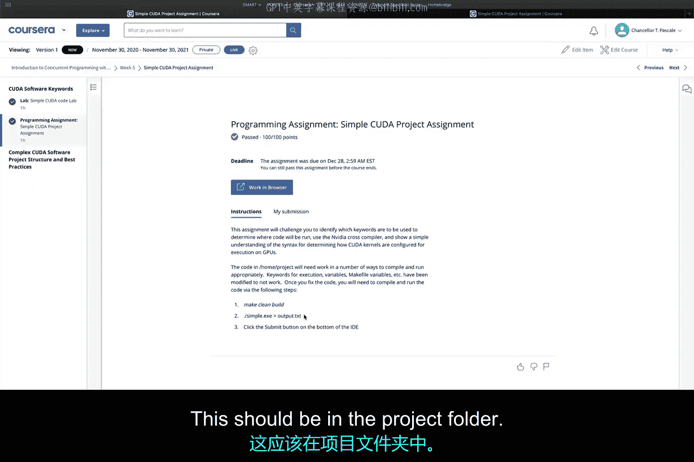
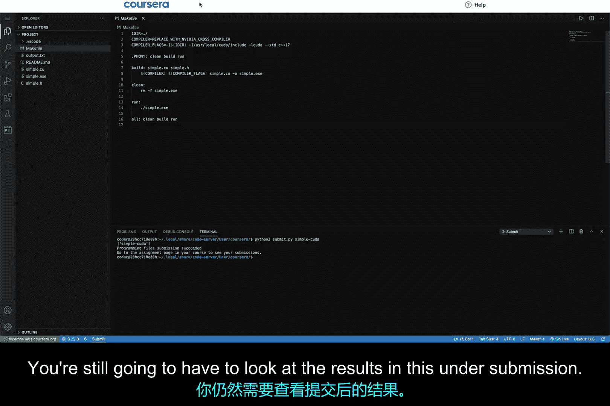
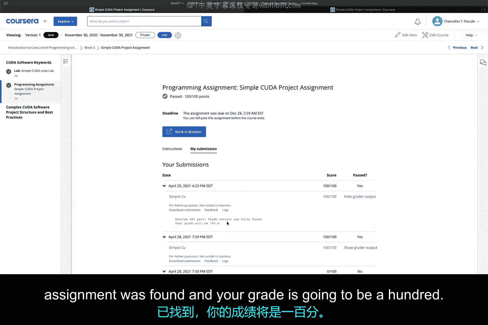

# 027：简单CUDA实验与作业指导 🧪

在本节课中，我们将学习如何完成一个简单的CUDA编程作业。我们将了解作业的结构、需要修改的关键代码部分，以及如何构建、运行并最终提交作业。

---

## 作业结构与目标

首先，我们来快速浏览一下这个CUDA编程作业的结构和关联目标。请注意，有一个与该作业关联的实验，其中包含了所有相同的代码。

以下是完成此作业的三个步骤：
1.  在运行前，你需要进行一系列修改。
2.  当你认为一切就绪后，需要执行 `make clean build` 命令，并且该命令需要成功完成。
3.  接着，执行由上一步构建生成的 `simple_dot.exe` 程序，并将其输出重定向到项目文件夹中的 `output.txt` 文件。最后，点击提交按钮。

---

## 探索VS Code环境

上一节我们介绍了作业的整体流程，本节中我们来看看具体的开发环境。让我们探索一下VS Code环境中有什么。

首先要做的是打开终端，这可能是我们在项目文件夹中最强大的工具之一。除了VS Code的一些元数据，这里还有一个 `Makefile`。请注意，许多文件被故意进行了轻微的混淆或破坏，以挑战你完成它们的能力。

例如 `Makefile` 文件。虽然其中大部分内容编写正确，但你需要使用的编译器在这里只是一个占位符。你必须知道我之前多次提到的、用于编译NVIDIA代码的交叉编译器是什么。

我已经运行并完成了这个作业，所以这里有一个正常情况下不会出现的 `.txc` 文件。有两个文件很重要：一个是 `simple_dot.c`，它包含了所有实际的代码，你需要修改的主要部分大多与其中的关键字有关；另一个你需要修改的地方是 `headaway_execute_the_kernel` 函数。

---

## 修改关键代码

这个函数的编写基本符合要求，除了其中使用了 `X`、`Y` 和 `z` 这些变量。此外，类似“网格中的块数”和“替换为块中的线程数”这样的文本提示，非常接近实际的代码行。你只需要复制适当的变量名即可。

同样，在某个地方你需要找到指向浮点基元的指针，并以适当的方式传递它们，以便能够正确执行向量的加法或乘法（本例中是乘法）。

当你完成这些修改后，就可以利用这里的 `Makefile` 了。修复后，你将能够运行 `make clean` 命令，该命令会清除之前创建的任何可执行文件。完成后，你就可以执行生成的可执行文件了。

执行方式类似这样，然后你需要将输出重定向到文件，按回车确认。完成后，点击提交按钮，系统会提示提交成功。

但这并不意味着你在这个作业中得了100分，你仍然需要查看提交后的结果。

---

## 查看提交结果

好了，我们收到了结果反馈。它显示我有一个100分的正方形，并且说我通过了。由于这是一个非常简单的作业，只有一个部分，你需要获得100%的分数才能通过。

现在让我们看看评分器的输出，它非常简单。它显示我运行了API部分（这是本次作业的唯一部分），并且你的成绩将是100分。

---

## 总结

本节课中，我们一起学习了如何完成一个基础的CUDA编程作业。我们了解了从探索开发环境、修改关键代码（特别是内核执行函数和Makefile中的编译器配置），到构建项目、运行测试并最终提交作业的完整流程。记住，成功的关键在于仔细阅读代码中的提示，并正确设置网格、块以及内存指针等核心概念。