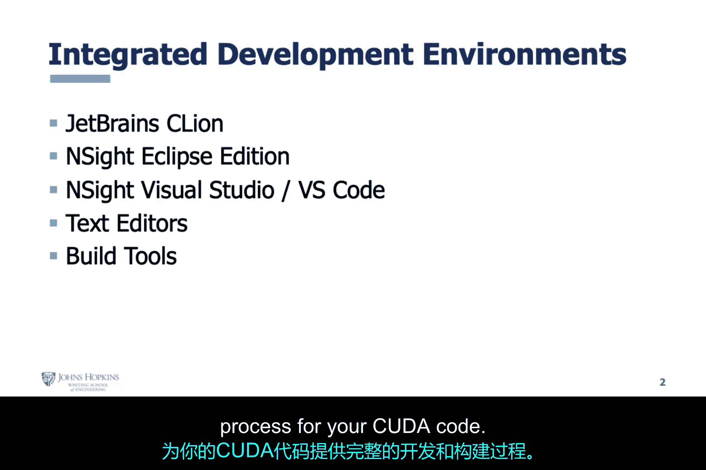
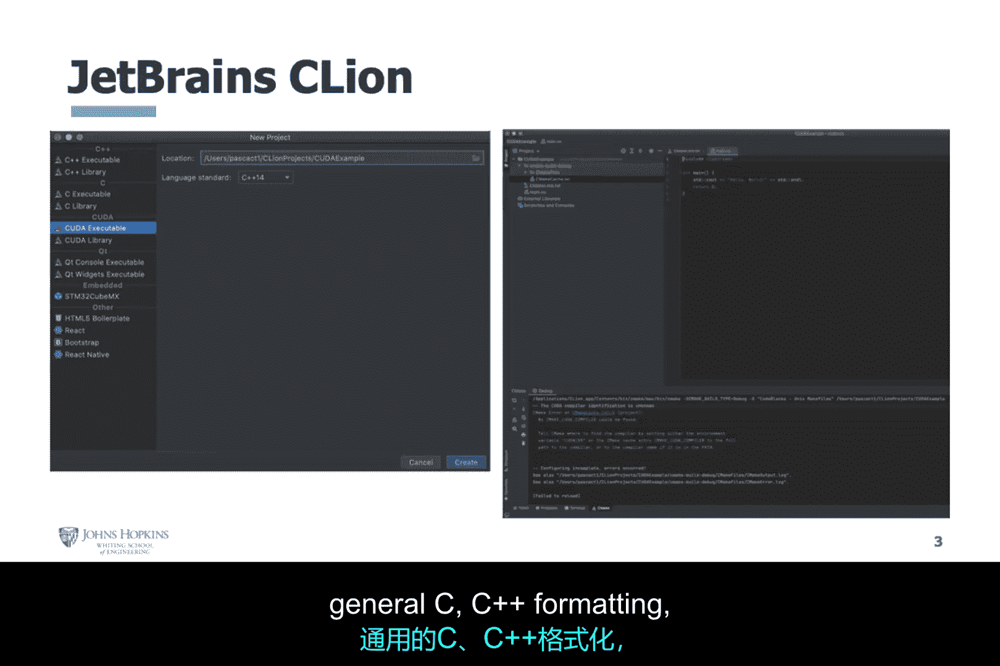
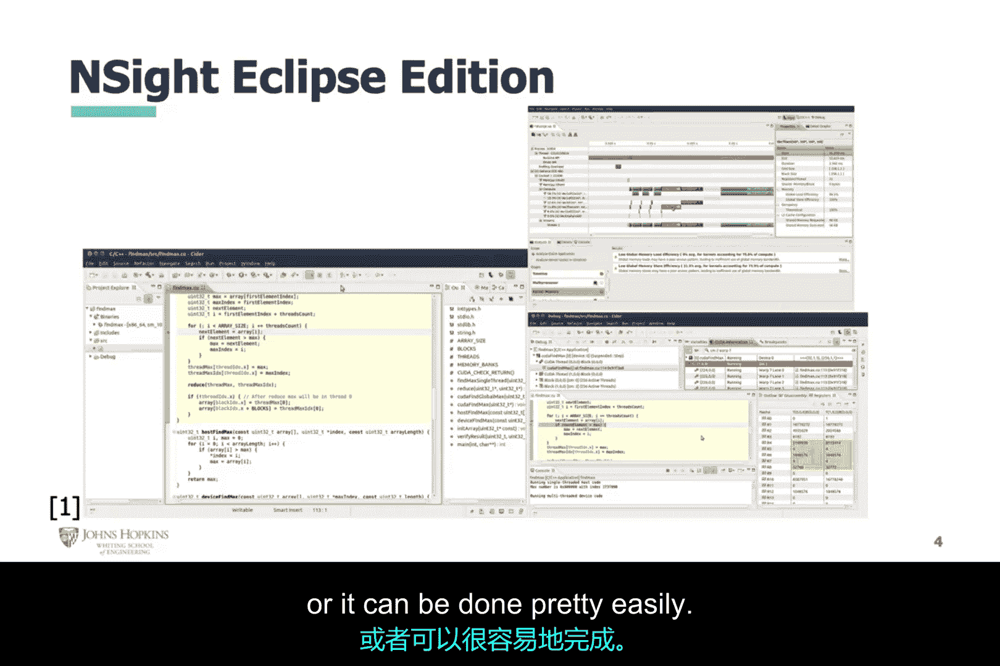
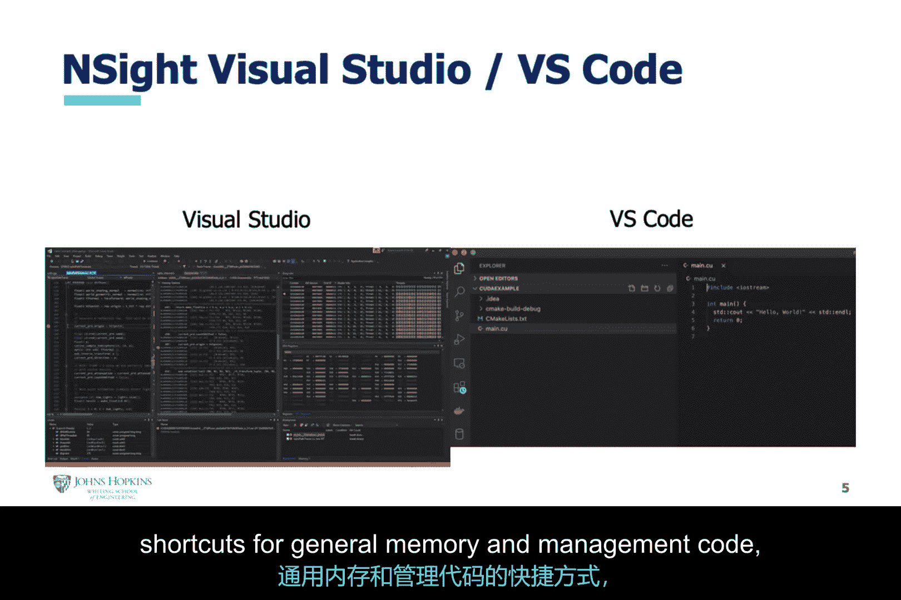
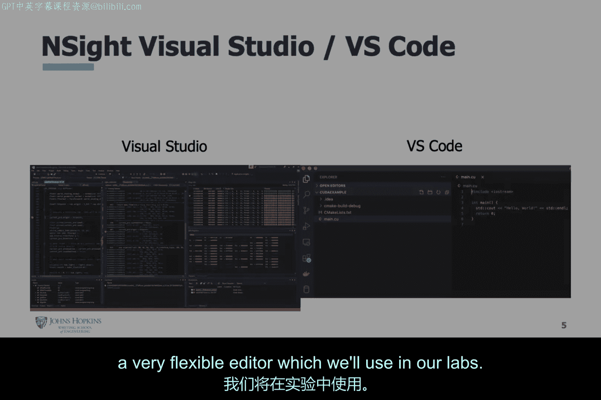
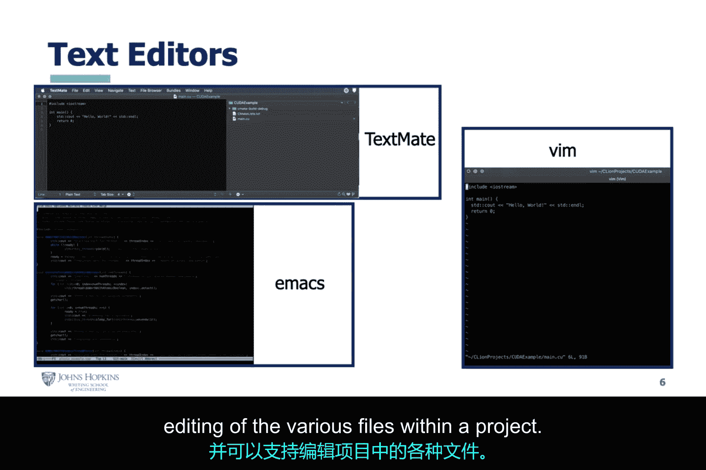
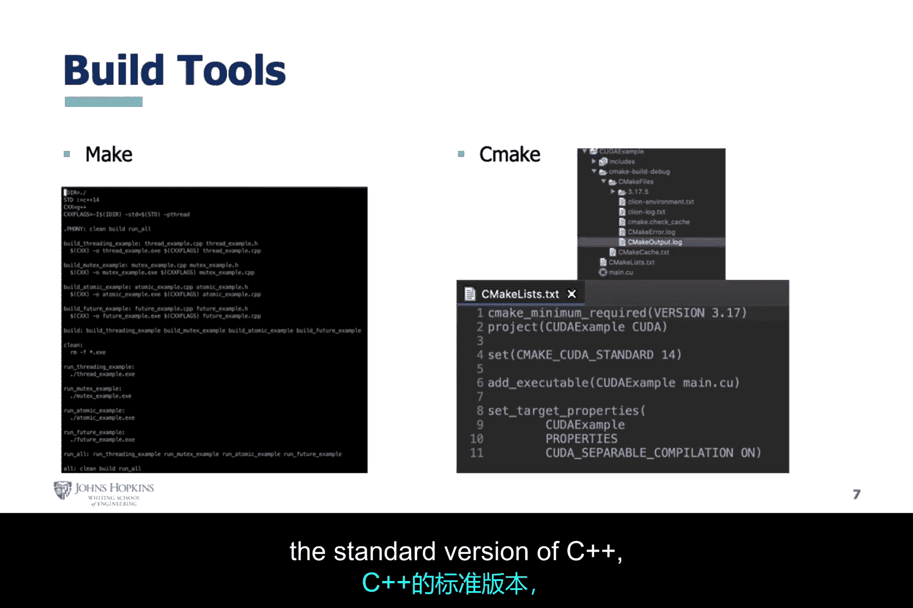
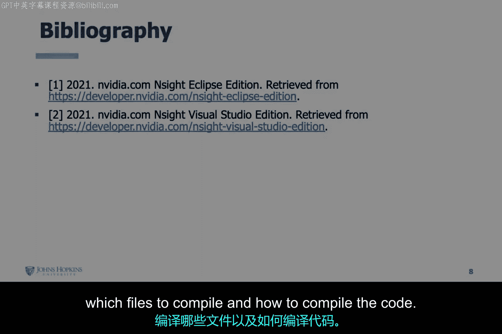

# 028：CUDA IDE编程实践 🛠️

在本节课中，我们将学习用于CUDA开发的集成开发环境（IDE）和文本编辑器。我们将了解不同工具的特点，以及它们如何与构建工具配合，共同构成完整的CUDA代码开发和构建流程。

## 主流IDE选项 💻

上一节我们介绍了CUDA编程的基础，本节中我们来看看具体的开发工具。前三类IDE选项是CUDA开发中最先进和流行的环境。

以下是三种主要的IDE：

*   **CLion**：这是一个通用的C/C++ IDE，不包含针对CUDA GPU代码调试和分析的特定功能。但它集成了CMake构建工具，并包含一个CUDA项目向导，可以创建包含CMake构建文件的基本CUDA程序结构。该IDE还提供代码补全、通用C/C++格式化等辅助开发功能。
*   **Eclipse**：最初是一个Java IDE，拥有众多变体。其中一个变体通过安装插件，允许对CUDA项目进行分析和调试。该编辑器的一个主要优势是，可以将一个IDE应用于不同语言的不同项目，并且项目视图会根据你的目标自动切换。运行该IDE需要在机器上安装Java。
*   **Microsoft选项**：微软提供两种选择。
    *   **Visual Studio**：这是一个功能齐全的IDE，包含许多CUDA开发的集成点，例如通过Nsight插件进行分析和调试。对于基于Windows的机器开发，它可能是最佳选择，因为功能最全面。
    *   **VS Code**：这是一个功能强大的通用文本编辑器，通过市场可以提供许多插件，以实现语法辅助、通用内存管理代码快捷方式等功能。它是一个非常灵活的编辑器，将在我们的实验中使用。

## 文本编辑器的作用 📝

虽然功能不如IDE丰富，但文本编辑器在CUDA开发中扮演着非常重要的角色。

以下是常见的文本编辑器类型：

*   **命令行编辑器**：根据你的偏好，Vim和/或Emacs是两个非常优秀的Linux命令行代码编辑工具。它们可以使代码替换、语法高亮和项目结构导航等任务变得更简单。
*   **GUI文本编辑器**：Textmate及类似的图形界面文本编辑器适用于大多数操作系统，并且可以支持编辑项目中的各种文件。

文本编辑器本身通常不提供IDE的所有功能，但可以通过插件进行增强。

## 构建工具 🔨

尽管它们不是代码编辑器，但构建工具与IDE和编辑器结合，为你的CUDA代码构成了完整的开发和构建流程。

构建工具获取项目代码及其自身的配置文件，并根据目标编译代码。

以下是两种常见的构建工具：

*   **Make**：使用一个单独的Makefile，其中包含Bash风格的环境变量声明、基于正则表达式的代码和对象文件识别，以及用于执行从简单到复杂的层次化构建的Bash脚本。
*   **CMake**：这是一个更现代、更程序化的构建工具选项。在示例中，CMake被告知要使用哪个版本的CMake、C++的标准版本、要编译哪些文件以及如何编译代码。

---

本节课中我们一起学习了CUDA开发可用的各类IDE、文本编辑器以及构建工具。我们了解了CLion、Eclipse和Visual Studio等主流IDE的特点，也认识了文本编辑器在开发中的辅助作用，最后探讨了Make和CMake如何将代码编译成可执行程序。掌握这些工具是进行高效CUDA编程实践的重要基础。