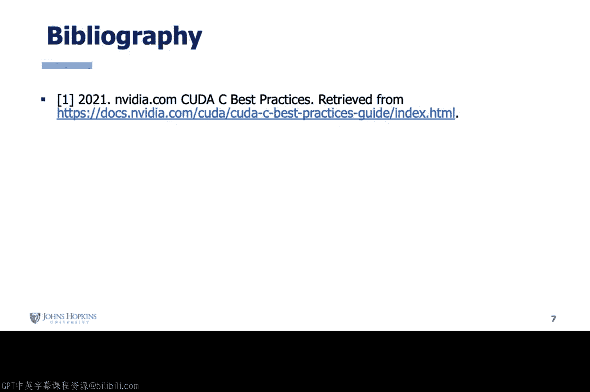

# 029：CUDA项目结构与最佳实践 🏗️

在本节课中，我们将学习如何创建一个CUDA项目，并探讨如何编写易于理解和维护的代码。编写处理复杂问题的优秀CUDA代码并非易事，如果不考虑一些关键因素，让他人理解你的代码将是一个挑战。我们将从项目结构和最佳实践这两个主要方面入手，它们能有效提升代码的可读性和性能。值得注意的是，许多应采纳的实践普遍适用于所有C或C++项目，因为CUDA代码是这些语言功能的一个子集。

## 项目结构 📁

上一节我们介绍了项目结构的重要性，本节中我们来看看具体的结构设计。

简单项目的结构通常非常扁平，所有代码和头文件可以直接存放在项目文件夹下。

然而，大型项目可能包含许多不同的配置和支持文件。在所有语言的所有项目中，唯一一个必须包含的文件是README。

README可以是一个简单的文本文件，但更推荐使用Markdown文件，因为它支持更高级的格式，并且Git服务器可以直接解析它们。README至少应包含如何构建和运行代码的文档。

根据你希望使用的构建系统，你需要创建以下文件之一：
*   **Makefile**：如果你使用`make`。
*   **CMakeLists.txt**：如果你使用`CMake`。在本课程中，我们将主要使用`make`，因为它在开发构建配置文件时的开销较低。

当你拥有一个真正复杂的项目时，你需要使项目的完整结构能够反映其目的，并勾勒出源代码的模块化。

这意味着源文件、头文件和相关的测试代码应反映在任何导入语句中，并应划分到它们自己的文件夹中。你应该养成记录代码的习惯，既在代码本身中记录，也在单独的文件中记录，例如设计文档、用户文档，以及任何未被构建系统处理的复杂安装说明。

与之前简单项目结构相比，一个主要变化是将源代码和头文件分离到`src`和`include`文件夹中。此外，将所有被其他代码文件使用的代码组织到`common`目录下的文件中是一个好做法。

这样做的一个主要原因是管理循环依赖。如果你有复杂的CMake配置文件，则应将其放在单独的`cmake`文件夹中，以使主项目文件夹不被非源代码文件污染。

当然，如果你使用`make`，那么你只需要一个Makefile，它可以放在项目的根目录下。再次强调，始终创建一个README，至少包含如何构建和执行代码的文档。

## 性能最佳实践 ⚡

理解了项目结构后，我们来看看提升CUDA代码性能的一些核心实践。

强扩展性可以通过**阿姆达尔定律**来衡量。算法应易于并行化，这应是首要考虑因素。一个例子是将`for`循环展开，让每个线程执行一部分迭代。

弱扩展性则意味着增加处理器数量不一定能线性提升性能。当你需要多个线程处理相同的数据点时（例如图像滤镜），需要考虑这一点。更多线程意味着更快的性能，但你无法将数据划分到与线程数一一对应。

内存优化可以产生影响，但不同数据类型之间的速度提升差异并非数量级的，而且通常更快的存储器（如寄存器）受限于线程数量和可用资源。因此，使用内存优化使代码运行更快是个好主意，但不要指望它能让糟糕的代码或复杂的算法在常数时间内运行。

一个非常重要的事情是了解分支（如`if`、`do`、`while`等）的代价。这是因为构成一个半线程束（half-warp）的16个线程（或构成线程束的32个线程）会同步执行。当一个线程进入不同的分支时，半线程束中的所有其他线程的运行时间几乎都会翻倍。

因此，应避免随意使用分支。处理此问题的一种方法是预处理信息，使其沿着半线程束的边界对齐。这可以通过操作偶数或奇数数据的代码实现，将它们移动到输入数据的开头或结尾，从而减少这种边界跨越的发生。

## 开发与测试 🔍

以下是关于代码开发和测试的一些关键实践：

*   **性能分析**：分析代码是识别内存瓶颈和性能不佳代码段的好方法。
*   **持续测试**：在整个开发过程中测试代码可以更早地发现错误和其他问题，这可以挽救你的项目。
*   **混合编程**：如果你无法为所有代码段编写CUDA代码，或者作为完全迁移到CUDA之前的临时解决方案，可以考虑使用像OpenACC这样的编译器，使部分代码能立即使用GPU。它们通常使用`#pragma`指令包裹`for`循环。
*   **输出性能指标**：最后但同样重要的是，将性能指标作为代码执行的一部分输出，可以显示你的代码在不同情况下的表现以及其工作效果。

## 总结 📝

本节课中我们一起学习了创建可维护CUDA项目的核心要素。我们首先探讨了从简单到复杂的项目结构设计，强调了模块化、文档化和使用README的重要性。接着，我们深入研究了性能优化的最佳实践，包括理解强扩展与弱扩展、进行内存优化以及避免代价高昂的分支操作。最后，我们介绍了开发过程中的关键实践，如性能分析、持续测试、利用OpenACC进行混合编程以及输出性能指标。遵循这些结构和实践准则，将帮助你编写出更高效、更清晰且更易于协作的CUDA代码。