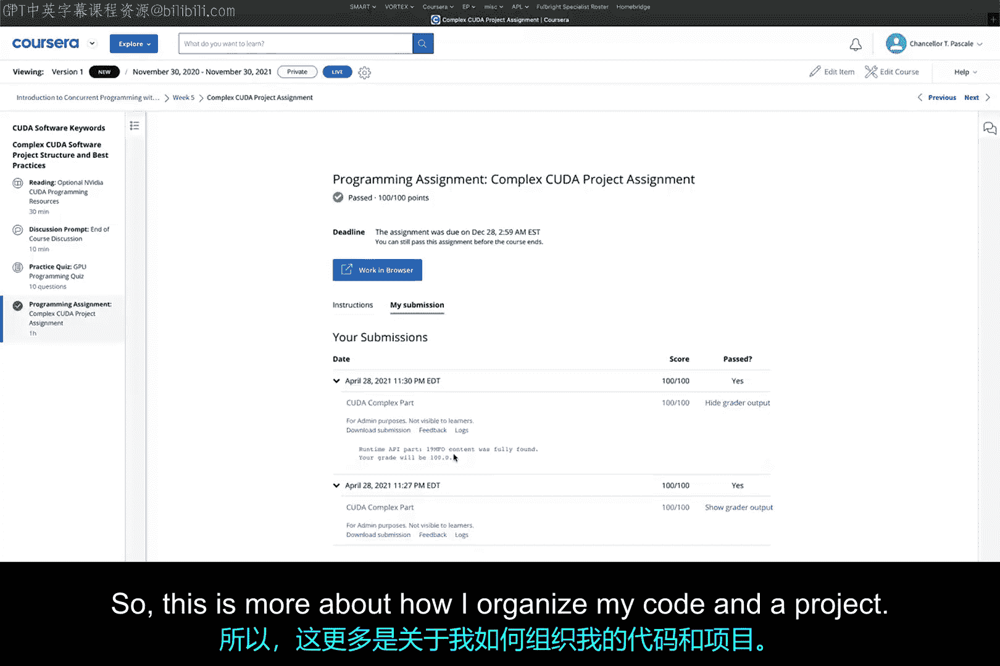

# 030：复杂CUDA项目作业解析 🧩

在本节课中，我们将快速解析与复杂CUDA软件项目相关的编程作业。我们将概述完成此作业需要遵循的五个关键步骤，并重点说明代码组织、Makefile配置以及项目构建的核心概念。

## 作业步骤概述 📋

上一节我们介绍了课程背景，本节中我们来看看完成本次编程作业的具体步骤。以下是完成作业需要执行的五个主要步骤。

1.  第一步是处理代码文件。我放入实验的代码几乎完全正确，但我移动了一些文件的位置，包括源文件和头文件。
2.  第二步是修改Makefile。你需要修改Makefile，将适当的包含目录作为环境变量，供make命令使用。
3.  第三步是构建项目。像之前一样，运行 `make clean` 和 `make build` 命令。这将在你当前的项目文件夹根目录下构建一个名为 `complex` 的可执行文件。
4.  第四步是运行并输出结果。执行 `complex` 这个可执行文件，并将其输出重定向到 `output.txt` 文件中。
5.  第五步是提交作业。点击提交按钮后，你将看到结果。系统基本上会报告它是否找到了预期的内容。

## 核心要点与目标 🎯

在了解了具体步骤后，我们需要明确本次作业的核心要点。作业过程中可能会有失败的情况，但你需要知道，本次作业的重点主要在于整合代码的不同部分（如头文件），并理解如何使用Makefile使整个项目正常工作。

我细分了代码结构，使其更清晰，并遵循了一些像谷歌这样的大公司所推行的实践规范。因此，本次作业更多是关于如何在项目中组织代码。虽然项目结构仍然相对简单，但足以让你入门。

## 总结 📝

本节课中我们一起学习了复杂CUDA项目作业的解析流程。我们概述了从代码处理、Makefile配置、项目构建、运行测试到最终提交的五个关键步骤，并强调了本次作业的核心目标是掌握代码组织与项目构建工具的使用，为后续更复杂的企业级开发实践打下基础。