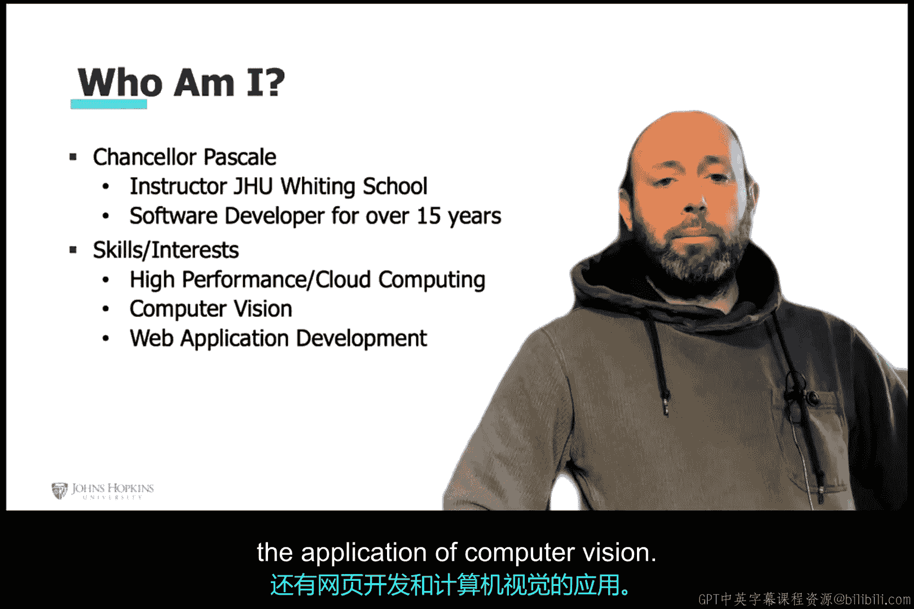
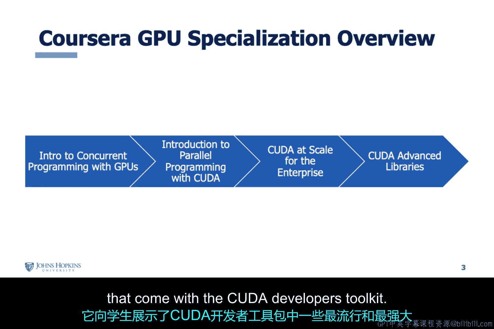
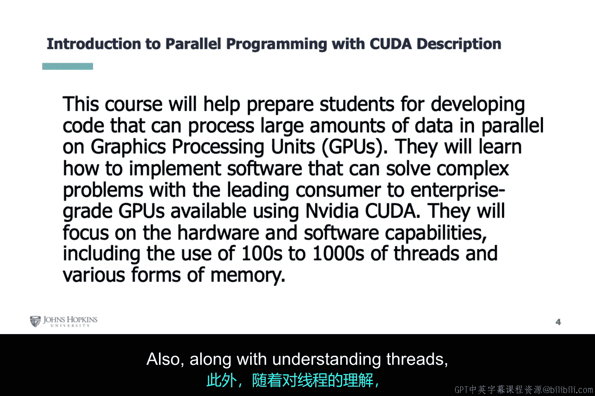
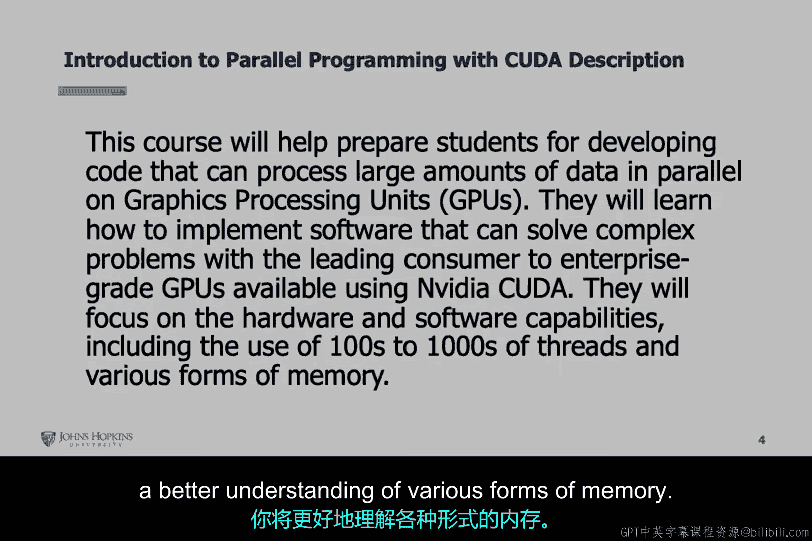
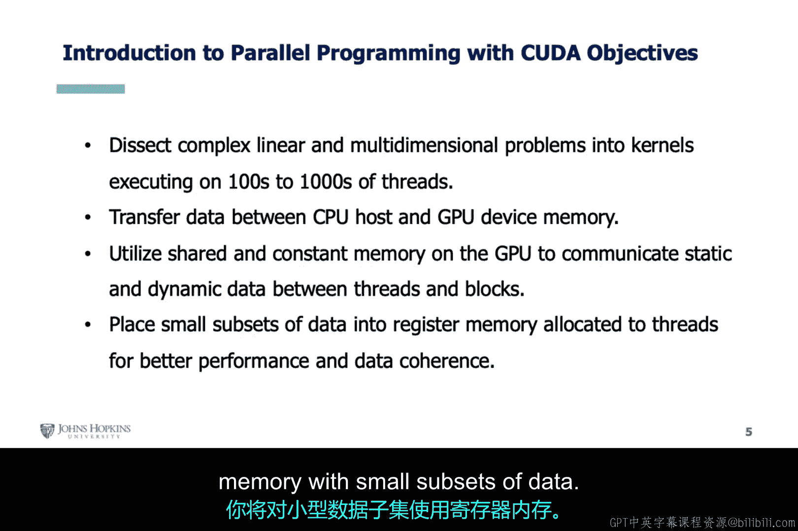

# 031：课程介绍与概述 🚀

在本节课中，我们将学习约翰霍普金斯大学GPU编程专项课程的整体结构，并深入了解第一门课程《CUDA并行编程导论》的目标与内容。

大家好，欢迎来到CUDA课程并行编程导论的第一节视频讲座。本视频将聚焦于GPU编程专项课程。我是谁？我是Chancellor Pascal。我在约翰霍普金斯大学怀廷工程学院担任讲师已有十年。我拥有十五年的软件开发经验。高性能计算、云计算、Web开发以及计算机视觉的应用是我的兴趣所在。现在，我想为大家概述一下Coursera平台上的GPU专项课程。

## 专项课程结构 📚

以下是GPU编程专项课程包含的四门课程。

*   **第一门课程：GPU并发编程导论**：这是您当前所在的课程，我将在下一张幻灯片中详细描述。
*   **第二门课程：CUDA并行编程导论**：这门课程专注于NVIDIA GPU和CUDA编程框架提供的基本硬件与软件能力。
*   **第三门课程：面向企业的规模化CUDA**：这门课程深入探讨CUDA更复杂的功能，以及如何将其应用于超越程序员个人机器、扩展到企业级硬件上。
*   **第四门课程：CUDA高级库**：这门课程向学生介绍CUDA开发工具包中附带的一系列最流行且功能强大的库。

上一节我们了解了整个专项课程的框架，本节中我们来看看您即将开始学习的第一门课程。

## 第一门课程：《CUDA并行编程导论》详解 🎯

那么，我将如何描述《CUDA并行编程导论》这门课程呢？我们将帮助您，也就是学生，准备好开发能够处理大量数据的代码。我们谈论的是数十万甚至数百万个数据点。您将开发的GPU（图形处理器）代码，将使用CUDA框架，在从消费级到企业级的NVIDIA GPU上解决复杂问题。此外，在理解线程的同时，您还将对各种形式的内存有更深入的理解。

接下来，让我们明确本课程的学习目标。

## 课程核心目标 🎯

以下是本课程结束时您将能够掌握的核心技能。

*   **分解复杂问题**：您将能够将复杂的线性和多维问题分解成**内核（kernel）**，这些内核可以在任一时刻在多达数千个线程上执行。
*   **管理数据传递**：您将在CPU（主机）和GPU（设备）内存之间传输数据。
*   **利用GPU特定内存**：您将学习利用GPU上的**共享内存（shared memory）** 和**常量内存（constant memory）**。这允许在线程和线程块之间传输静态和动态数据，旨在提升线程间的数据一致性以获得更好的性能。
*   **使用寄存器内存**：您将为数据的小子集使用**寄存器内存（register memory）**。

本节课中，我们一起学习了GPU编程专项课程的整体规划，并详细探讨了第一门课程《CUDA并行编程导论》的定位与具体学习目标。希望本次介绍能让您开始思考自己在本课程乃至整个GPU专项课程中希望达成的目标。