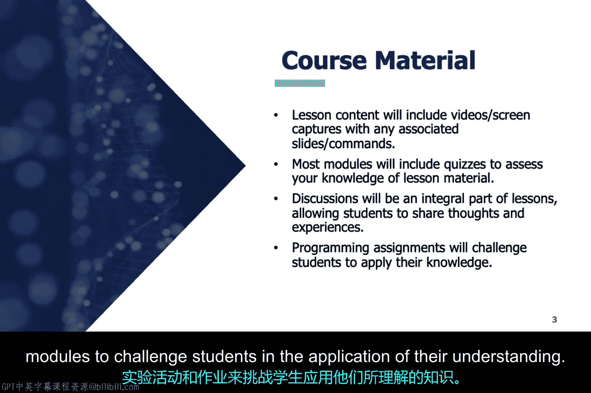
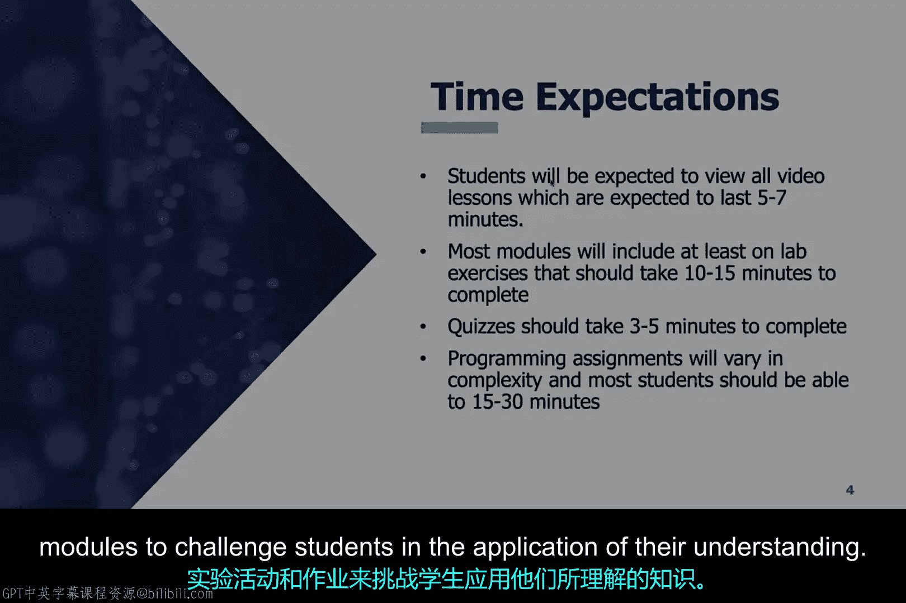
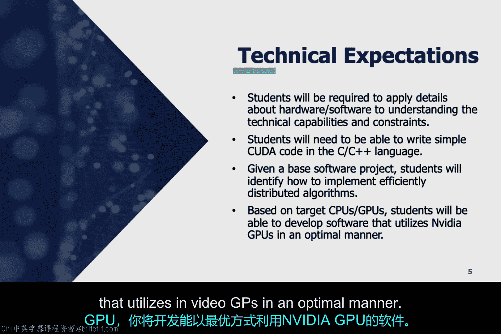

# 032：课程预期目标 🎯

在本节课中，我们将了解《使用CUDA进行并行编程》课程的整体结构、学习材料、时间投入以及技术能力要求。

## 课程材料与结构 📚

上一节我们介绍了课程概述，本节中我们来看看课程的具体安排。从材料角度看，每个模块将包含4到7节课，每节课配有视频、测验等内容。

以下是课程材料的主要形式：
*   视频材料将以幻灯片或屏幕录制的形式呈现。
*   带有旁白的幻灯片视频将同时提供PowerPoint幻灯片文件。
*   对于包含屏幕录制内容的视频，相关的操作命令也会提供。

## 时间投入与学习活动 ⏱️

从时间角度看，学生每周需要投入以下内容：
*   观看20到30分钟的视频。
*   完成15到30分钟的非计分作业，例如实验和讨论。
*   完成30到60分钟的计分作业，形式为编程作业和测验。

每节课将包含讲座视频和技术应用视频，这些是深入理解课程主题所必需的，时长通常在5到7分钟之间。

以下是不同类型学习活动的具体时间预估：
*   **实验活动**：允许学生在实际环境中探索技术主题，通常需要10到15分钟来掌握其核心内容。
*   **测验**：用于评估学生对理论或特定技术知识的掌握，每个模块的测验预计需要3到5分钟完成。
*   **编程作业**：对于每个模块，学生应预留15到30分钟来完成编程作业。

## 技术能力要求 💻

现在，让我们深入了解课程对技术能力的具体期望。你需要理解如何利用硬件和软件的约束与能力细节来优化程序。

以下是课程的核心技术目标：
1.  你需要能够使用C++语言编写至少简单的CUDA代码。
2.  我将提供一个基础的软件项目，在完成作业时，你需要识别在哪里放置你的代码，以及如何最高效地分配算法。
3.  最后，基于你自己的硬件或Coursera实验平台的目标CPU和GPU，你将开发出能够以最优方式利用NVIDIA GPU的软件。

为了挑战和评估学生对技术主题的理解，大多数模块将使用编程实验活动和作业。

## 协作与评估 🤝

为了鼓励协作和分享想法与经验，讨论将是每个模块的一部分，学生应将其视为学习过程中不可或缺的环节。许多模块会包含测验，以评估学生对讲座材料的掌握情况。

本节课中我们一起学习了《使用CUDA进行并行编程》课程的整体框架。我们明确了课程提供的材料形式、需要投入的时间分布、以及需要掌握的核心技术能力，包括编写CUDA C++代码和优化GPU程序。准备好开始你的并行编程之旅了吗？