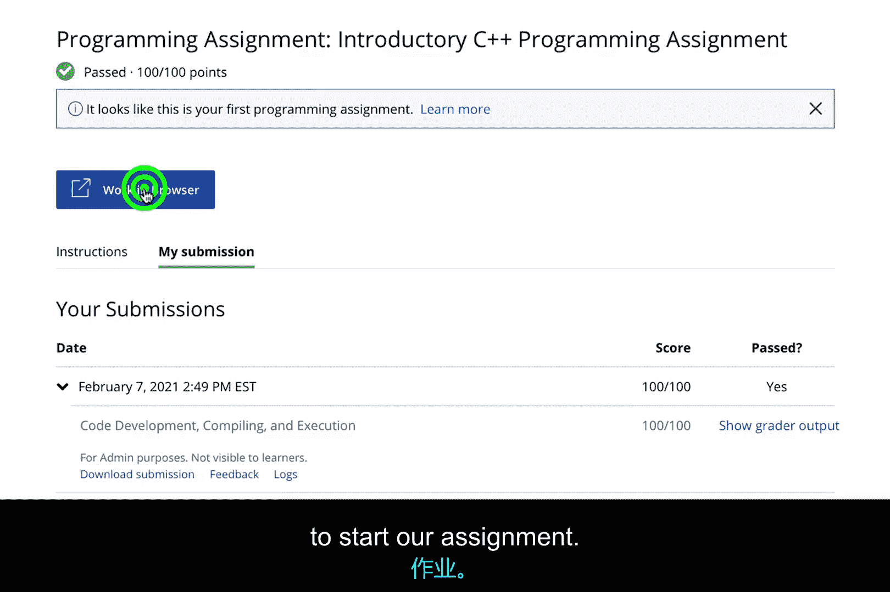
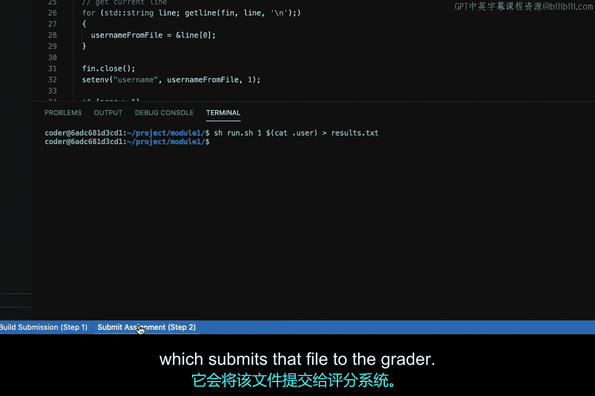
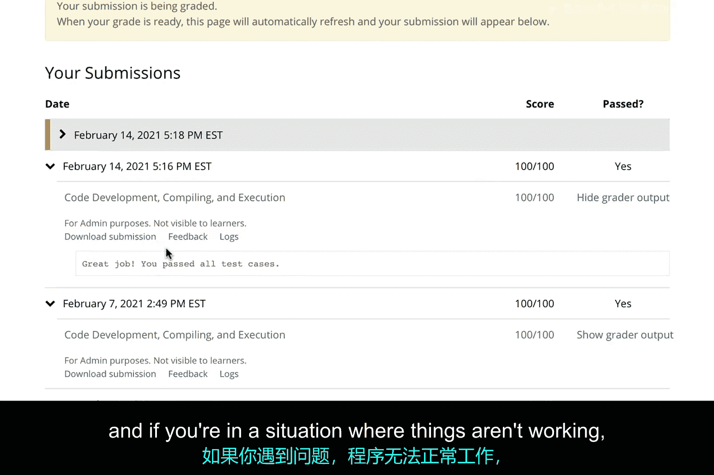
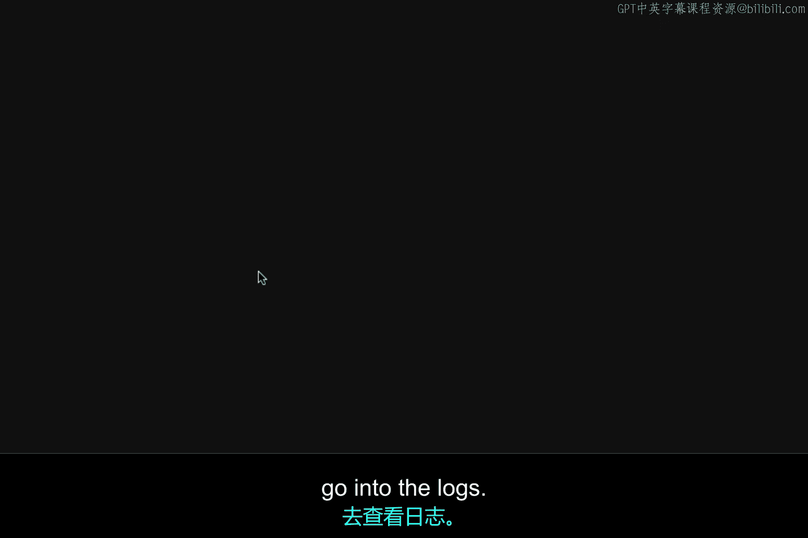

# 033：Coursera实验作业环境指南 🖥️

在本节课中，我们将学习如何使用Coursera的实验和作业环境进行CUDA编程。我们将详细介绍从打开环境到提交作业的完整流程。

## 概述

Coursera的GPU编程课程实验和作业开发流程包含六个核心步骤。我们将逐一讲解每个步骤的具体操作和注意事项。

## 开发流程详解

### 第一步：打开Coursera实验环境

首先，你需要在浏览器中打开Coursera的实验环境，该环境集成了VS Code编辑器。

### 第二步：导航并打开项目目录

接下来，你需要在VS Code中打开与实验或作业相关的项目目录。以下是具体操作步骤：

如果编辑器页面顶部没有显示模块编号和名称，你需要从菜单栏点击“文件”选项。在下拉菜单中选择“打开”，这将调出“打开文件或文件夹”对话框。

在对话框中，你可以通过点击“..”来向上导航目录结构。对于本课程的项目，你需要导航至 `home/coder/project/module1` 目录。

找到所需文件夹后，点击“打开”按钮。该文件夹将在编辑器左侧打开，其中包含开始当前模块实验或作业所需的所有文件。

### 第三步：阅读说明文件

打开项目后，你应该首先阅读 `README.md` 文本文件。该文件包含背景材料和一系列作业说明。

此外，你可以查看 `run.sh` 文件，这是一个用于执行作业所有步骤的脚本。`Makefile` 文件则用于清理、构建和运行你的代码。通常你不需要修改这两个文件，只需修改代码及其他相关文件。

### 第四步：编辑配置文件与代码

如果你正在进行作业，接下来需要确保 `.user` 文件中的用户名信息正确。用户名可以是任何不包含特殊字符的名称或登录名。

在开始编写作业其余部分的代码之前，另一个需要编辑的地方是你的主代码文件（例如 `assignment.cpp`）。你需要修改 `USER_NAME` 字符串常量，使其与你在 `.user` 文件中设置的用户名一致。

通过编辑这两个文件，你可以确保你的提交满足作业的第一个要求：用户名验证。当你通过 `run.sh` 脚本或 `make` 命令执行代码时，需要传递相同的用户名。

### 第五步：构建与执行代码

提交代码的下一步是点击页面底部的“构建提交（步骤1）”按钮。页面底部将出现一个终端窗口，它会清理、构建并执行你当前的代码，同时将输出写入一个用于作业评分的文件。请注意查看终端中的任何输出信息。

### 第六步：提交作业

然后，点击同样位于页面底部的“提交作业（步骤2）”按钮。该操作会将上一步生成的文件提交给评分系统。

## 查看提交结果

提交后，你可以在作业页面查看提交结果。结果在评分器运行完成前会显示为琥珀色。

打开提交结果后，你可以看到分数、是否通过以及任何反馈信息。如果遇到问题，你可以进一步查看日志以获取详细信息。

## 总结

本节课我们一起学习了Coursera GPU编程课程实验作业的完整操作流程。我们涵盖了从打开浏览器环境、导航项目目录、阅读说明文件、编辑必要配置和代码，到最终构建、执行并提交作业的每一个关键步骤。掌握这个流程是顺利完成后续编程实践的基础。