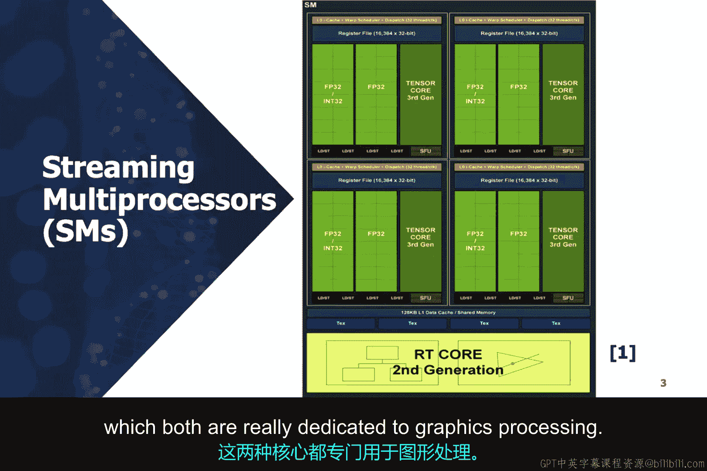
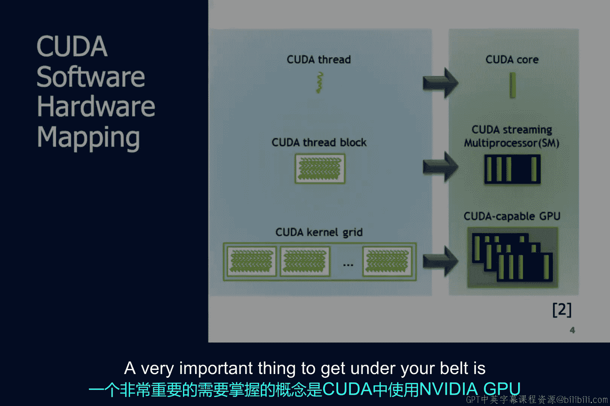
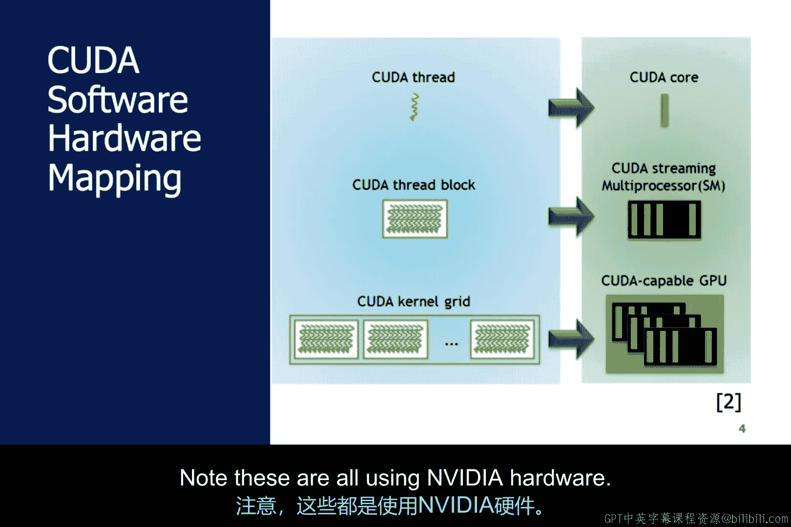
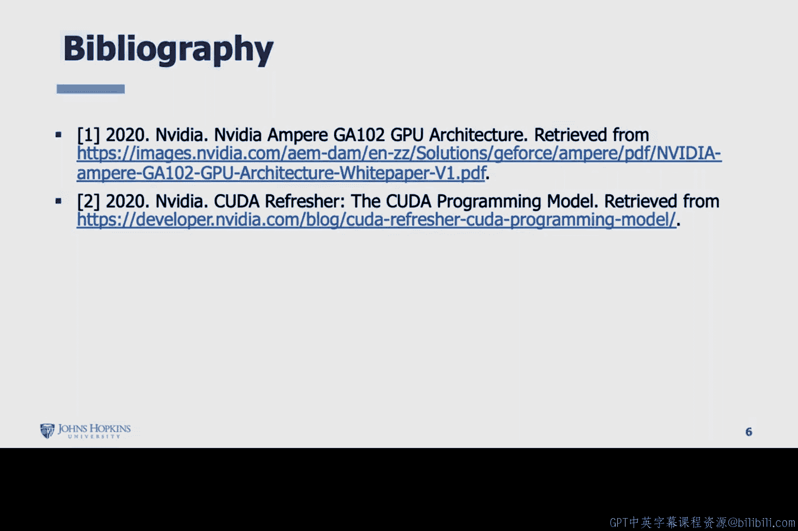

# 034：核函数执行原理 🚀

在本节课中，我们将学习GPU的高层架构、CUDA编程中软件与硬件的映射关系，以及核函数的执行原理。理解这些概念是编写高效并行程序的基础。

## GPU高层架构 🏗️

上一节我们介绍了GPU编程的基本概念，本节中我们来看看GPU的高层架构。下图展示了Ampere架构的示意图。

在图的中央，被黄色框包围的多个方框代表了**流式多处理器**，它们是GPU计算的核心。图的左右两侧是**内存控制器**，它们帮助在GPU的不同类型内存之间移动和存储数据。

图的顶部是**GigaThread引擎**，它是主要的调度器。顶部和底部的接口分别是：顶部的**通用IO总线**，由CPU和GPU共享，数据在它们之间传输；底部的**NVLink高速链接**，主要用于加速GPU之间的数据传输。

## 深入流式多处理器 🔬

现在，让我们放大观察流式多处理器。下图是一个Ampere架构GPU中SM的示例。

在这个SM中，你会看到四个**线程束**。每个线程束包含：
*   一个L0指令缓存。
*   一个调度器。
*   一个寄存器集合，称为**寄存器文件**。
*   两个**半线程束**：一个能执行浮点或32位整数运算，另一个专用于32位浮点运算。它们具备加载和存储能力。
*   一个专属于该线程束的**张量核心**。
*   使用L1数据缓存作为**共享内存**的能力，我们稍后会详细讨论。
*   四个**纹理核心**。
*   一个**光线追踪核心**。纹理核心和光线追踪核心主要专用于图形处理。

## 软件与硬件的映射 🗺️

理解CUDA编程中软件与硬件的映射关系至关重要。以下是核心的映射概念：

*   **线程**：最小的计算单元，相当于一个**核心**。回想一下，在流式多处理器中提到的两个半线程束，分别执行浮点和整数运算，其中的每个执行单元就是一个核心。
*   **线程块**：一组线程的集合。通常，一个**线程束**包含32个核心，对应CUDA流式多处理器中的一个或多个分区。
*   **网格**：包含多个线程块。网格可以非常大，可以在同一个GPU上或跨多个GPU上重复执行。

下图直观地展示了这种映射关系。

## 核函数执行 🚦

现在，让我们运用所学的硬件、软件及其映射知识，来看看它们如何应用于核函数的执行。

一个重要的符号是 `<<< >>>`。这个符号告诉调度器和编译器，传入其中的参数描述了如何在GPU上划分工作。这是你在外部控制工作分配的主要方式。

以下是核函数启动配置中可以指定的参数：

*   **网格与块维度**：你可以指定网格中的块数量以及每个块中的线程数量。这两者的乘积通常与你处理的数据量相关。`dimGrid` 和 `dimBlock` 实际上可以指定为三维对象，以描述在三个维度上如何划分工作。我们将在后续课程中详细讨论。
*   **共享内存**：指定你打算使用多少硬件中存在的共享内存。
*   **流**：指定一个流，用于发送数据和事件，以实现更交互式的内核执行。

当然，你还需要传递核函数本身的参数，这些通常是进出核函数的数据。

核函数本身的定义遵循特定格式：
*   它以 `__global__` 关键字开头（`__` 是两个下划线符号）。
*   它不返回任何值，因此返回类型是 `void`。
*   然后是核函数名称及其输入参数。

在下面的示例中，核函数通过简单的索引计算，获取二维线程和块空间中的 `i` 和 `j` 坐标（即x和y坐标），从而映射到两个输入矩阵或数组中，将它们的值相加，然后将结果放入一个二维矩阵或数组中。

## 总结 📝

本节课中，我们一起学习了GPU的高层架构，包括流式多处理器和内存控制器等核心组件。我们深入探讨了CUDA编程模型中线程、线程块和网格与GPU硬件核心、SM之间的映射关系。最后，我们详细解析了核函数的执行原理，包括启动配置语法 `<<< >>>` 和核函数定义的关键要素。理解这些基本原理是后续进行高效并行GPU编程的基石。