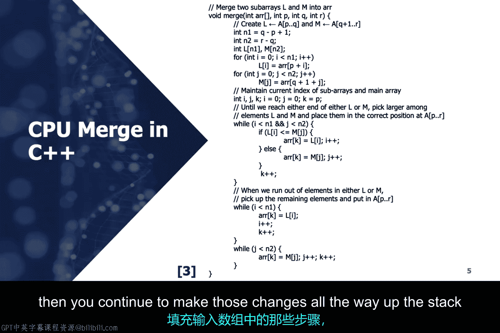
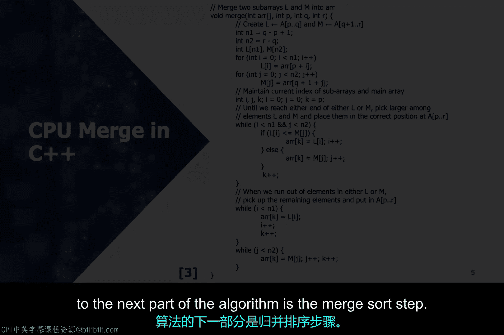
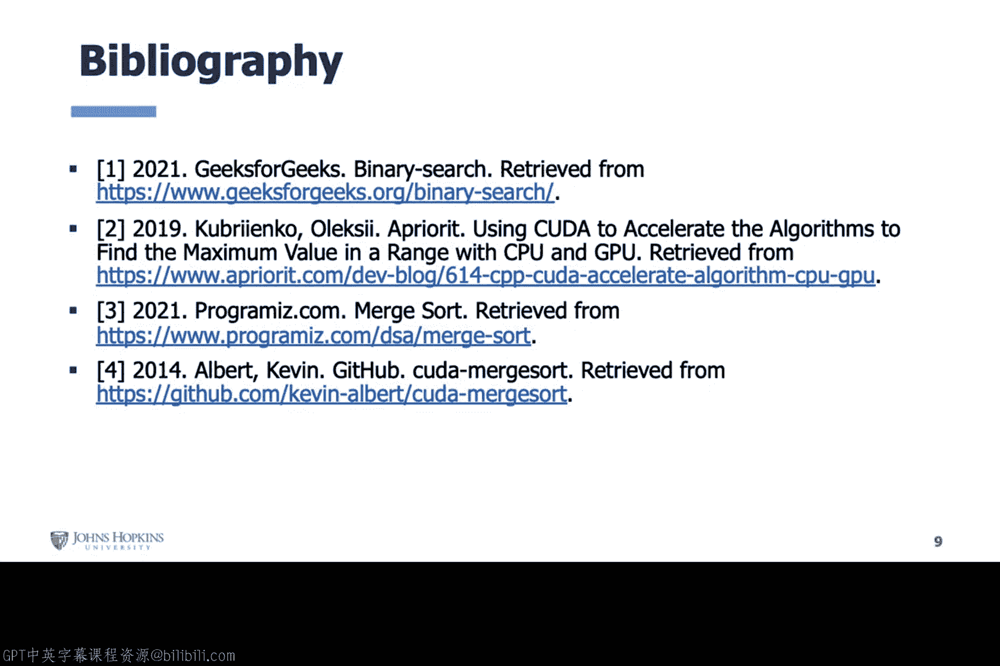

# 035：分治法与GPU算法设计

在本节课中，我们将学习如何将一个为CPU精心调优的分治算法，转换为基于CUDA GPU的算法。我们将以归并排序为例，详细解析其CPU实现原理，并探讨如何将其核心思想迁移到GPU上，利用其并行计算能力。

## 概述：从CPU归并排序说起

上一节我们介绍了分治法的基本思想。本节中，我们来看看另一个经典的分治算法——归并排序。

归并排序的目标是得到一个有序的数组。其核心操作是递归地将输入数组对半拆分，直到每个子数组只包含一个元素（即叶子节点），然后通过合并有序子数组的方式，自底向上地构建出完整的有序数组。

## CPU归并排序的工作原理

以下是CPU上单线程归并排序的典型步骤：

1.  **递归分解**：算法首先创建一个递归调用树，将给定的输入数组不断对半拆分，直到每个子数组只包含一个元素。此时到达叶子节点，递归过程停止。
2.  **回溯与合并**：递归调用开始返回。每个调用接收两个已排序的子数组，并将它们合并成一个更大的有序数组。这个过程逐层向上进行，直到回溯到最初的调用，此时整个原始数组已完成排序。

虽然这不是最高效的排序算法，但在单线程CPU上，它是一种非常有效的算法。

## 核心：合并步骤详解

从前面的图表中，最重要的步骤是“合并”。理解这一点至关重要。

可以想象，在整个递归过程中，算法操作的是同一个原始数组，并非在每一步都创建全新的子数组副本。算法通过指针来标记当前处理的数组片段的起始和结束位置。

以下是合并两个有序子数组 `L` 和 `M` 的具体过程：

*   创建临时数组 `L` 和 `M`（在实际优化实现中，可能通过指针操作避免完全复制）。
*   使用指针指向 `L` 和 `M` 中当前最小的元素（因为 `L` 和 `M` 各自已排序）。
*   始终比较 `L` 和 `M` 的当前最小元素。
*   将两者中较小的一个放入输出数组的正确位置。
*   当一个子数组（如 `L`）的所有元素都处理完毕后，将另一个子数组（`M`）的剩余元素全部按序填入输出数组的剩余位置。

这个合并操作在递归回溯的每一层都会被调用，它接收两个已排序的数组片段，并将它们合并成一个更大的有序片段，最终在栈顶完成整个数组的排序。

## 过渡到GPU：CUDA归并排序

与CPU上的归并类似，CUDA也提供了合并函数。需要注意的是，GPU上的合并操作不仅要处理单个元素（如线性搜索），还必须能够合并整个子数组。

CUDA合并函数的输入通常包括：
*   `source array`：内核执行开始时源数据的数组。
*   `destination array`：用于存放合并结果的数组（因为GPU上常采用异地操作）。
*   `start`, `middle`, `end`：定义了在源数组中需要合并的片段的起始、中间和结束位置。

其工作原理是遍历指定的片段（从 `start` 到 `middle` 和从 `middle` 到 `end` 这两部分），通过比较和交换，将有序结果输出到目标数组。这是一种“原地修改”思想的变化形式，只不过输出被放在了另一个数组中。

## CPU与GPU实现的关键差异

CUDA归并排序在功能上与CPU版本相似，它也为GPU底层的合并操作设置起始、中间和结束位置。

但两者存在显著差异：
*   **执行粒度**：CPU版本通常处理大小相等的切片，并且一次只执行一个合并操作。
*   **并行策略**：GPU版本则需要考虑数据总量、线程数量以及偏移宽度。它会通过一个循环，动态决定如何将数组划分成多个小块交给大量线程并行合并。例如，如果数据量小但线程多，可能每个合并操作只分配一个线程，这在一定程度上是高效的。然而，在算法的某个阶段，它总是需要跨多个数据子集进行合并，这涉及到线程间的协作与同步。

## 总结

本节课中，我们一起学习了如何将CPU上的分治算法——特别是归并排序——的思路迁移到GPU编程中。我们剖析了CPU归并排序的递归分解与合并过程，并重点探讨了在CUDA环境下实现归并排序的关键考虑，包括合并函数的输入输出、以及GPU大规模并行执行模型带来的算法设计差异。理解这些核心概念，是将传统算法高效移植到GPU并行架构的重要基础。