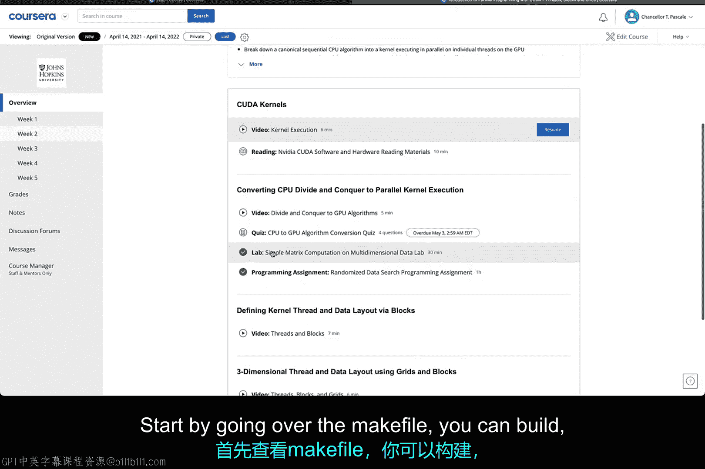
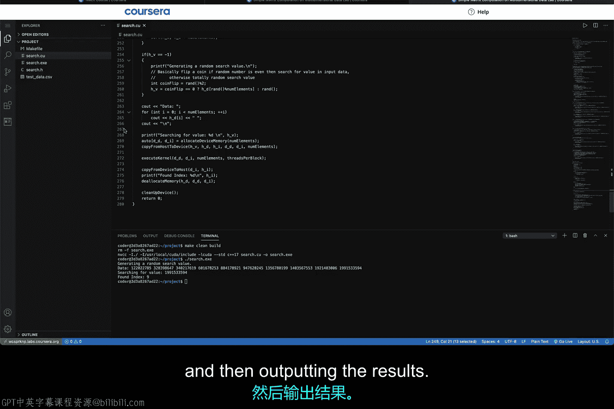

# 036：实验总览教程 🚀



在本节课中，我们将一起学习约翰霍普金斯大学GPU编程课程第二周的编程实验。我们将详细解析实验代码的结构、核心函数的功能以及整个程序的执行流程。通过本教程，你将理解一个基础的CUDA搜索程序是如何工作的。

## 实验环境与构建 🛠️

首先，我们来看如何构建和运行实验代码。所有操作都通过终端完成。

以下是构建和运行代码的基本步骤：

1.  使用 `make` 命令编译代码。
2.  使用 `make clean` 命令清理编译文件。
3.  使用 `make run` 命令运行编译好的程序。

构建过程可能需要一些时间，并且如果源代码存在问题，可能会失败。成功运行后，你会看到一个名为 `search.exe` 的可执行文件。运行程序，你将看到一行输出，其中包含输入数据、搜索值以及是否找到该值的索引（如果找到的话）。

## 核心内核函数解析 ⚙️

上一节我们介绍了如何构建和运行程序，本节中我们来看看程序的核心——CUDA内核函数。

内核函数 `search` 定义在 `search.cu` 文件中。它的主要功能是在一个数组中并行地搜索特定值。

以下是该内核函数的伪代码描述：

```cuda
__global__ void search(int *d_data, int *d_found_index, int search_value, int num_elements) {
    // 1. 计算当前线程的全局索引
    int tid = blockIdx.x * blockDim.x + threadIdx.x;

    // 2. 边界检查：确保索引不越界
    if (tid >= num_elements) return;

    // 3. 从全局内存读取数据到线程私有变量
    int my_element = d_data[tid];

    // 4. 执行比较：检查当前元素是否为搜索值
    if (my_element == search_value) {
        // 5. 如果找到，将当前线程的索引写入结果位置
        // 注意：如果搜索值出现多次，此位置会被多次覆盖
        d_found_index[0] = tid;
    }
}
```

这个内核函数展示了CUDA编程的基本模式：由大量线程并行执行相同的指令，每个线程处理数据的不同部分。

## 主机端辅助函数概览 🔧

理解了核心的内核函数后，我们来看看主机（CPU）端有哪些辅助函数来支持内核的执行。

以下是主机端主要辅助函数的列表及其简要说明：

*   **`allocate_random_memory`**：此函数负责生成随机数，为搜索内核准备输入数据。
*   **`read_csv`**：此函数从CSV文件中读取输入数据。在本次实验中，你通常不需要修改它。
*   **`allocate_device_memory`**：此函数在GPU设备上分配内存。实验不要求修改此函数，但你可以尝试探索其实现。
*   **`copy_from_host_to_device`**：顾名思义，此函数使用 `cudaMemcpy` 将数据从主机内存（`h_*`）复制到设备内存（`d_*`）。这个函数非常稳定。
*   **`execute_kernel`**：此函数是调用搜索内核的封装器。它负责计算每个块的线程数（`threadsPerBlock`）和网格的块数（`blocksPerGrid`），并处理可能出现的错误。
*   **`copy_from_device_to_host`**：此函数功能简单，负责将搜索结果从设备内存（`d_found_index`）复制回主机内存（`h_found_index`）。
*   **`deallocate_memory` 和 `cleanup_device`**：这两个函数负责释放内存和清理设备资源，你通常不需要关心它们。

这些函数共同搭建了主机与设备之间的桥梁，管理着数据传输和内核启动。

## 主程序执行流程 📋

最后，我们来梳理整个程序的入口——`main` 函数的执行流程。它协调了前面介绍的所有步骤。

`main` 函数首先解析命令行参数，以确定以下配置：
*   是否传入了输入数据文件。
*   是否需要对输入数据进行排序。
*   需要设定每个块的线程数，从而间接决定了处理的数据量。
*   需要传入要搜索的目标值。

解析完参数后，程序进入核心执行阶段：

1.  **复制主机数据到设备**：调用 `copy_from_host_to_device` 函数。
2.  **执行内核**：调用 `execute_kernel` 函数启动GPU上的并行搜索。
3.  **复制设备内存到主机**：调用 `copy_from_device_to_host` 函数获取搜索结果。
4.  **输出结果**：将找到的索引（或未找到的提示）打印到终端。

## 总结 🎯



本节课中我们一起学习了GPU编程第二周实验的完整结构。我们从如何构建项目开始，深入分析了在GPU上并行执行搜索任务的核心内核函数 `search`。接着，我们概述了主机端一系列辅助函数的作用，它们负责内存管理、数据传输和内核启动。最后，我们梳理了 `main` 函数的执行流程，它像指挥家一样将各个部分有序地组合起来，完成从参数解析到结果输出的全过程。通过这个实验，你能够直观地理解一个典型CUDA程序的骨架和工作原理。