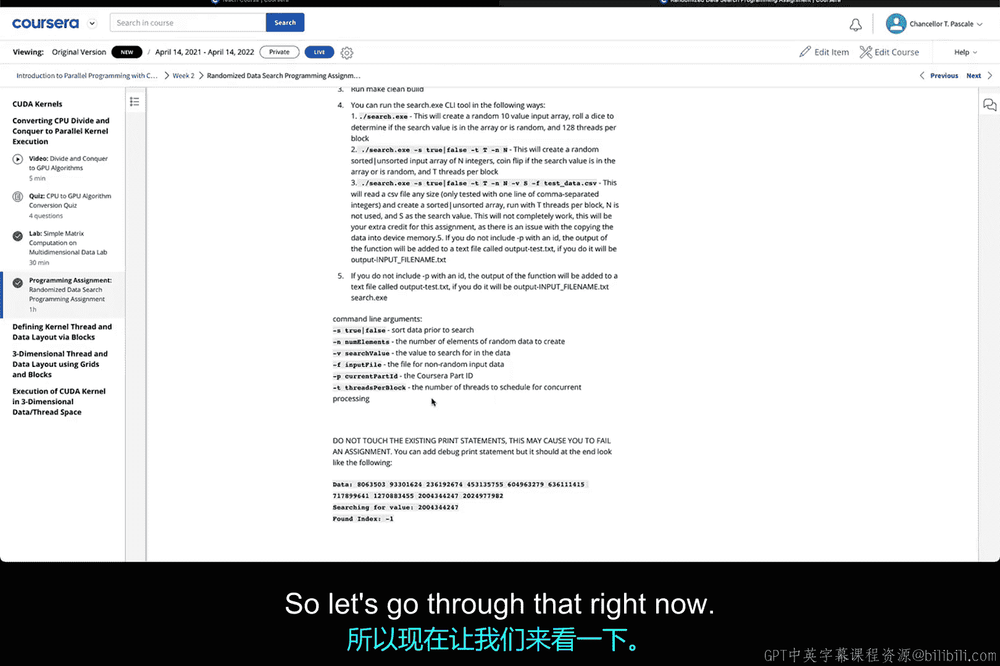
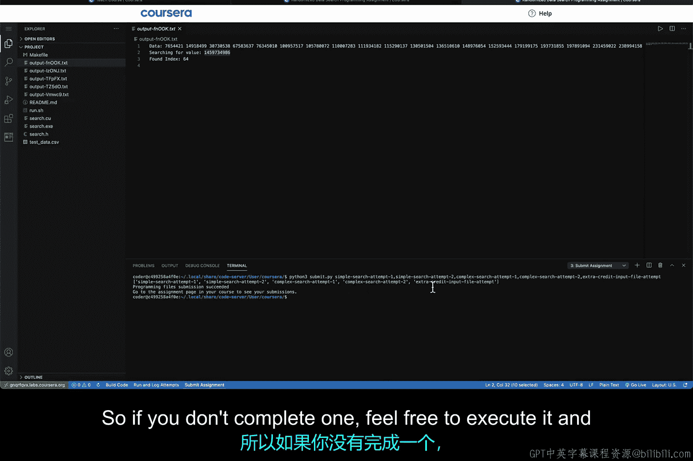
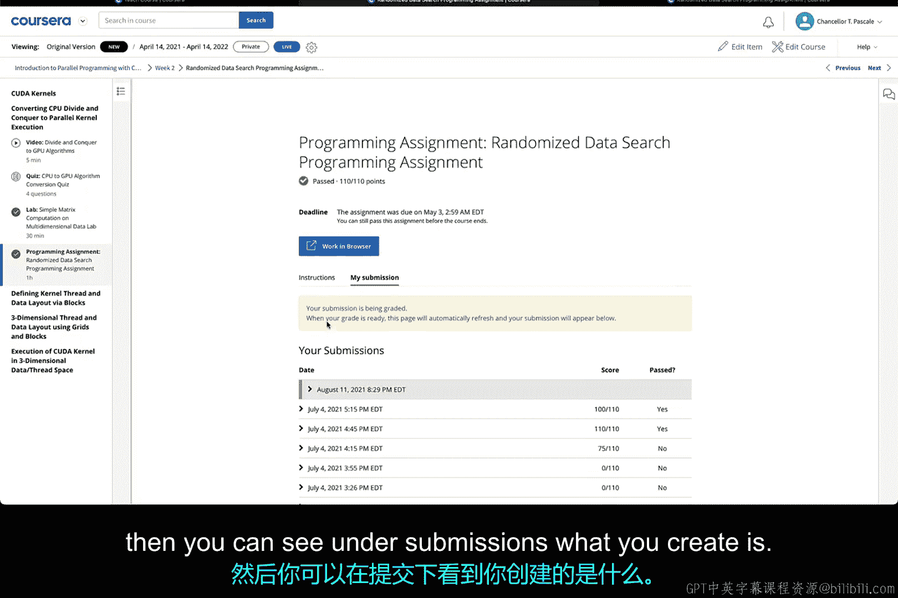
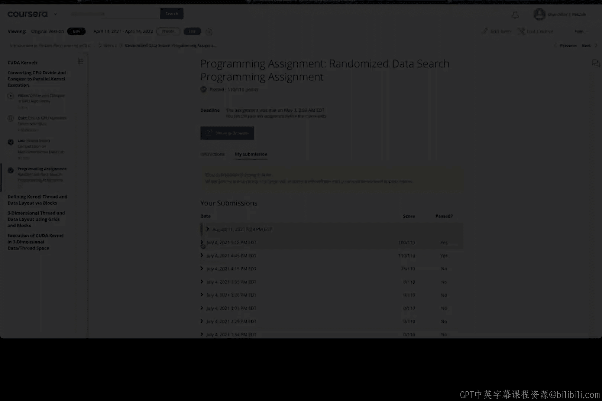

# 037：随机数据搜索作业指南 🎯

在本节课中，我们将学习如何完成第一个编程作业。这个作业的核心任务是：在随机生成的数据中搜索特定值。我们将使用一个已搭建好的程序框架，它能够接收不同的命令行参数来控制数据生成与搜索行为。

## 作业概述与要求 📋

现在，让我们开始第一个编程作业。在这个作业中，你将在一组随机数据中进行搜索，这与我们在实验课中看到的内容类似。

本作业的一个主要特点是，我构建了一个程序结构，它可以接收不同的命令行参数，用于指定：
*   数据是否需要排序。
*   将要创建的数据元素数量。
*   要搜索的目标值。
*   输入文件的文件名（如果使用文件输入）。
*   当前作业部分的ID（你通常不需要修改此项，因为它由评分工具使用）。
*   每个线程块中的线程数。

请注意，数据元素的数量应始终大于每个线程块的线程数。并非所有参数都必须提供，关于命令行工具的使用方法，在你编译程序后会进行讨论。

## 代码修改与调试指南 🔧

上一节我们了解了作业的整体要求，本节中我们来看看具体的代码修改和调试步骤。

**不要修改任何打印语句**。程序会输出输入数据、搜索值以及是否找到目标值等信息。我使用了预定义的数据，这就是为什么会有输入文件参数。在调试时，你可以随意添加额外的打印语句，但在完成后请确保将其移除。



你需要做的是进入项目文件夹（我们稍后会在编辑器中查看），然后修改搜索内核函数。之后，运行典型的 `make clean` 和 `make build` 命令来编译程序。编译完成后，你就可以根据指南使用这个工具了。

## 操作流程详解 🖥️

了解了代码修改要点后，接下来我们看看完整的操作流程。

你应该能在界面底部看到三个按钮：
1.  **构建代码**：运行 `make clean build`。这需要一些时间，请等待其完成。
2.  **运行并记录**：运行你的代码。该操作的第一步也会执行 `make clean build`，因此耗时相同。之后程序会运行，你会注意到生成了一系列以“output-”和作业部分ID命名的输出文件。这些文件包含了不同的数据输入、搜索值以及搜索结果。同时请注意，程序使用了不同的命令行参数组合。
3.  **提交**：当你完成后，可以点击此按钮提交。

## 搜索算法实现示例 💡

在开始动手之前，我们先来看一个搜索算法的简单示例，这与你们之前所做的没有太大不同。

以下是实现搜索算法的主要部分。大部分其他代码（如分配设备内存和主机内存、在两者之间复制数据、将内容输出到文件等）已经为你开发好了。你不需要修改这些部分。如果你想探索一下，可以自由尝试，但请确保输出格式与要求一致：即显示输入数据（来自文件或随机生成）、搜索值以及目标值在输入中的位置。这些输出会被自动检查，因此不要随意填写数字。程序执行时使用的值也会变化。

```c
// 搜索内核函数示例
__global__ void searchKernel(int* data, int searchValue, int* result, int N) {
    int idx = blockIdx.x * blockDim.x + threadIdx.x;
    if (idx < N && data[idx] == searchValue) {
        *result = idx; // 找到目标值，记录其索引
    }
}
```

## 提交与评分 📤

最后，当你点击提交按钮后，系统会提交本次作业的五个不同部分。这些部分是独立评估的，你的最终成绩是各部分权重得分的总和。如果你没有完成某一部分，也可以执行提交，然后在提交记录中查看你的成绩。

---







**本节课总结**：在本节课中，我们一起学习了如何完成随机数据搜索编程作业。我们了解了作业要求、需要修改的代码部分（主要是搜索内核）、通过界面按钮进行构建、运行和提交的完整流程，并预览了一个简单的搜索算法实现示例。记住，确保输出格式正确，并利用好提供的框架代码是成功完成作业的关键。