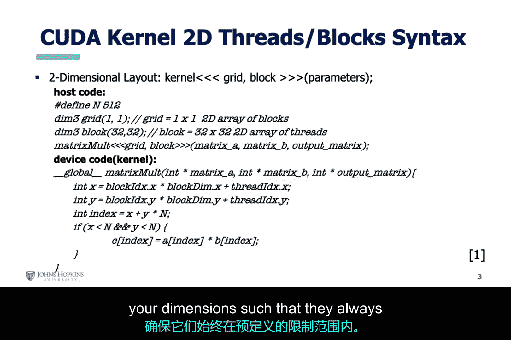
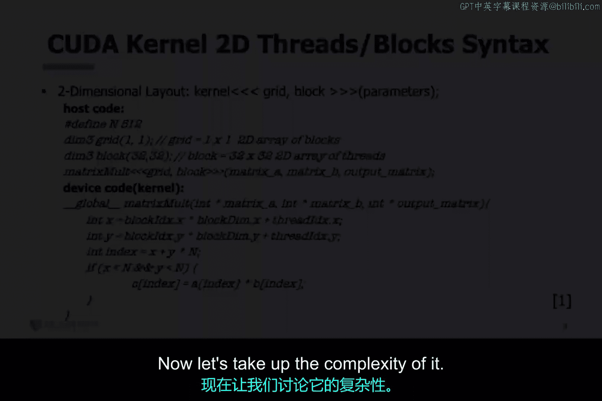

# 038：线程与线程块概念解析 🧵

在本节课中，我们将学习如何确定在GPU上执行的线程块（Block）中的线程（Thread）数量。我们将从最简单的一维布局开始，逐步深入到二维和三维布局，并理解如何计算每个线程在数据中的索引。

## 一维线程块布局

上一节我们介绍了GPU编程的基本概念，本节中我们来看看最简单的情况：一维线程块布局。

在主机（Host）代码中，我们定义了一个全局变量 `N`，其值为 `1618`。这个变量在主机和设备（Device）代码中都可用，用于定义输入输出数据的大小并限制对数据的越界访问。

以下是如何定义一个仅包含一个块、每个块有32个线程的内核启动方式：
```cpp
addKernel<<<1, 32>>>(A, B, C);
```
其中，`<<<1, 32>>>` 中的 `1` 表示网格（Grid）中有一个线程块，`32` 表示每个线程块包含32个线程。

设备内核函数使用 `__global__` 关键字标识，它接收三个整数数组 `A`、`B` 和 `C`。为了获取输入和输出数组的索引，我们首先需要处理所在线程块的偏移量。

由于我们只有一个块，块索引 `blockIdx.x` 始终为0。因此，索引主要由线程在块内的索引 `threadIdx.x` 决定。计算索引的公式如下：
```
index = blockIdx.x * blockDim.x + threadIdx.x
```
在这个一维例子中，`blockIdx.x` 为0，`blockDim.x` 为32，所以索引简化为 `threadIdx.x`。

我们必须始终检查计算出的索引是否在数据边界内（即小于 `N`，本例中为1618）。然后，内核函数执行计算 `C[index] = A[index] + B[index]`。

## 二维线程块布局

理解了线性布局后，现在让我们处理二维线程块布局。

在这种情况下，我们使用 `dim3` 数据类型来定义二维布局。网格仍然只在X和Y方向上各有一个块，因此块偏移量始终为0。每个块现在由32x32个线程组成。

内核启动方式如下：
```cpp
dim3 gridSize(1, 1);
dim3 blockSize(32, 32);
matrixMultiplyKernel<<<gridSize, blockSize>>>(A, B, C);
```

在设备代码中，我们需要计算每个线程在二维数据中的索引。以下是计算行（`row`）和列（`col`）索引的方法：
```
col = blockIdx.x * blockDim.x + threadIdx.x
row = blockIdx.y * blockDim.y + threadIdx.y
```
由于 `blockIdx.x` 和 `blockIdx.y` 均为0，索引再次简化为 `threadIdx.x` 和 `threadIdx.y`。

然后，我们需要将二维索引转换为一维数组索引。如果数组宽度为 `WIDTH`（例如512），则一维索引的计算公式为：
```
index = row * WIDTH + col
```
同样，必须检查 `row` 和 `col` 是否都小于数据维度 `N`（本例中为32），以确保索引有效。





## 三维线程块布局

最后，我们将复杂度提升一点，探讨三维线程块布局。

这里，我们需要将块布局指定为三维的，例如 `16 x 16 x 16`。网格仍然定义为 `1 x 1 x 1`，这意味着所有维度的块偏移量始终为0。

主机代码的更改主要在于 `dim3` 对象的初始化：
```cpp
dim3 gridSize(1, 1, 1);
dim3 blockSize(16, 16, 16);
kernel3D<<<gridSize, blockSize>>>(A, B, C);
```

设备代码变得更为复杂。直接分解出X、Y、Z索引并分别加上偏移量的方法虽然可行，但效率较低且不易阅读。更直接的计算一维索引的公式如下：
```
index = (blockIdx.z * blockDim.z + threadIdx.z) * (blockDim.y * blockDim.x) +
        (blockIdx.y * blockDim.y + threadIdx.y) * blockDim.x +
        (blockIdx.x * blockDim.x + threadIdx.x)
```
由于所有 `blockIdx` 分量均为0，公式可以简化为仅与 `threadIdx` 和 `blockDim` 相关。但核心思想是逐层计算偏移：先计算Z平面的偏移，再计算该平面内Y行的偏移，最后加上X方向的偏移。

与之前一样，最后一步是确保计算出的 `index` 没有超出输入数组的边界（本例中为 `16 x 16 x 16`）。

## 总结


本节课中我们一起学习了如何确定GPU内核中线程块和线程的数量。我们从最简单的一维布局开始，了解了如何计算线程索引并进行边界检查。接着，我们探讨了二维布局，学习了如何将二维线程索引映射到一维数据数组。最后，我们分析了更复杂的三维布局，理解了计算三维索引的通用方法。无论维度如何，养成检查索引是否越界的习惯对编写正确、安全的GPU代码至关重要。