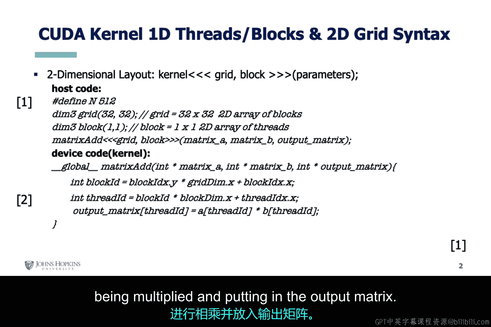
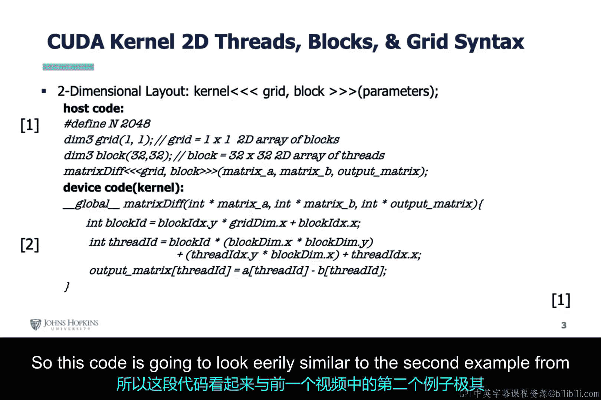
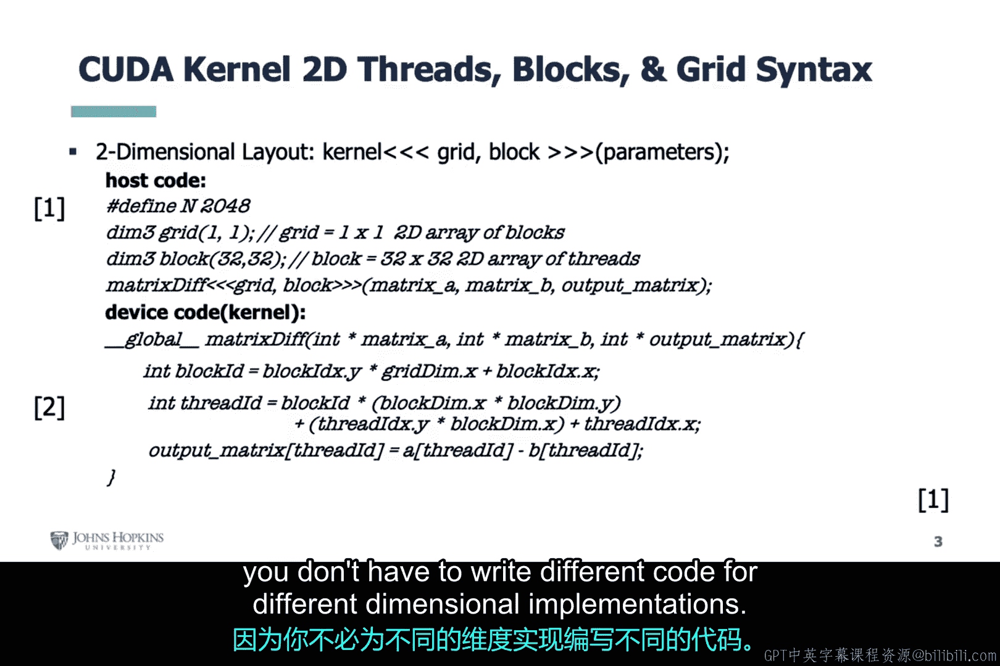
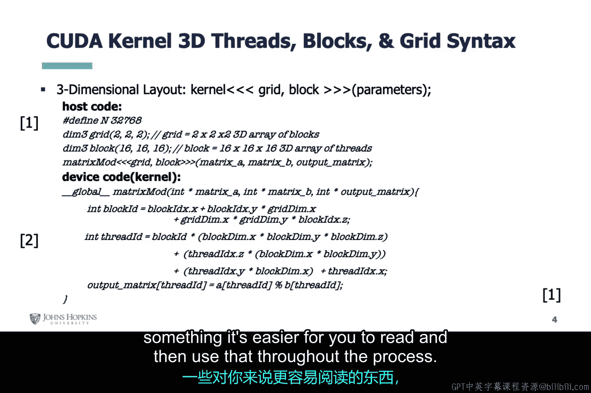

# 039：线程块与网格结构详解 🧩

在本节课中，我们将学习CUDA中线程、线程块和网格的布局结构。我们将从一维布局扩展到更复杂的二维和三维布局，并理解如何编写能够适应不同维度配置的通用内核代码。

上一节我们介绍了线程和线程块的基本概念，本节中我们来看看如何组织多维的线程块和网格。

## 网格与线程块的布局

在CUDA编程中，线程被组织成线程块，而线程块又被组织成网格。布局可以从一维扩展到三维，甚至在某些情况下可以支持到六维。虽然这听起来可能有些复杂，但请理解，这里展示的是所有可能性，在实际编码中可能只会用到其中的一小部分。我们将简化内容，专注于线程块和网格的布局。

## 一维线程块与二维网格

首先，我们来看一个简单的例子：线程块采用一维布局，而网格采用二维布局。

*   **线程块布局**：一维，每个块包含一个线程。
*   **网格布局**：二维，大小为 `32 x 32`。
*   **数据规模**：输入数据最大为512个元素。

需要注意的是，由于网格规模（`32*32=1024`个线程）大于输入数据规模（512个元素），很可能有一半的线程会访问到输入或输出数组的有效范围之外。虽然示例代码中没有进行检查，但在实际的设备代码中，**必须**添加边界检查。

在主机代码中，你只需要更改 `dim3` 类型的网格变量值，并使用相同的线程块配置来调用内核。设备代码中的关键变化在于计算**块索引**。

以下是计算全局线程索引的核心思路：

1.  **确定块索引**：你需要根据线程在网格中的X和Y维度位置来计算当前线程块在网格中的唯一ID。
2.  **确定线程索引**：在确定了块索引后，再计算线程在其所属块内的局部ID。这个计算方式与之前学过的类似。

这样做的目的是将复杂性转移到块索引的计算上，从而使线程索引的计算保持相对简单。当你使用更多维度时，则需要在两个部分都进行计算。

## 二维线程块与二维网格



接下来，我们看一个更通用的例子：线程块和网格都采用二维布局。




实际上，即使你声明网格是 `1 x 1`，它在技术上也是二维的。这里的线程块采用了二维布局。

与之前示例的唯一区别在于：在之前的简单一维线程块例子中，我们默认网格在Y维度的偏移量为0，因此无需考虑。但现在，我们需要显式地计算块在网格二维空间中的位置。

这种实现的优势在于其**适应性**。即使网格大小发生变化，这个内核依然可以工作，因为块索引是通过相同的通用公式计算的。这个公式与上一张幻灯片中的计算本质相同。

线程索引的计算现在稍微复杂一些，因为我们需要显式地处理X和Y两个维度。而在之前的一维线程块例子中，我们知道Y维度的偏移量始终为0，所以无需担心。

这种为网格和线程块都实现二维布局的方式，使其能够适应 `1D x 1D`、`2D x 2D` 或 `2D x 1D` 等各种布局组合。因此，这段代码实际上更有用，因为你不必为不同维度的实现编写不同的代码。

## 三维线程块与三维网格

现在，让我们进入最复杂的例子：线程块和网格都采用三维布局。



在主机代码中，你将网格和线程块都定义为 `dim3` 类型，并指定为三维。例如，网格可以是 `2 x 2 x 2`，而每个线程块可以是 `16 x 16 x 16`。


在设备代码中，定义块索引现在需要包含Z维度的索引作为乘数。

以下是计算全局线程索引的通用公式思路：

1.  **计算块偏移**：现在增加了第三个维度（Z），你需要计算块在X、Y、Z三个维度上的整体偏移量。
2.  **计算线程偏移**：你的线程ID使用块ID作为其偏移计算的一部分，然后分别乘以它在X、Y、Z维度上的大小，并加上线程在块内的局部索引。

对应的代码逻辑如下（概念性表示）：
```cpp
// 计算块在网格中的全局起始索引
int blockOffsetX = blockIdx.x * blockDim.x;
int blockOffsetY = blockIdx.y * blockDim.y;
int blockOffsetZ = blockIdx.z * blockDim.z;

// 计算线程在全局网格中的唯一索引
int threadGlobalIdX = blockOffsetX + threadIdx.x;
int threadGlobalIdY = blockOffsetY + threadIdx.y;
int threadGlobalIdZ = blockOffsetZ + threadIdx.z;

// 然后将 threadGlobalIdX, Y, Z 映射到你的数据数组索引
```
这看起来有些复杂，但你可以习惯它。这样做的好处是**极强的适应性**：如果你的网格在任何维度上都没有扩展（即大小为1），那么对应的块索引（`blockIdx`）将为0，这个公式依然成立。因为内核启动时的上下文总是会设置这些维度值（即使为1），所以这段代码可以适应任何维度的数据布局。

你可能需要花时间理解它，或者找到一种对你而言更易读的写法，并在整个编程过程中坚持使用。




## 总结


本节课中我们一起学习了CUDA中线程块与网格的多维布局结构。我们从简单的一维线程块与二维网格开始，逐步深入到二维和三维的通用布局。核心在于掌握计算全局线程索引的通用方法，即结合**块索引**和**线程索引**，并考虑各个维度的规模。通过编写这种具有适应性的内核代码，我们可以用同一段代码灵活处理不同维度的数据布局，而无需为每种情况单独编写代码。记住，始终在内核中添加边界检查，以防止线程访问越界。