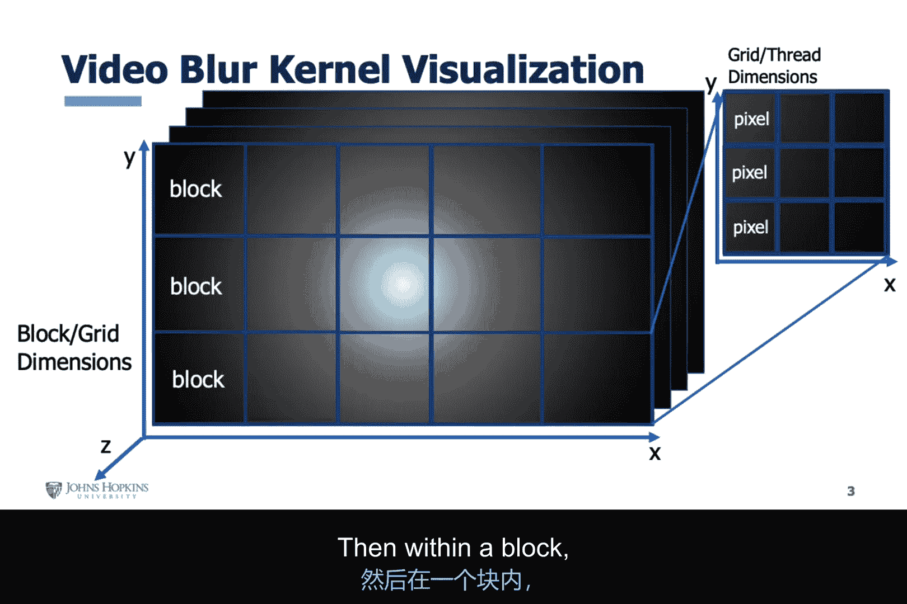
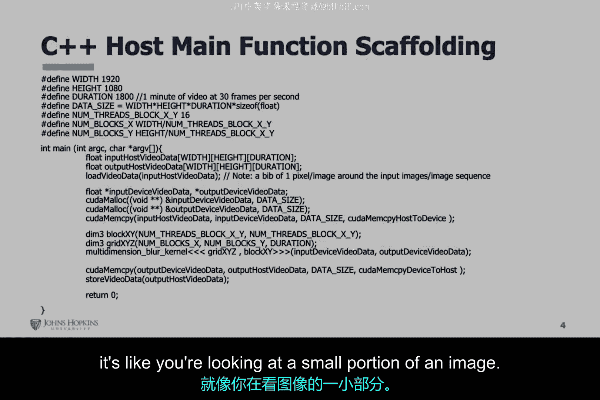
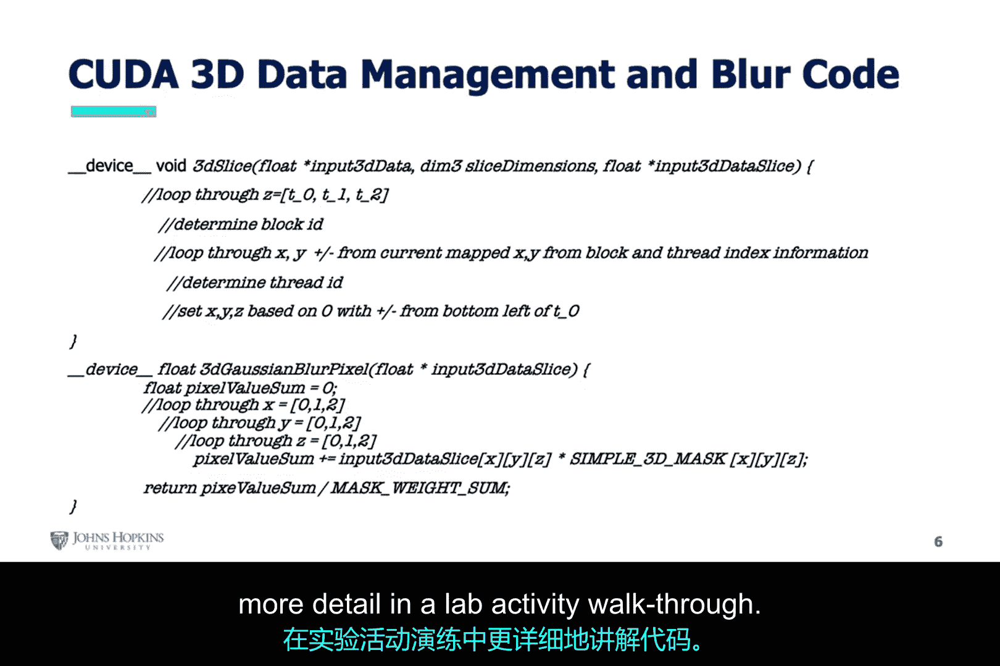

# 040：多维高斯模糊核函数实例 🎬

在本节课中，我们将学习一个具体的GPU编程实例：一个用于视频处理的多维高斯模糊核函数。我们将探讨其设计思路、线程组织方式以及核心算法的实现。

## 概述

我们将分析一个执行三维高斯模糊的CUDA核函数。其中，三维指的是图像的空间维度（X和Y）以及时间维度（帧序列）。这个核函数会对视频中的每一帧图像进行模糊处理，同时考虑相邻帧的影响，从而实现跨时间的平滑效果。

## 核函数设计思路

上一节概述了多维高斯模糊的应用场景，本节中我们来看看其具体的设计模式。

核函数处理的是一个三维数据体：两维是图像的X和Y坐标，第三维是时间（视频帧序列）。X和Y维度通过线程块（blocks）和线程（threads）来并行执行，而时间维度则在网格（grid）层面进行处理。

其核心思想是：对于输出视频中的每一个像素点，我们不仅查看当前帧中该点周围3x3区域的像素，还会查看前一帧和后一帧对应位置的3x3区域。这形成了一个3x3x3的“立方体”滑动窗口。为了简化边界条件处理，我们会在输入图像的四周以及视频序列的首尾添加一圈“边框”像素（例如填充为白色或0值）。这样，核函数在访问相邻像素时，就无需额外判断是否越界，尽管边界处的模糊效果会不太理想。


## 线程与数据空间可视化

理解了设计模式后，我们需要明确线程是如何组织并映射到数据上的。

线程的组织方式如下：
*   在网格（Grid）层面：处理不同的视频帧（Z/时间维度）。
*   在线程块（Block）层面：处理单帧图像中不同区域的像素（X和Y维度）。
*   在线程（Thread）层面：每个线程负责计算输出视频中一个特定像素（在特定帧的特定位置）的新值。

可以想象，每个线程会聚焦于一个小的3x3图像区域，并且这个区域会随着时间（前后帧）延伸，形成一个3x3x3的数据立方体。该线程计算出的新像素值，就是这个立方体中心点的模糊结果。





## 主机端代码框架

接下来，我们看看启动这个核函数的主机端（CPU）代码需要做哪些准备工作。

主机端代码主要完成数据准备、内存管理和核函数启动任务。以下是关键步骤：

1.  **定义并加载数据**：声明用于存储输入和输出视频数据的三维数组（例如`float input_data[Z][Y][X]`），并将视频数据加载到输入数组中。
2.  **分配设备内存**：使用`cudaMalloc`在GPU上为输入和输出数据分配显存。
3.  **拷贝数据至设备**：使用`cudaMemcpy`将主机内存中的输入视频数据拷贝到GPU显存中。
4.  **定义执行配置**：根据视频分辨率（如1920x1080）和总帧数，计算并定义`dim3`类型的网格（grid）和线程块（block）布局，确保能覆盖所有像素。
5.  **启动核函数**：调用多维高斯模糊核函数，并传入定义好的执行配置以及设备内存指针等参数。
6.  **取回并存储结果**：核函数执行完毕后，使用`cudaMemcpy`将GPU显存中的输出数据拷贝回主机内存，并保存为处理后的视频文件。

## 设备端核函数框架

现在，我们将焦点转移到在GPU上实际运行的设备端核函数代码。

核函数本身是三维的。它使用一个3x3x3的掩码（mask）或卷积核，其中中心点的权重最高，随着与中心点距离的增加，权重递减。这个掩码所有值的总和用于计算归一化的加权平均值。

在核函数内部，每个线程需要执行以下操作：
*   **确定数据切片**：根据线程的全局索引（对应输出图像的某个像素位置），获取输入数据中对应的3x3x3数据立方体。这是通过一个辅助函数（如`get3DSlice`）完成的。
*   **应用高斯模糊**：将获取到的3x3x3数据切片与预定义的高斯权重掩码进行卷积运算。
*   **计算输出**：对加权求和的结果进行归一化（除以权重总和），得到该像素的模糊后值，并写入输出数组的对应位置。

## 核心算法伪代码详解

最后，我们来深入理解核函数中两个最核心部分的算法逻辑。

以下是关键方法的伪代码说明：

**1. 获取3D数据切片 (`get3DSlice`)**
此方法的目的是根据当前线程的坐标，从输入数据中提取一个3x3x3的立方体。

```pseudocode
函数 get3DSlice(当前线程坐标 threadIdx, 输入数据 inputData):
    初始化一个 3x3x3 的数组 slice
    for dz in [-1, 0, 1]: // 时间维度（前后帧）
        for dy in [-1, 0, 1]: // Y维度（上下行）
            for dx in [-1, 0, 1]: // X维度（左右列）
                计算源坐标 src_x = threadIdx.x + dx
                计算源坐标 src_y = threadIdx.y + dy
                计算源坐标 src_z = threadIdx.z + dz
                将 inputData[src_z][src_y][src_x] 的值存入 slice[dz+1][dy+1][dx+1]
    返回 slice
```

**2. 执行3D高斯模糊 (`apply3DGaussianBlur`)**
此方法对获取到的数据切片应用高斯权重并计算加权平均值。

```pseudocode
函数 apply3DGaussianBlur(数据切片 dataSlice, 高斯掩码 gaussianMask):
    初始化 加权和 weightedSum = 0
    初始化 权重总和 totalWeight = 0

    for z in 范围(3):
        for y in 范围(3):
            for x in 范围(3):
                像素值 pixelValue = dataSlice[z][y][x]
                权重 weight = gaussianMask[z][y][x]
                weightedSum += pixelValue * weight
                totalWeight += weight

    // 计算加权平均值作为输出像素值
    输出像素值 = weightedSum / totalWeight
    返回 输出像素值
```

高斯掩码 `gaussianMask` 是一个3x3x3的数组，其值符合三维高斯分布，中心值最大，向边缘递减。所有权重之和应为1（或另一个常数，用于归一化）。


## 总结



本节课中，我们一起学习了一个三维高斯模糊CUDA核函数的完整实例。我们从其处理视频数据的应用场景出发，逐步分析了线程在多维空间（X, Y, 时间）的组织映射方式、主机端管理数据和启动核函数的流程，以及设备端核函数获取数据切片并进行加权平均模糊计算的核心算法。通过这个例子，我们看到了如何将经典的图像处理算法（高斯模糊）扩展到时域，并利用GPU的并行架构高效实现。在后续的实践环节中，我们将逐行分析具体的代码实现。