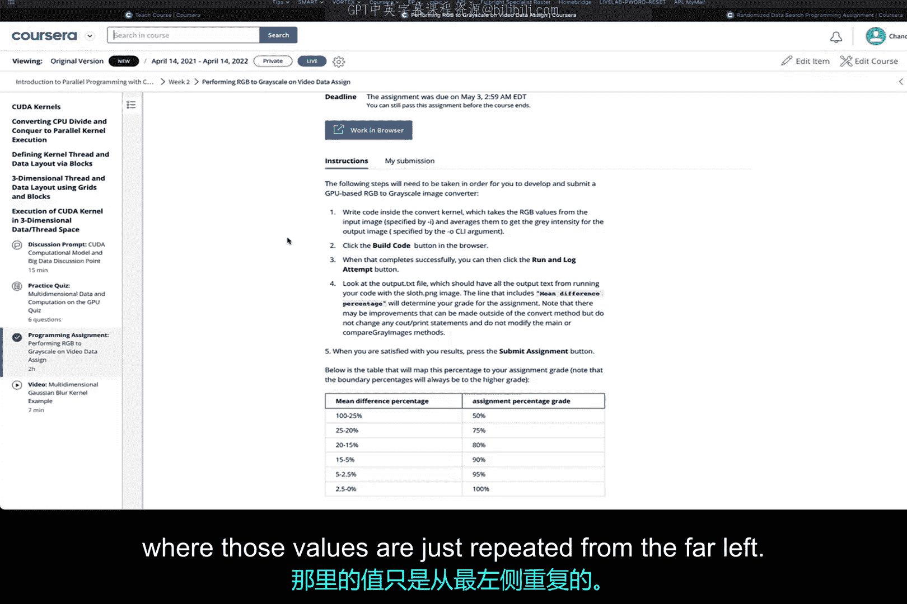
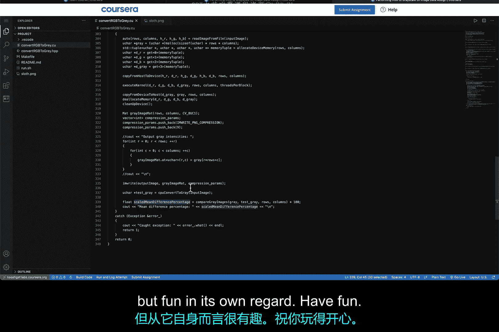
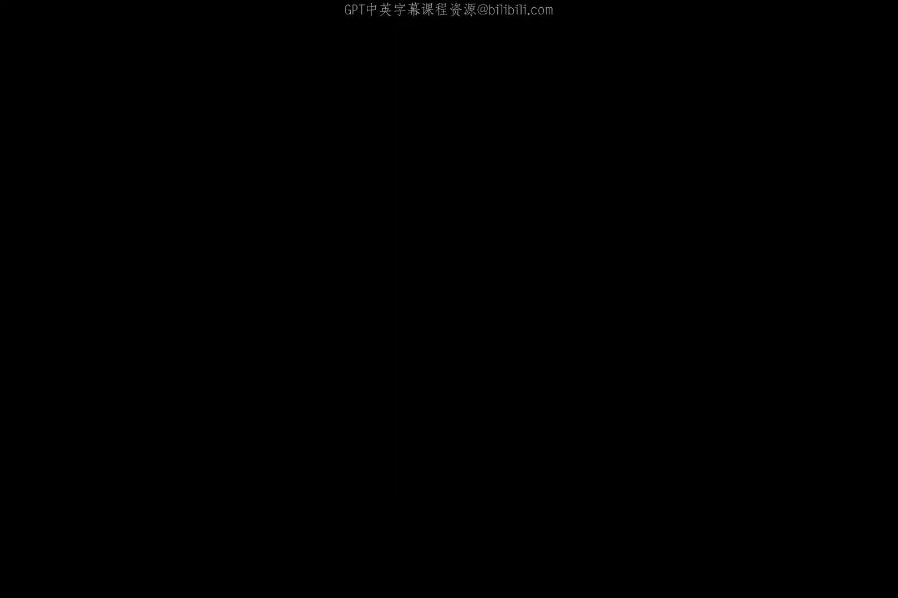

# 041：图像处理作业指南 🖼️

在本节课中，我们将学习第二个编程作业：使用GPU将彩色图像转换为灰度图像。我们将介绍作业要求、核心算法、评分机制以及代码实现的关键部分。

## 作业概述

作业要求你读取一张图像，将其RGB值转换为灰度值。最低要求是实现一个简单的平均算法。虽然作业不强制处理视频，但你可以将视频分解为图像序列并应用此过程。

## 作业结构与评分

以下是作业的常规流程：
*   你需要构建代码，执行 `make`、`clean` 和 `run` 命令。
*   程序会运行生成的可执行文件，并输出一张灰度图像。

评分基于一个“平均差异百分比”的计算。系统会将你的GPU内核实现的结果与一个CPU版本的算法结果进行比较。

具体计算方式如下：
*   对于图像中的每个像素（坐标X和Y），比较GPU结果与CPU结果的差异值（范围0到1）。
*   对所有像素的差异值求平均。
*   将这个平均差异值映射到0-255的范围，并计算百分比误差。

评分标准如下：
*   如果误差在 **100% 到 25%** 之间，得分为 **50%**。
*   如果误差在 **2.5% 到 0%** 之间，得分为 **100%**。

只需实现简单的平均算法，你就能轻松获得80分。但要获得90到100分，需要调整图像数据在内存中行（Y）与列（X）的读取方式，否则输出图像右侧可能会出现重复的条纹。

## 核心算法：RGB转灰度

你的提交中最关键的部分是实现 `convertToGray` 内核函数。该函数接收三个 `unsigned char` 类型的指针，分别代表红（R）、绿（G）、蓝（B）通道，并输出一个 `unsigned char` 类型的灰度值。所有值的范围都是0到255。

其核心公式是计算RGB三个通道强度的平均值：
`gray = (red + green + blue) / 3`

每个GPU线程将执行一个内核，处理其对应位置的RGB值，通过上述平均计算得到该像素的灰度强度。虽然这不是最完美的灰度转换方法，但效果相当不错。

## 代码框架解析

上一节我们介绍了核心算法，本节中我们来看看提供的代码框架。

代码中已包含其他辅助函数：
*   一个函数用于比较GPU生成的灰度图像与CPU版本的结果。
*   一个函数用于执行内核。
*   内存释放和设备清理工作已处理，你无需担心。
*   命令行参数解析也已完成。

在用于评估的CPU版本（`convert_to_gray_cpu`）中，代码使用OpenCV读取图像并直接转换为灰度图，以确定目标行数和列数，并填充指针数组。其内存索引方式为：`R * rows + C`，其中 `R` 代表行（Y），`C` 代表列（X）。

主函数的逻辑清晰：
1.  读取输入图像。
2.  执行你的GPU内核。
3.  写入GPU生成的灰度图像。
4.  生成用于测试的CPU灰度图像。
5.  计算并输出决定你成绩的“缩放平均差异百分比”。

## 总结

本节课中我们一起学习了第二个编程作业的完整指南。你了解了作业目标是将RGB图像转换为灰度图像，掌握了基于平均算法的核心转换公式 `gray = (R+G+B)/3`，熟悉了基于“平均差异百分比”的评分机制，并浏览了代码框架中已实现的部分与你需要完成的核心内核。这是一个简单但有趣的图像处理入门实践，祝你编码愉快！