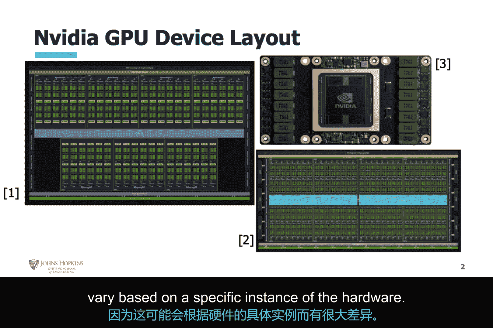
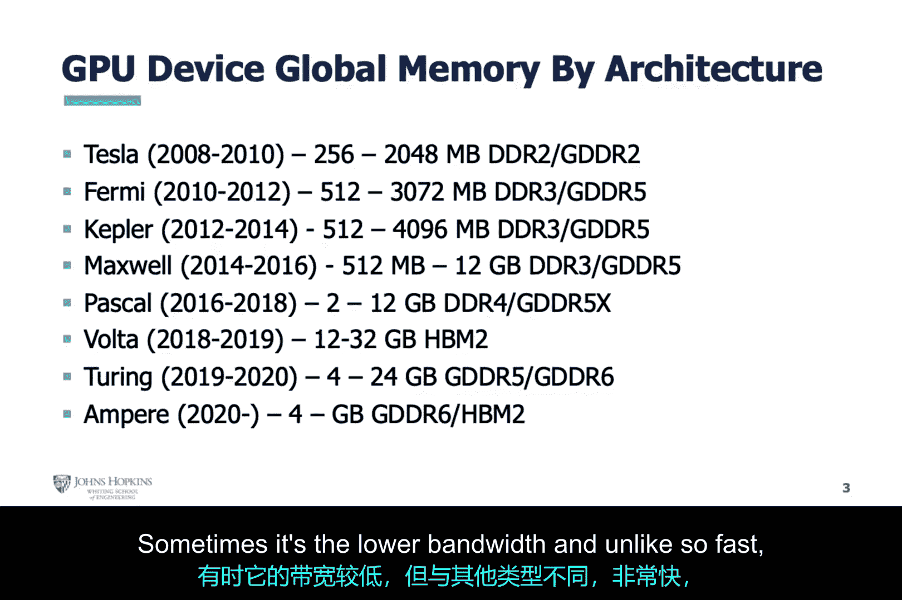
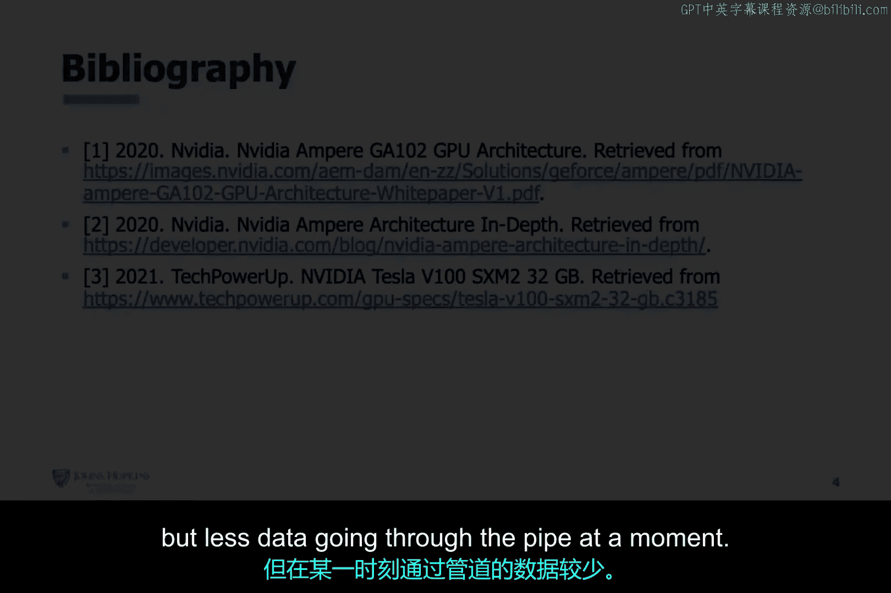

# 042：NVIDIA GPU设备全局内存 🧠

在本节课中，我们将学习NVIDIA GPU设备上的全局内存。我们将了解其物理布局、不同架构下的容量演变以及内存类型。

## 全局内存的物理布局

上一节我们介绍了课程主题，本节中我们来看看GPU上全局内存的物理布局。下图展示了三种GPU的全局内存布局。在所有情况下，全局内存都位于示意图的左右两侧或实际显卡上。

图1和图2展示了采用安培架构的GPU及其内存控制器示意图。图3位于右上角，展示了一块实际的GPU。可以看到，共有16个内存控制器，位于示意图的左右两侧。在实际的GPU设备示意图中，通常不会明确标出全局内存，或者仅用通用方框表示。这是因为不同硬件实例的全局内存容量差异很大，厂商不希望为特定架构指定具体容量。

## 不同架构的全局内存容量

了解了物理布局后，我们来看看不同架构下全局内存的容量范围及其代际演变。大约每两年，CUDA就会推出一个新的架构。以下是各代架构的全局内存容量范围：

*   **低端容量**：指该架构下GPU的最小全局内存容量。
*   **高端容量**：指该架构下GPU的最大全局内存容量。

你会注意到，前三个架构的低端和高端容量都相对适中。直到麦克斯韦架构，内存容量出现了大约三倍的增长。这是因为从这个时期开始，出现了专门为服务器或GPU集群设计的GPU。

从那时起，你会观察到每一代架构的容量都在稳步增长，有时甚至每代翻倍，无论是低端还是高端容量。这意味着可用的全局内存越来越多，这允许你的应用程序在每个线程中处理越来越多的数据。请务必充分利用这一点。

需要注意的是，由于我们正处于安培架构的中期，因此未列出其高端容量上限。

## 内存类型

除了容量，内存类型也是关键因素。下图右侧标注了各代架构使用的内存类型：

以下是主要的内存类型：

*   **DDR2, DDR3, DDR4, DDR5, GDDR2-GDDR5**：这些是不同类型的内存，与你在CPU上看到的内存非常相似。
*   **HBM / HBM2**：这是高带宽内存。当你看到HBM时，这意味着这是专门为GPU设计的内存。它往往速度非常快，但有时带宽较低，意味着在任何时刻通过管道的数据量较少，但传输速度极快。

## 总结

本节课中，我们一起学习了NVIDIA GPU的全局内存。我们了解了全局内存通常位于GPU芯片的左右两侧，通过多个内存控制器进行管理。我们回顾了从早期架构到现代架构的全局内存容量增长趋势，特别是从麦克斯韦架构开始，为服务器设计带来了容量的大幅提升。最后，我们认识了不同的内存类型，从通用的DDR/GDDR系列到专为GPU设计的高带宽HBM内存。理解这些特性有助于你更好地为应用程序分配和利用GPU内存资源。