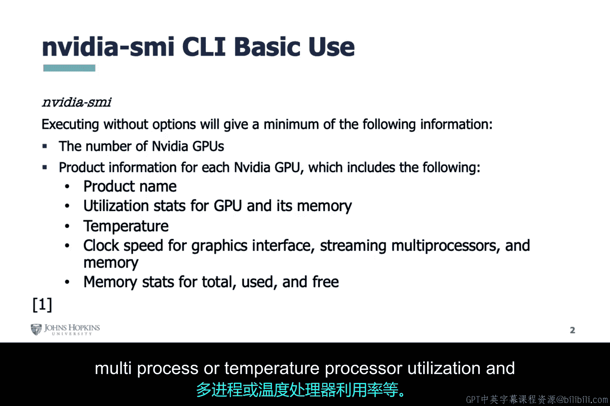
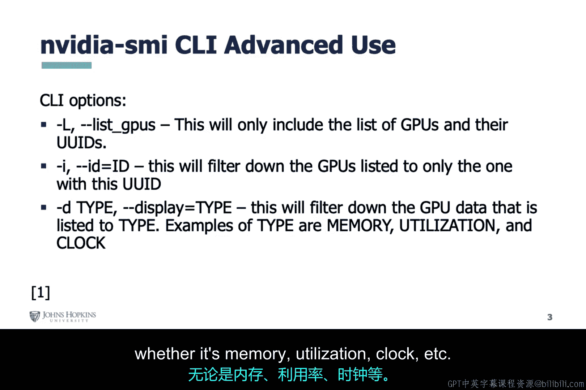
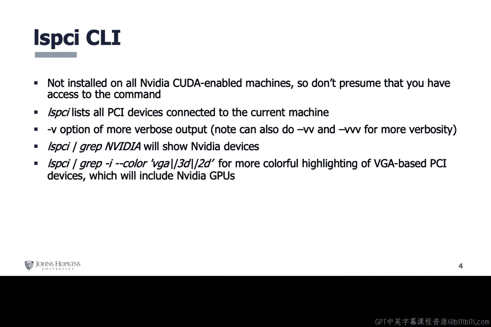

# 043：Linux命令行GPU设备识别 🖥️🔍

在本节课中，我们将学习如何在Linux命令行环境下，使用可用的工具来识别GPU设备的特定功能，其中之一是全局内存的容量与带宽。

## 识别GPU设备信息 🧐

上一节我们介绍了课程概述，本节中我们来看看具体的命令行工具。`nvidia-smi` 命令是NVIDIA提供的一个非常实用的工具，用于监控和管理GPU设备。

在不带任何参数的情况下运行 `nvidia-smi` 命令，它会列出系统中所有的NVIDIA GPU。对于每一块GPU，它会显示诸如内存容量、图形接口时钟频率、流式多处理器温度、处理器利用率等多项信息。

## `nvidia-smi` 命令选项 ⚙️

了解了基本命令后，我们来看看 `nvidia-smi` 的一些常用选项，它们可以帮助我们获取更具体的信息。

以下是 `nvidia-smi` 的几个关键命令行选项：
*   `-L` 或 `--list-gpus`：此选项仅列出GPU及其UUID（通用唯一识别码）。
*   `-i` 或 `--id`：此参数允许你指定一个特定的GPU ID，并只返回与该ID匹配的GPU信息。
*   `-q` 或 `--query`：此选项用于指定你希望获取的统计数据类型，例如内存使用情况、利用率、时钟频率等。

## 使用 `lspci` 命令 🔧

除了NVIDIA专属工具，Linux系统还有一个通用的硬件信息查询命令 `lspci`。

`lspci` 命令用于列出所有连接到机器的PCI设备信息。这个命令可能并非在所有机器上都默认可用，但它能提供非常详尽的硬件信息。你可以通过管道和 `grep` 命令来筛选信息，例如使用 `lspci | grep -i nvidia` 来只显示NVIDIA设备。此外，你还可以选择不同的信息详细程度（verbosity），并为输出信息着色，使其更易于阅读和理解。

## 总结 📝

本节课中我们一起学习了在Linux命令行下识别GPU设备信息的方法。我们主要介绍了 `nvidia-smi` 命令及其常用选项（`-L`, `-i`, `-q`），用于获取NVIDIA GPU的详细状态和性能数据。同时，我们也了解了通用的 `lspci` 命令，它可以用来查看包括GPU在内的所有PCI设备信息，并通过过滤和着色功能使输出更清晰。掌握这些工具是进行GPU编程和系统管理的基础。