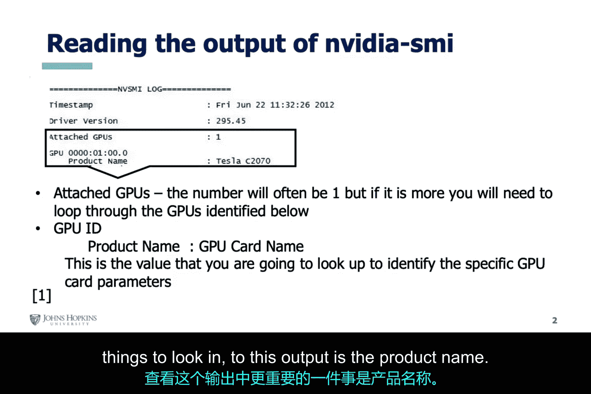
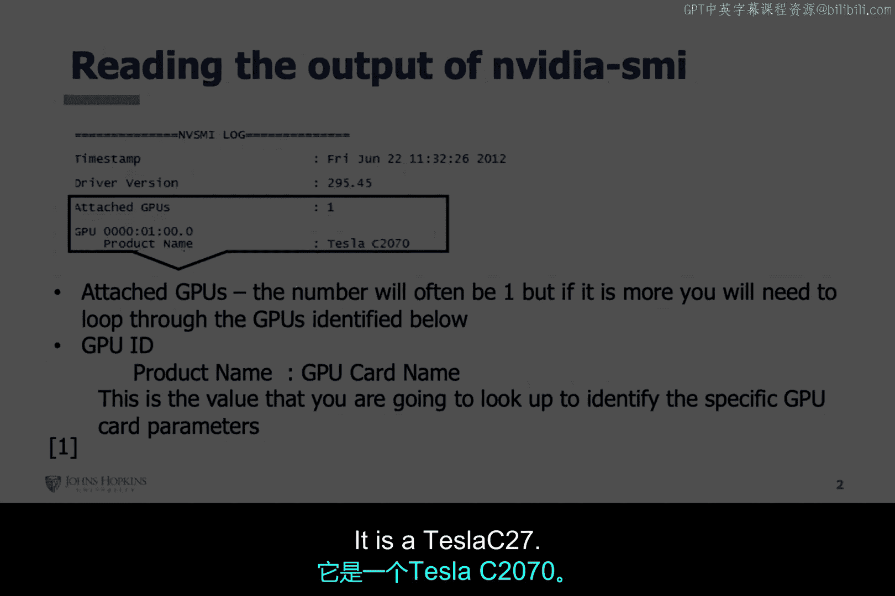
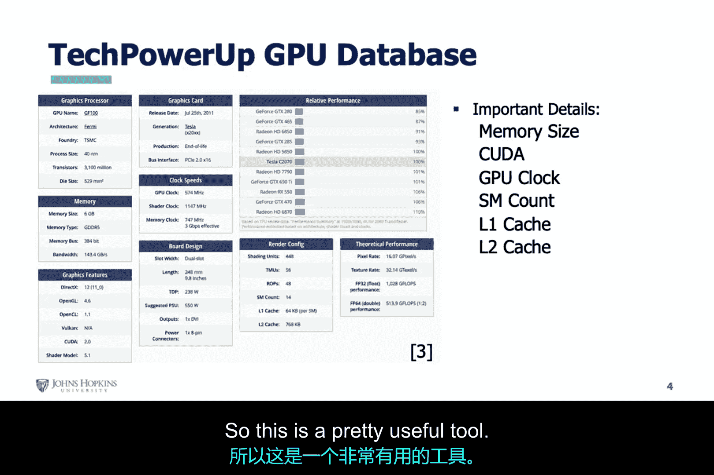

# 044：GPU全局内存研究

在本节课中，我们将学习如何获取GPU设备的标识符，并查明其全局内存容量及其他硬件能力。我们将通过多种工具和数据源来获取这些信息。

## 获取GPU设备信息

上一节我们介绍了课程目标，本节中我们来看看如何获取GPU的基本信息。一个直接的方法是使用NVIDIA提供的系统管理接口命令。

以下是使用 `nvidia-smi` 命令获取信息的示例：

```
nvidia-smi
```



该命令会输出连接到当前主机的所有NVIDIA GPU信息。在示例中，系统连接了一块GPU。输出信息中，**产品名称**是一个关键项，例如，它可能显示为“Tesla C2070”。



## 查阅在线数据库

除了命令行工具，我们还可以借助在线数据库来获取更详细的GPU规格信息。这有助于我们理解设备的硬件限制和潜力。

### 维基百科列表

维基百科上有一个详尽的NVIDIA GPU列表，涵盖了包括CUDA架构推出之前的历代产品及其相关统计数据。

以下是查找“Tesla C2070”的步骤：
1.  访问维基百科的NVIDIA GPU列表页面。
2.  在页面中搜索“Tesla C2070”。
3.  在搜索结果中，可以找到该显卡的详细规格，例如高亮区域显示其拥有 **6 GB的GDDR5显存**。

### TechPowerUp GPU数据库

另一个数据源是TechPowerUp网站，它提供了一个GPU数据库，可以更直观、便捷地查找特定显卡的所有信息。

该数据库提供的信息包括：
*   **处理器**规格
*   **内存**信息（再次确认是6 GB GDDR5）
*   内存带宽和总线宽度
*   关于显卡的各种详细信息
*   甚至提供相对性能比较

这是一个非常有用的工具，可以帮助开发者全面了解其GPU硬件。



## 总结


本节课中我们一起学习了如何研究GPU的全局内存。我们首先使用 `nvidia-smi` 命令获取了GPU的设备标识和基础信息。接着，我们介绍了两个重要的在线资源——维基百科的GPU列表和TechPowerUp的GPU数据库——来查询更详细的硬件规格，特别是全局内存的容量和类型。掌握这些信息对于进行GPU编程和优化至关重要。