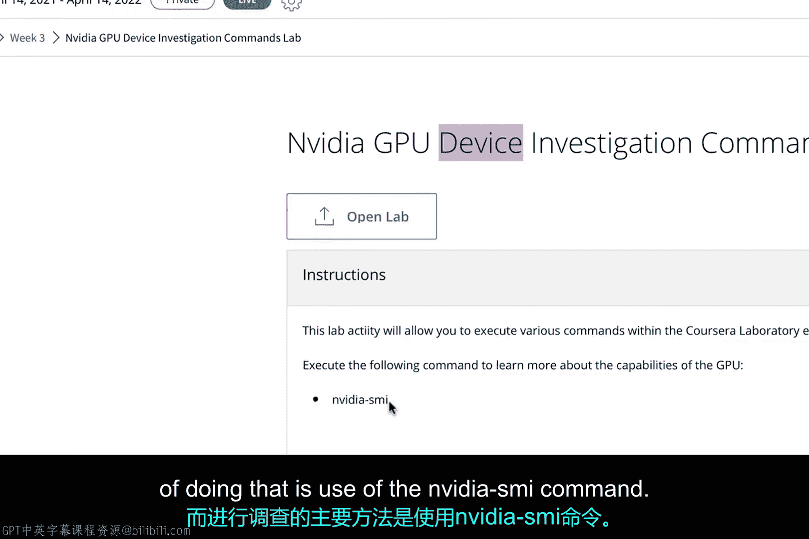
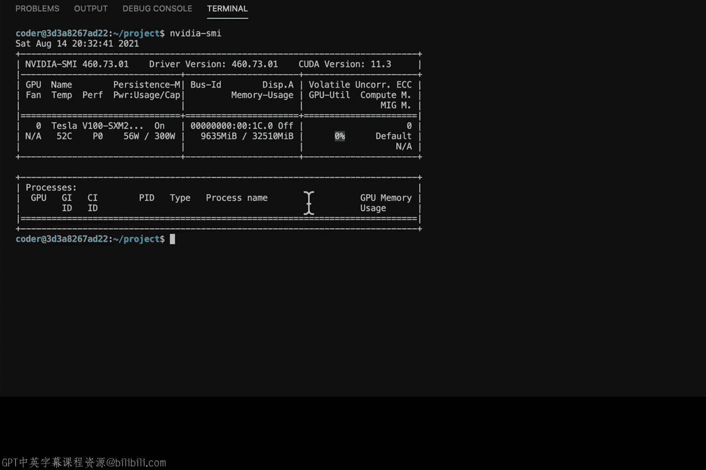

# 045：NVIDIA GPU设备检测命令实验 🖥️

在本节课中，我们将学习如何使用NVIDIA系统管理接口命令来检测和获取GPU设备的详细信息。这是进行GPU编程前了解硬件环境的关键步骤。

## 概述与准备工作

上一节我们介绍了GPU编程的基础概念，本节中我们来看看如何具体地检测和了解你的NVIDIA GPU硬件。



首先，确保你的系统已安装NVIDIA驱动和CUDA工具包。准备工作完成后，打开一个终端窗口。

## 执行NVIDIA-SMI命令

以下是执行设备检测的核心命令。在终端中输入此命令以获取GPU信息。

```bash
nvidia-smi
```

执行该命令后，系统将打印出关于GPU的重要信息。这些信息对于后续的编程和性能调优至关重要。

## 解读命令输出信息

命令的输出包含多个部分，每一部分都提供了GPU的不同维度的状态数据。

*   **头部信息**：显示`nvidia-smi`工具的版本、驱动版本以及CUDA版本。
*   **GPU标识**：显示GPU处理器的具体型号（例如Tesla V100）。
*   **功耗与温度**：提供GPU的当前功耗、最大功耗限制以及当前温度。
*   **内存使用情况**：显示GPU显存的总量、当前使用量以及剩余量。
*   **GPU利用率**：以百分比形式显示GPU的计算核心利用率。
*   **进程信息**：列出当前正在使用该GPU的所有进程及其资源占用情况。

## 总结



本节课中我们一起学习了如何使用`nvidia-smi`命令来检测NVIDIA GPU设备。我们了解了命令的输出结构，并学会了如何解读关键的硬件信息，如GPU型号、驱动版本、功耗、温度、内存使用率和运行进程。掌握这些信息是进行高效GPU编程和系统管理的基础。