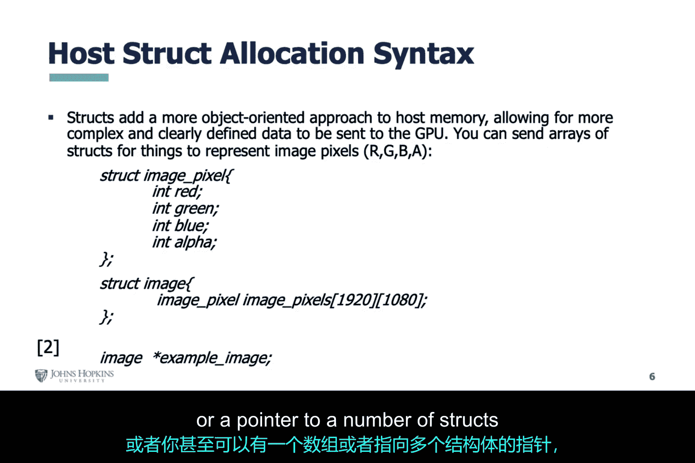
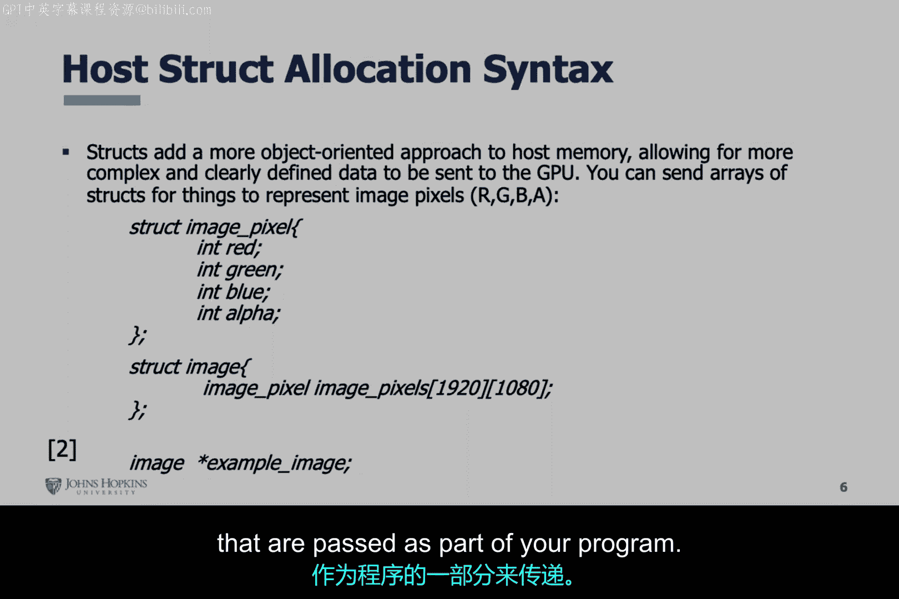

# 046：主机内存分配机制 🧠

在本节课中，我们将学习如何为主机（CPU）分配内存，这是将数据传输到GPU的第一步。理解不同的内存类型及其分配方式，对于优化GPU程序的性能至关重要。

## 主机内存类型概述

在CUDA编程中，主机内存主要有四种类型：可分页内存、固定内存、映射内存和统一内存。可分页内存是默认类型。数据通常先在CPU上分配内存，然后传输到固定内存，最后再传输到设备内存。

上一节我们介绍了内存传输的基本流程，本节中我们来看看每种内存类型的具体特性和分配方法。

### 可分页内存

可分页内存是CPU程序的默认内存分配方式。它的分配速度最慢，因为在数据传输到GPU之前，需要先将数据复制到一个临时的“固定”缓冲区。这会增加一次额外的内存拷贝操作。

以下是分配主机可分页内存的方法，与标准C/C++程序中的做法完全相同：

*   对于指针，使用 `malloc` 命令和 `size_t` 类型。基本方法是：将你想要的数组大小乘以你将要使用的原始类型（或结构体等）的大小。
*   对于数组，分配方案更为简化。

### 固定内存

固定内存（或称页锁定内存）的分配方式可以节省将数据从可分页内存复制到固定缓冲区所花费的额外时间。在分配时直接指定内存为固定内存即可。

以下是固定内存的分配语法：
```c
cudaMallocHost(&pointer, size_in_bytes);
```
你需要传入想要分配内存的指针地址和内存大小。

### 映射内存

映射内存基本上将你的GPU内存映射到CPU地址空间上，因此CPU可以直接访问这块内存（实际上内存物理上位于GPU）。其分配语法与固定内存非常相似。

以下是映射内存的分配方法：
```c
cudaHostAlloc(&pointer, size_in_bytes, cudaHostAllocMapped);
```
这个语法与固定内存分配类似。你需要传入指针地址、内存大小，并使用 `cudaHostAllocMapped` 标志来将其与其他内存类型区分开。

### 统一内存

统一内存本质上是在CPU和GPU内存之上的一层抽象。双方都认为访问的是同一块内存，但在底层实际上仍有数据传输发生。这使得编程变得更加容易。

以下是统一内存的分配命令：
```c
cudaMallocManaged(&pointer, size_in_bytes);
```
同样，你需要传入指针地址和内存大小（例如元素数量乘以类型大小，本例中为 `float`）。

## 性能比较

不同内存类型的性能特点总结如下：
*   **可分页内存最慢**，因为它增加了一次额外的拷贝，内存传输时间较长。
*   **统一内存第二慢**，因为内核执行速度较慢，所有内存实际上仍存在于CPU端。
*   **固定内存和映射内存速度相当且较快**，因为它们要么减少了内存传输，要么降低了对内核执行的开销。

## 结构体与主机内存分配

与主机内存分配相关的一个概念是结构体。结构体与类模板非常相似，但更简单。它们只用于定义对象。

你可以这样定义一个结构体：
```c
struct ImagePixel {
    float r;
    float g;
    float b;
    float a;
};
```
你指定结构体名称（例如 `ImagePixel` 或 `Image`），然后定义其属性的名称和类型。

在结构体内部，你也可以包含数组，并可以指定默认大小。这可以使你的代码更加清晰整洁。之后，你可以传递一个指向该结构体的指针，甚至可以将一个结构体数组或指向多个结构体的指针作为程序的一部分进行传递。

关于使用点符号与解引用等细节，你可以参考任何优秀的C或C++教程或课程来更好地理解。

---





本节课中，我们一起学习了CUDA中四种主要的主机内存类型：可分页内存、固定内存、映射内存和统一内存。我们了解了它们各自的特性、分配语法以及性能差异。同时，我们也简要介绍了如何在内存分配中使用结构体来组织数据。掌握这些知识是进行高效GPU编程和数据传输的基础。