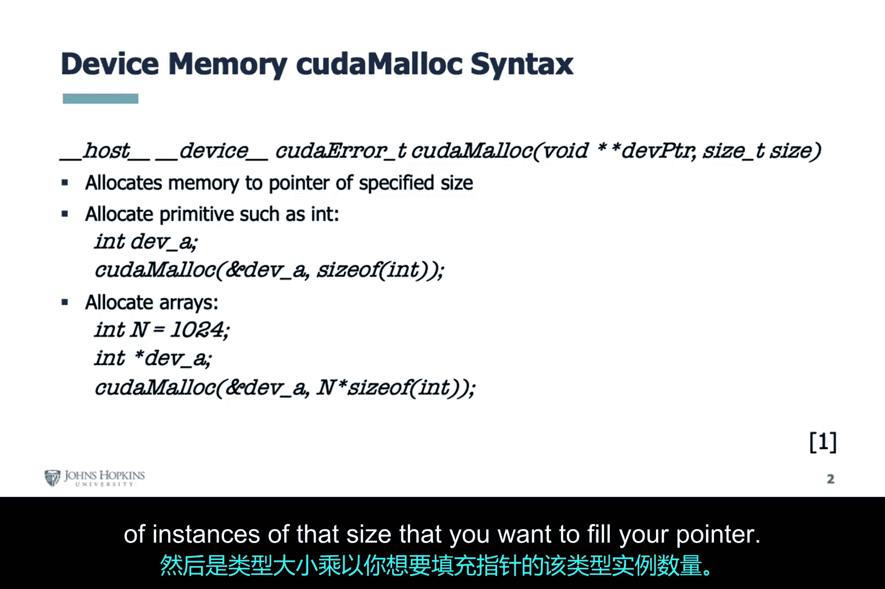
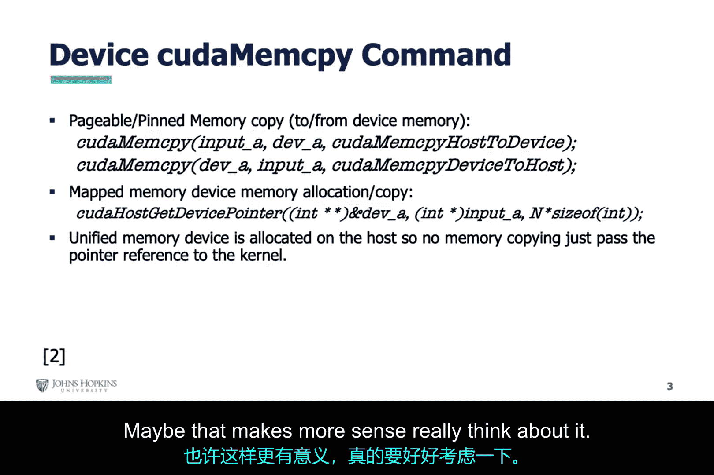
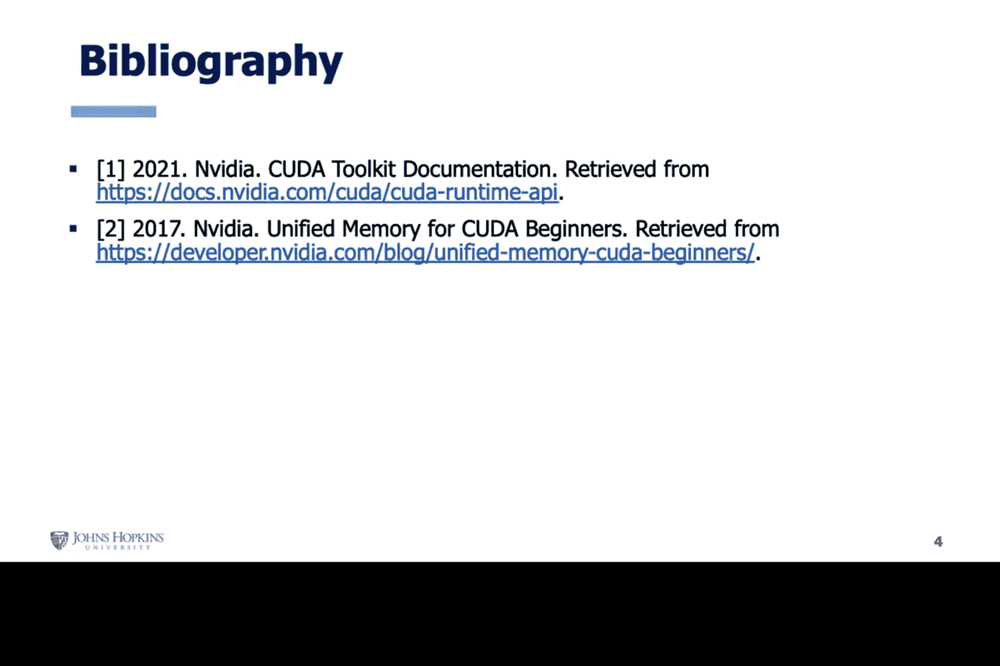

# 047：设备全局内存分配策略 🧠

在本节课中，我们将学习如何在GPU设备上分配全局内存。我们将介绍核心的分配命令、数据拷贝方法以及不同类型内存（如映射内存和统一内存）的使用策略。理解这些概念对于编写高效的CUDA程序至关重要。

---

## 分配设备内存

上一节我们介绍了GPU内存的基本概念，本节中我们来看看如何具体地在设备上分配全局内存。最基础的设备内存分配命令是 `cudaMalloc`。

其基本语法如下：你传入一个设备指针和所需分配的大小（以字节为单位）。这个大小基于你想要创建的数组大小或输入数据的大小，以及将要填充的数据类型的大小。

*   你可以通过传入指针和基本数据类型的大小来分配基本类型的内存。
*   对于更复杂或更大的结构体指针，你需要传入指针，然后指定该结构体类型的大小乘以你希望填充的实例数量。

核心的分配命令可以用以下代码描述：
```c
cudaError_t cudaMalloc(void** devPtr, size_t size);
```



---

## 数据拷贝命令

分配内存后，下一步通常是在主机（CPU）和设备（GPU）之间传输数据。接下来非常重要的命令是 `cudaMemcpy`。

这个命令可以双向拷贝信息。对于可分页内存和固定（Pinned）内存，你都需要指定源地址、目标地址以及一个表示拷贝方向的标志。

以下是 `cudaMemcpy` 的核心用法：
```c
cudaMemcpy(dest, src, size, cudaMemcpyHostToDevice); // 从主机拷贝到设备
cudaMemcpy(dest, src, size, cudaMemcpyDeviceToHost); // 从设备拷贝到主机
```
参数按此顺序传递。这样可以将内存拷贝到设备，也可以从设备拷贝回主机。

---

## 使用映射内存

当使用映射内存（Mapped Memory，或称零拷贝内存）时，流程有所不同。你需要使用 `cudaHostGetDevicePointer` 函数。

该函数以主机指针作为第二个参数，设备指针作为第一个参数。然后你指定指针的大小，或者你打算在任一方向拷贝的数据量。

这种方法非常方便，因为它减少了一次数据拷贝。你只是直接将数据映射过去，使得操作更简单。

---

## 统一内存的优势

当你使用统一内存（Unified Memory）时，你不需要指定任何拷贝操作。设备和CPU都会表现得好像内存是本地的一样（尽管物理上可能不是）。你让CUDA运行时来决定数据的迁移。

这种方式更加简单，但性能可能有所不同。使用不同类型的内存时，需要仔细考虑应用程序的特点、成本以及计算模式。

*   如果有很多处理过程，也许前端或后端的一点额外成本并不重要，这比不断按需拷贝数据的成本要好。
*   或者，如果你有一个复杂的代码库，可能更倾向于使用更简单的方案，比如统一内存。它带来的轻微额外成本可能会被大量的计算分摊，这可能更有意义。

请根据你的具体应用场景仔细权衡。

---



## 总结



本节课中我们一起学习了GPU设备全局内存的分配策略。我们掌握了使用 `cudaMalloc` 进行内存分配，使用 `cudaMemcpy` 在主机与设备间传输数据，了解了映射内存如何通过 `cudaHostGetDevicePointer` 简化流程，并认识了统一内存的便利性。关键在于根据应用程序的计算模式、数据访问频率和代码复杂度，来选择最合适的内存管理策略。