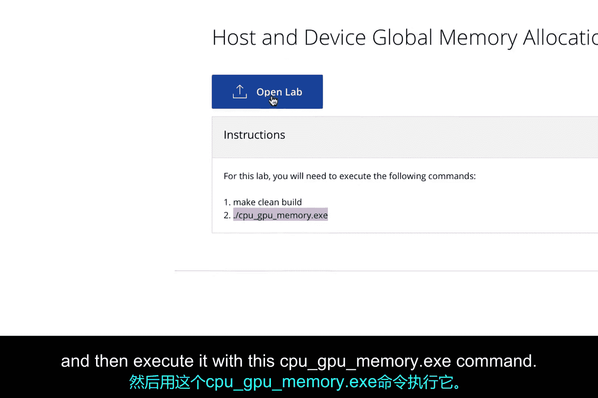
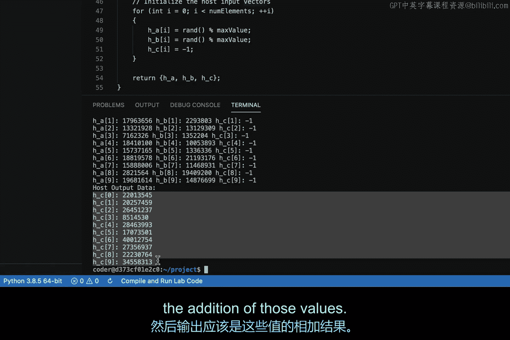

# 048：主机与设备内存分配实验 🧪

在本节课中，我们将学习如何在CUDA编程中进行主机（CPU）与设备（GPU）之间的内存分配、数据传输以及内核执行。我们将通过一个具体的实验代码来理解这些核心步骤。

## 概述

内存管理是GPU编程的基础。CPU（主机）和GPU（设备）拥有各自独立的内存空间。为了在GPU上执行计算，我们必须：
1.  在主机上分配和初始化数据。
2.  在设备上分配内存。
3.  将数据从主机内存复制到设备内存。
4.  在GPU上执行计算内核。
5.  将结果从设备内存复制回主机内存。
6.  释放所有已分配的内存。



接下来，我们将通过分析实验代码来详细讲解每一步。

## 实验代码结构

首先，我们来看一下实验项目的构建和运行方式。项目使用一个`Makefile`来管理编译和清理过程。

以下是`Makefile`中定义的三个主要目标：

*   **`build`**：编译源代码，生成可执行文件。
*   **`clean`**：删除生成的可执行文件。
*   **`run`**：在编译后执行生成的可执行文件。

我们可以通过命令 `make clean` 和 `make build` 来清理并重新构建项目。

## 核心函数解析

上一节我们介绍了项目的构建流程，本节中我们来看看实现加法运算的核心CUDA内核函数。

### 内核函数：`addKernel`

这个函数在GPU上并行执行，将两个数组`A`和`B`的对应元素相加，结果存入数组`C`。

```cpp
__global__ void addKernel(int *A, int *B, int *C, int numElements) {
    int i = blockDim.x * blockIdx.x + threadIdx.x;
    if (i < numElements) {
        C[i] = A[i] + B[i];
    }
}
```

**代码解释**：
*   `__global__` 声明这是一个在GPU上运行的内核函数。
*   参数 `A`, `B`, `C` 是指向设备内存中数组的指针。
*   `numElements` 是数组的元素总数。
*   第一行计算当前线程处理的全局索引 `i`。
*   `if (i < numElements)` 是一个边界检查，防止线程访问超出数组范围的内存。
*   `C[i] = A[i] + B[i];` 执行实际的加法操作。

### 主机端辅助函数

内核函数需要在主机代码的驱动下运行。以下是主机端完成准备工作的几个关键函数。

**`randomAllocHostMemory` 函数**：在主机（CPU）内存中为数组`A`、`B`、`C`分配空间，并为`A`和`B`填充随机数。

**`allocateDeviceMemory` 函数**：在设备（GPU）上为数组`d_A`、`d_B`、`d_C`分配内存空间。

**`copyHostToDevice` 函数**：使用 `cudaMemcpy` 函数将主机上`A`和`B`数组的数据复制到设备上对应的`d_A`和`d_B`中。其核心调用如下：
```cpp
cudaMemcpy(d_A, A, size, cudaMemcpyHostToDevice);
```

**`executeAddKernel` 函数**：配置并启动GPU内核。它根据用户指定的`threadsPerBlock`和总的`numElements`来计算需要的网格大小（`blocksPerGrid`），然后调用内核。
```cpp
int blocksPerGrid = (numElements + threadsPerBlock - 1) / threadsPerBlock;
addKernel<<<blocksPerGrid, threadsPerBlock>>>(d_A, d_B, d_C, numElements);
```

**`deallocateMemory` 和 `cleanupDevice` 函数**：分别用于释放所有已分配的主机和设备内存，以及重置CUDA设备。

**`parseCommandLineArguments` 函数**：解析命令行参数，例如使用 `-n` 指定数组元素数量，使用 `-t` 指定每个线程块的线程数。

## 主函数执行流程

了解了各个功能函数后，现在我们来梳理主函数 `main` 如何将它们串联起来，形成一个完整的工作流。

1.  **解析参数**：首先，解析命令行输入的数组大小（`numElements`）和线程块大小（`threadsPerBlock`）。
2.  **分配主机内存**：调用 `randomAllocHostMemory`，在主机上为`A`、`B`、`C`分配并初始化内存。
3.  **打印输入数据**：输出`A`和`B`数组的内容，便于调试和验证。
4.  **分配设备内存**：调用 `allocateDeviceMemory`，在GPU上为`d_A`、`d_B`、`d_C`分配内存。
5.  **复制数据到设备**：调用 `copyHostToDevice`，将主机数据`A`和`B`复制到设备内存`d_A`和`d_B`。
6.  **执行内核**：调用 `executeAddKernel`，在GPU上启动并行加法计算。请注意，数组`C`在主机分配，但指针`d_C`指向设备内存，因此内核直接操作设备内存。
7.  **复制结果回主机**：计算完成后，使用 `cudaMemcpy` 将设备上的结果`d_C`复制回主机内存的`C`中。
    ```cpp
    cudaMemcpy(C, d_C, size, cudaMemcpyDeviceToHost);
    ```
8.  **释放内存**：调用 `deallocateMemory` 释放所有主机和设备内存。
9.  **打印输出结果**：输出结果数组`C`的内容。
10. **清理设备**：调用 `cleanupDevice` 进行最终清理。

## 运行与验证

现在，让我们按照流程构建并运行程序。在终端中执行：
```bash
make clean
make build
./cpu_gpu_memory.ex -n 10 -t 256
```

程序将输出两部分内容：
1.  **主机输入数据**：显示初始生成的10个随机数对（数组A和B）。
2.  **输出结果**：显示计算得到的10个和（数组C），这应该是A和B对应元素相加的结果。

通过对比输入和输出，我们可以验证GPU内核计算是否正确。

## 总结

本节课中我们一起学习了CUDA编程中主机与设备内存管理的完整流程。我们通过一个具体的向量加法实验，逐步分析了如何：
*   使用 `cudaMalloc` 在设备上分配内存。
*   使用 `cudaMemcpy` 在主机和设备间传输数据。
*   编写和启动一个简单的 `__global__` 内核函数。
*   合理配置线程块和网格维度。
*   使用 `cudaFree` 释放设备内存。



掌握这些步骤是进行更复杂GPU编程的基石。记住，清晰的内存管理对于避免内存泄漏和确保程序正确性至关重要。