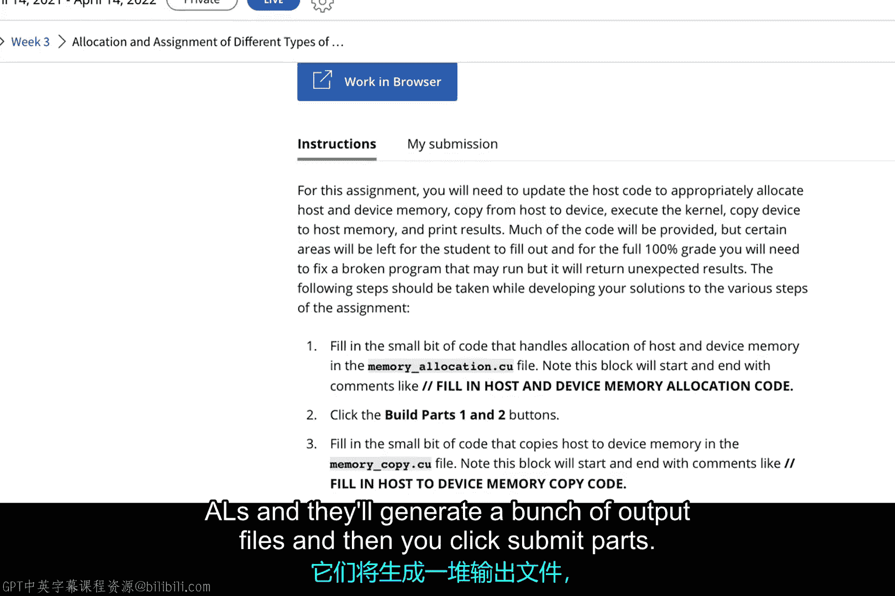
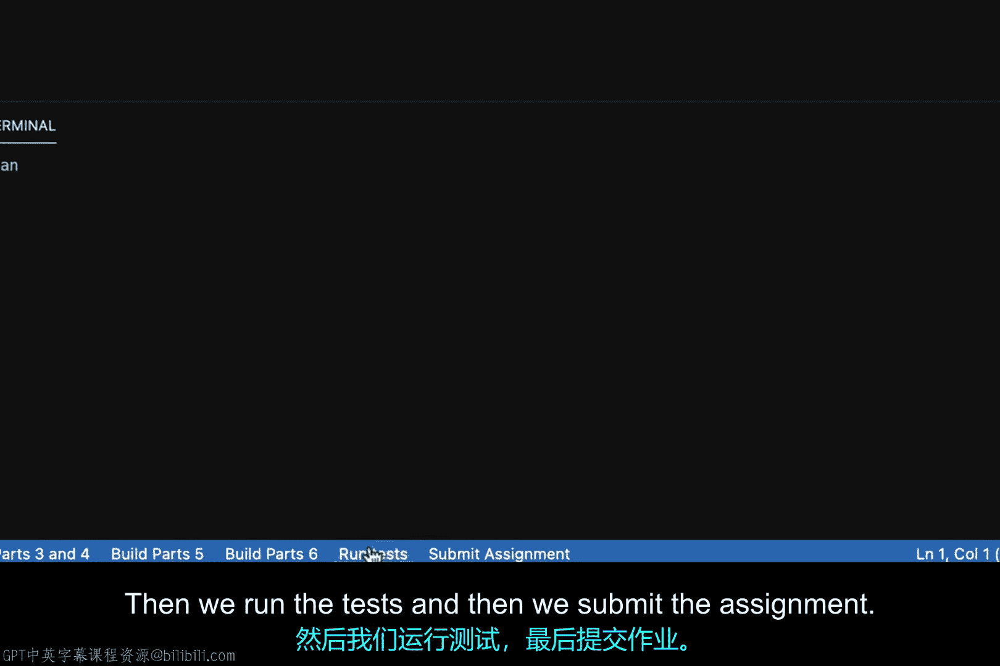

# 049：编程作业指南 🚀

在本节课中，我们将学习如何完成第三周的编程作业。我们将详细讲解作业的各个部分，包括如何填充代码、构建项目、运行测试以及提交作业。通过本教程，你将掌握处理不同类型主机与全局内存分配的基本流程。

---

## 作业概述 📋

我们将首先查看内存分配的CUDA文件。你需要更新设备内存分配函数。请注意，文件中会有多处标记为“fill in”的注释，你需要在注释之间填入相应的代码。

接下来，我们将转移到内存复制部分。你需要寻找“从主机复制到设备”的注释，并在指定的位置填入代码。

---

## 第一部分：内存分配CUDA文件 🔧

首先，我们来看内存分配的CUDA文件。你需要更新`allocate_device_memory`函数。文件中会有多处标记为“fill in”的注释，你需要在注释之间填入相应的代码。

以下是需要完成的具体步骤：

1.  **更新设备内存分配函数**：在`allocate_device_memory`函数中，找到标记为“fill in”的注释，并在注释之间填入分配设备内存的代码。
2.  **检查注释位置**：确保代码填入在正确的注释之间，避免语法错误。

---

## 第二部分：内存复制操作 🔄

上一节我们介绍了内存分配，本节中我们来看看内存复制操作。在内存复制部分，你需要寻找“copy from host to device”的注释，并在指定的位置填入代码。

以下是需要完成的具体步骤：

1.  **定位复制代码位置**：在文件中找到标记为“copy from host to device”的注释。
2.  **填入复制代码**：在注释之间填入从主机内存复制数据到设备内存的代码，例如使用`cudaMemcpy`函数。

---

## 第三与第四部分：修复映射内存与页锁定内存分配 🛠️

接下来，我们将处理映射内存和页锁定内存的分配。这两个部分需要你修复相应的CUDA文件中的`allocate_device_memory`函数。

以下是需要完成的具体步骤：

1.  **修复映射内存分配**：在`broken_mapped_memory_allocation.cuda`文件中，修复`allocate_device_memory`函数。
2.  **修复页锁定内存分配**：在`broken_page_pinned_memory_allocation.cuda`文件中，同样修复`allocate_device_memory`函数。

---

## 第五部分：运行脚本与Make文件 📁

现在，我们将注意力转向运行脚本和Make文件。`run_do_s`脚本会执行清理、构建以及运行不同部分的测试。Make文件中包含了项目所需的各种构建和运行目标。

以下是需要了解的关键点：

1.  **Make文件的作用**：Make文件定义了清理、构建虚拟输出、生成测试数据等目标。
2.  **测试数据格式**：测试数据以CSV格式提供，包含整数和浮点数。

---

## 第六部分：浏览器底部按钮操作 🖱️

最后，我们将介绍如何使用浏览器底部的按钮逐步完成作业。你需要依次构建每个部分，运行测试，然后提交作业。

以下是操作步骤：

1.  **逐步构建**：点击对应按钮，依次构建Part 1到Part 6。
2.  **运行测试**：构建完成后，运行测试以生成输出文件。
3.  **提交作业**：最后，点击提交按钮，完成作业。

---

## 总结 🎯

本节课中，我们一起学习了如何完成第三周的GPU编程作业。我们从内存分配开始，逐步讲解了代码填充、内存复制、修复特定内存分配函数、使用Make文件以及通过浏览器界面完成构建、测试和提交的全过程。掌握这些步骤对于顺利完成CUDA编程任务至关重要。