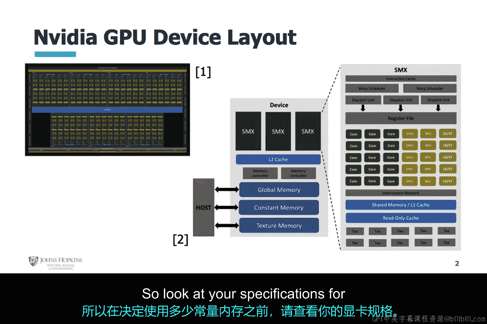
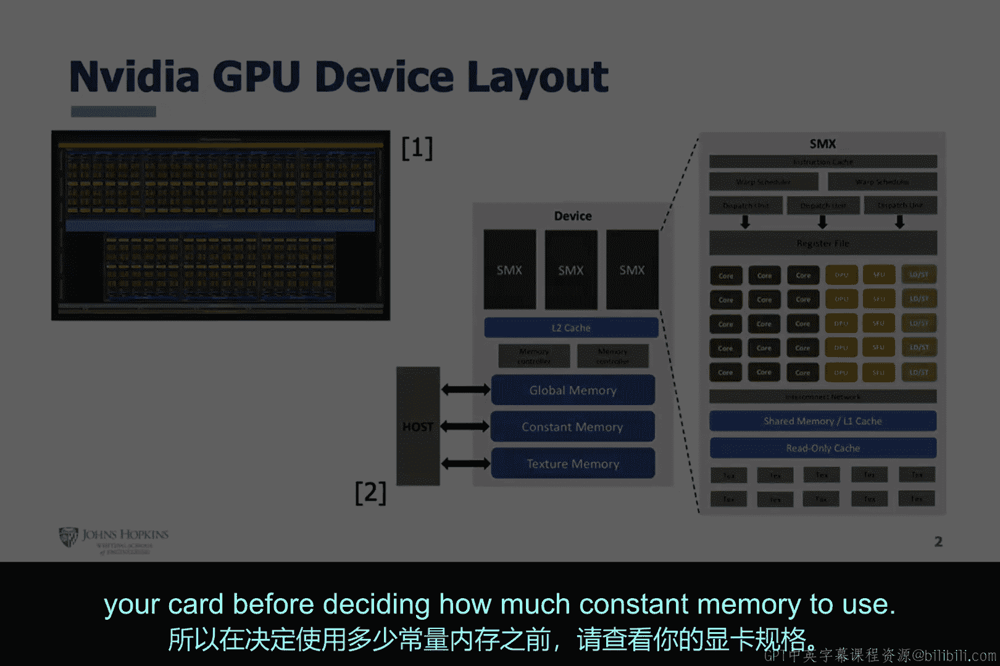
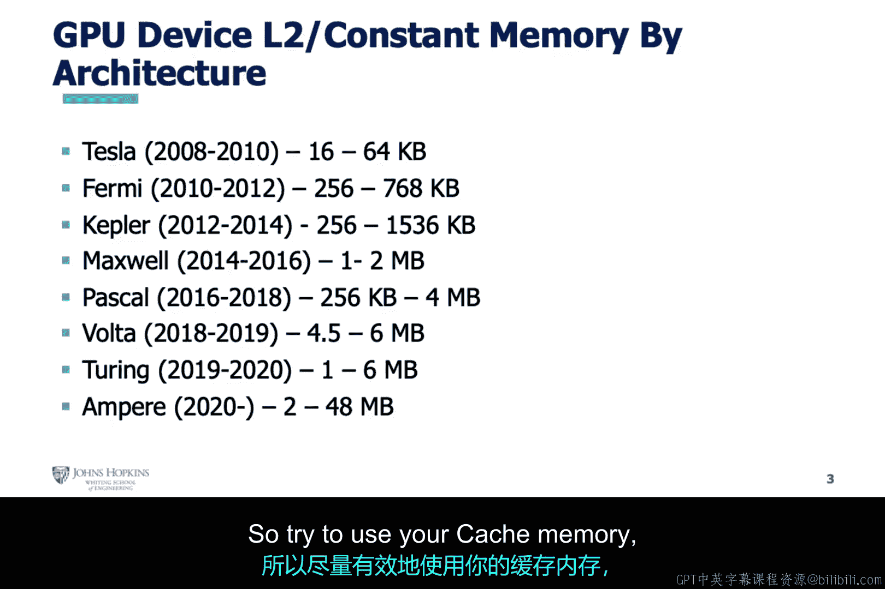
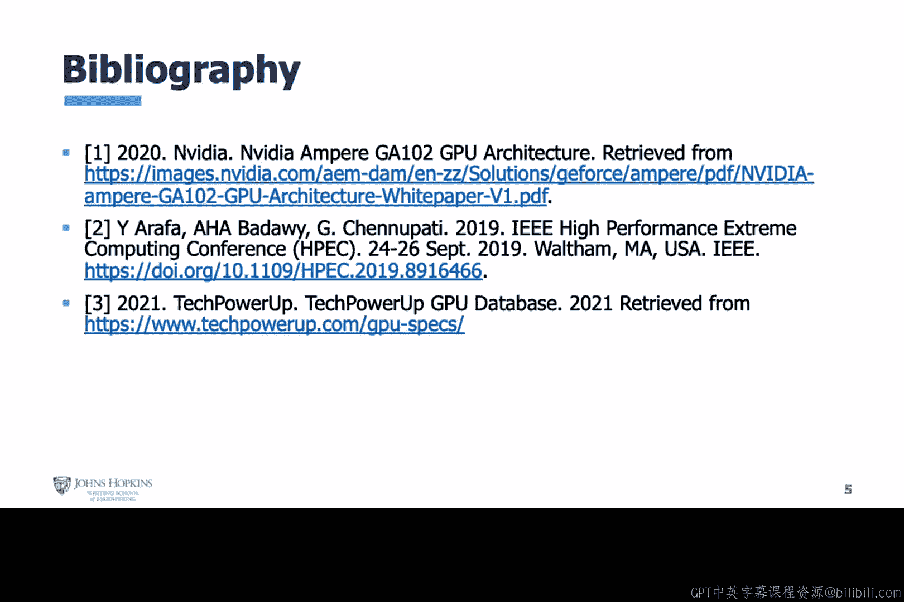

# 050：NVIDIA GPU共享内存与常量内存 🎮

在本节课中，我们将深入学习NVIDIA GPU设备上的共享内存与常量内存。这两种内存类型对于优化CUDA程序的性能至关重要。

## 理解NVIDIA GPU架构 🏗️

上一节我们介绍了GPU编程的基本概念，本节中我们来看看NVIDIA GPU的具体架构。为了更好地理解NVIDIA GPU设备，让我们深入分析一些架构图。

在左上角，您可以看到一个熟悉的图表。它展示了NVIDIA GPU卡的整体布局。您可以看到七个不同的流式多处理器（SM），以及不同类型的内存和总线等。

在右侧，您可以看到一个新的图表。它展示了对一个SM（在本例中是SMX）的深入剖析。但从功能上讲，所有版本的SM或流式多处理器在功能上是等效的。

## 流式多处理器内部结构 🔬

在流式多处理器上，您将看到共享内存或L1缓存。这部分内存由同一线程块内的所有核心和线程共享。

您还会看到，在观察整个设备时，存在常量内存。现在，常量内存的大小通常上限为64KB。但有时，它可以被整合到L2缓存中。

因此，在决定使用多少常量内存之前，请查看您显卡的规格说明。

## 常量内存与L2缓存的发展 📈

以下是不同架构中与L2缓存相关的发展情况，L2缓存是分配的大部分内存。您会看到它的容量随着时间的推移而增长。

最初，几乎所有的L2缓存，即64KB的限制，都被常量内存分配或可用于常量内存分配。但后来，L2缓存的容量增加了，以至于现在已接近48MB。

请注意，如果存在大量的缓存读取未命中（这些未命中随后必须访问全局内存），那么使用L2缓存可能会产生显著的成本，并使其性能降低到与全局内存相当的水平。

因此，请尝试非常有效地使用您的缓存内存，特别是L2缓存。

## 共享内存的演变 🔄

共享内存，或L1缓存，并非在每个架构中都一直可用。基于设计决策，每个流式多处理器上的共享内存容量有增有减。

从安培架构开始，您可以看到其容量增加了三倍，但这是超过10年发展的结果。拥有这种缓存确实非常有用，但就像其他所有资源一样，有效地使用它、避免读取未命中，并利用它在线程之间进行通信而不引发竞态条件或类似问题，是非常重要的。

## 核心概念总结 📝

本节课中我们一起学习了NVIDIA GPU上两种关键的内存类型：

*   **共享内存**：位于每个流式多处理器内部，由同一线程块内的所有线程共享。其访问速度极快，常用于线程间通信和数据复用。
    *   **代码示例**：在CUDA内核中声明共享内存数组：`__shared__ float s_data[BLOCK_SIZE];`
*   **常量内存**：位于设备内存中，但通常通过常量缓存（如L2）进行访问，适合存储所有线程只读的常量数据。容量通常较小（如64KB）。
    *   **代码示例**：使用常量内存：`__constant__ float c_coeff[256];` 并在主机端使用 `cudaMemcpyToSymbol` 进行数据拷贝。

理解并合理利用共享内存和常量内存，是优化CUDA内核性能、减少全局内存访问延迟的关键步骤。