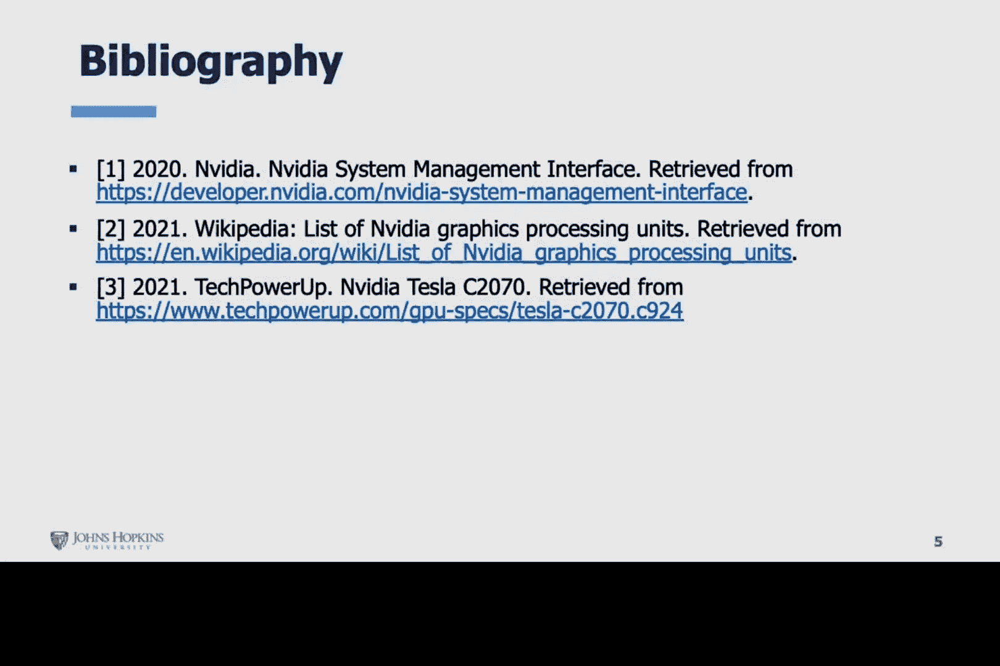

# 051：GPU共享与常量内存研究 🔍

在本节课中，我们将学习如何调查GPU设备上共享内存和常量内存的容量与规格。了解这些信息对于优化CUDA程序的内存使用至关重要。

## 工具选择：NVIDIA SMI

上一节我们介绍了不同类型的内存。本节中，我们来看看如何获取设备的具体内存信息。调查设备信息最重要的工具是NVIDIA SMI工具。

以下是关于NVIDIA SMI工具的关键点：
*   如果你安装了CUDA开发工具包，你将获得NVIDIA SMI工具。
*   像`lspci`或Windows/Mac系统工具不一定总是可用，因此建议尽可能依赖NVIDIA SMI。
*   使用`nvidia-smi`命令会生成一个日志，列出所有连接的设备信息，包括产品名称（例如Tesla C2070）。

## 在线数据库与调优指南

获取设备名称后，你可以借助外部资源查找具体规格。我推荐使用一个特定的在线数据库来查找NVIDIA GPU设备的详细信息。

无论何时，基于你所知的显卡架构代次，查阅相关的调优指南都会非常有帮助。你会发现，NVIDIA会保留大约五到六代产品的调优指南。任何仍在轻度支持的设备都有相应的文档。

这些指南不仅适用于常量或共享内存，它们还提供了大量关于内存使用、不同类型内存间数据传输的信息，几乎涵盖了你为实现代码性能优化所需了解的所有内容。

## 专用GPU数据库

在之前关于全局内存的讨论中，我提到可以查阅维基百科的NVIDIA GPU设备列表。然而，这对于共享内存或常量内存的调查效果不佳，因为维基百科提供的相关信息很少。

TechPowerUp网站有一个GPU数据库。你可以从顶部开始，选择搜索特定显卡，或者按架构或设备类型浏览。找到你想调查的设备后，你会看到一个非常直观的仪表板，其中显示了关于处理器、各级缓存、常量内存等信息。它还会将该显卡的性能与其他显卡进行比较。因此，如果你需要在多个设备间切换，这个数据库非常有价值，建议你将其收藏备用。

本节课中我们一起学习了如何调查GPU的共享内存和常量内存。我们介绍了使用NVIDIA SMI命令行工具获取基础设备信息，并推荐了查阅官方调优指南和TechPowerUp在线数据库来获取更详细的内存规格与性能数据。掌握这些工具和方法是进行有效GPU内存优化的第一步。