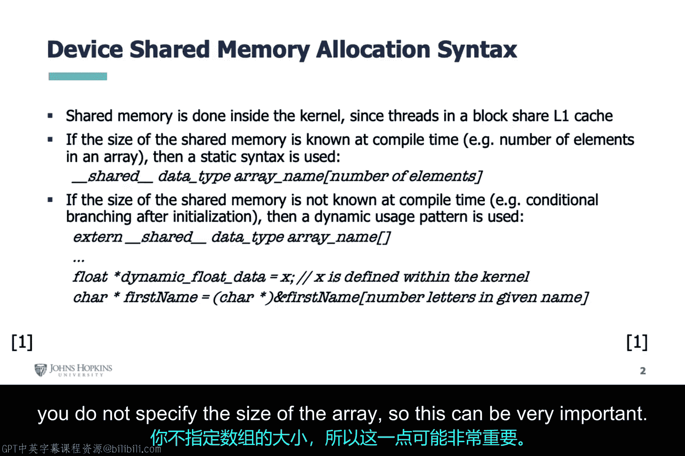
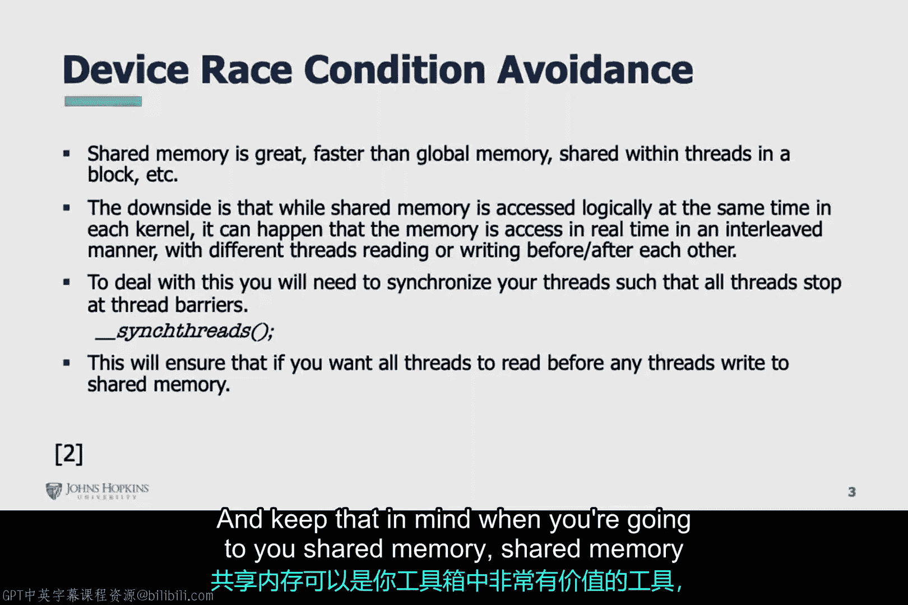

# 052：GPU共享内存分配技术 🧠

在本节课中，我们将学习GPU编程中一个关键的性能优化工具——共享内存。我们将探讨如何在GPU设备上分配共享内存，理解其两种分配方式，并分析其优势与使用时的注意事项。

## 编译时分配共享内存

上一节我们介绍了共享内存的基本概念，本节中我们来看看如何具体分配它。第一种情况是在编译时已知内存大小。这种方式非常简单直接。

以下是静态分配共享内存的语法：
```c
__shared__ T array_name[array_size];
```
在这个声明中，`__shared__` 关键字用于指定共享内存，`T` 是数据类型，`array_name` 是数组名称，`array_size` 是编译时已知的常量大小。

## 运行时分配共享内存

然而，并非所有情况都能在编译时确定内存大小。如果共享内存的大小需要在运行时根据输入参数（例如块ID或变量）动态决定，我们就需要使用动态分配。





动态分配共享内存的语法与静态分配类似，但有关键区别：
```c
extern __shared__ T array_name[];
```
这里使用了 `extern` 关键字，并且**不指定数组大小**。数组的实际大小将在启动内核时，通过第三个执行配置参数来指定。

## 共享内存的优势与挑战

共享内存是优化内核性能的宝贵工具。了解其特性对于有效使用至关重要。

以下是共享内存的主要优势：
*   **速度更快**：在理想情况下（没有读取缺失），共享内存的访问速度远快于全局内存。
*   **线程间通信**：它允许同一个线程块内的线程进行通信和协作，例如用于存储中间计算结果。

然而，使用共享内存也带来一个关键挑战。虽然代码在逻辑上是顺序执行的，但实际运行时，线程的执行速度可能因任务不同而各异。

为了保证数据一致性，必须在关键操作后使用同步屏障：
```c
__syncthreads();
```
这个函数会创建一个屏障，确保块内的所有线程都执行到此点并完成相应操作后，才能继续执行后续指令。这可以防止在数据未准备就绪时发生读写冲突。

## 总结


本节课中我们一起学习了GPU共享内存的分配技术。我们掌握了在编译时使用 `__shared__ T array[size]` 进行静态分配，以及在运行时使用 `extern __shared__ T array[]` 进行动态分配的方法。我们认识到共享内存具有访问速度快和便于线程块内通信的优点，但也必须谨慎使用 `__syncthreads()` 来同步线程，以确保数据的正确性和程序的稳定性。正确使用共享内存是提升GPU内核性能的关键步骤之一。