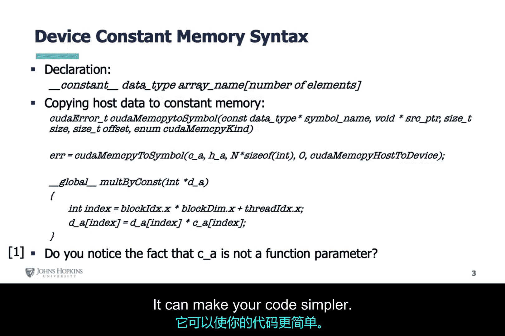

# 053：GPU常量内存分配方法 🧠

在本节课中，我们将学习GPU常量内存（Constant Memory）的概念、分配方法以及如何将数据从主机（Host）传输到设备（Device）的常量内存中。常量内存是一种特殊的内存类型，其内容在GPU内核执行期间保持不变，所有线程都可以访问相同的值。

## 常量内存概述

上一节我们介绍了共享内存，本节中我们来看看常量内存。常量内存，顾名思义，其内容在定义后不会改变。一旦在GPU设备级别定义了常量内存，所有线程都可以访问这些相同的值。常量内存通常最大为64KB。

与共享内存不同，常量内存的分配和数据传输需要更多考虑。共享内存仅在设备上分配和使用，而常量内存需要在主机和设备之间进行数据传输。

## 常量内存的特性与分配

常量内存的分配不是在GPU内核内部进行的，甚至不是在特定函数内部定义或初始化的。这意味着常量变量通常被放置在C文件的顶部或函数上下文之外。它们只在某个函数内部被设置一次。

虽然常量内存的访问速度可能比全局内存快，甚至可以达到与寄存器内存相同的速度，但它可能因缓存未命中而变慢。因此，必须确保指定的常量内存大小在允许的最大64KB范围内。

以下是常量内存的关键特性列表：
*   **不变性**：在GPU内核执行期间，其内容保持不变。
*   **全局可访问性**：所有线程都可以访问相同的常量值。
*   **容量限制**：通常最大为64KB。
*   **文件级作用域**：在C文件级别（函数外部）声明和定义。
*   **性能考虑**：访问速度快，但需注意缓存未命中问题。


## 常量内存的使用方法

当你想使用常量内存时，需要使用 `__constant__` 关键字来声明它。这必须在文件级别完成，而不是在函数内部。

```c
__constant__ float constArray[1024];
```

然后，使用 `cudaMemcpyToSymbol` 函数将主机数据复制到设备的常量内存中。你需要传递设备上常量内存的指针、主机内存指针、数据大小、偏移量以及内存复制类型。

```c
cudaMemcpyToSymbol(constArray, hostDataPtr, dataSize, 0, cudaMemcpyHostToDevice);
```

内存复制类型应始终为 `cudaMemcpyHostToDevice`。这是因为内存是常量，在内核中无法修改，因此永远不需要甚至不可能使用 `cudaMemcpyDeviceToHost`。

## 注意事项与最佳实践

在CPU上，常量内存使用 `const` 关键字。虽然技术上可以在CPU和GPU常量内存之间进行复制，但不要混淆它们。为了使代码更清晰，许多开发者会为设备的常量内存使用 `__device__` 关键字（尽管 `__constant__` 已隐含了设备属性）。

常量内存是一个非常强大的工具，当你拥有预定义的常量输入时应该使用它。例如，用于图像模糊的卷积核，或者以相同值对图像进行增亮或变暗的系数等。

在编写代码时，请将常量内存的使用记在心中，因为它可以加速程序执行，并使代码更简洁。

## 总结



本节课中我们一起学习了GPU常量内存。我们了解了常量内存不变和全局可访问的核心特性，其最大容量通常为64KB。我们掌握了使用 `__constant__` 关键字在文件级别声明常量内存，以及使用 `cudaMemcpyToSymbol` 函数将数据从主机传输到设备常量内存的方法。最后，我们讨论了常量内存的适用场景，如图像处理中的固定卷积核或调整参数，正确使用它可以有效提升程序性能。