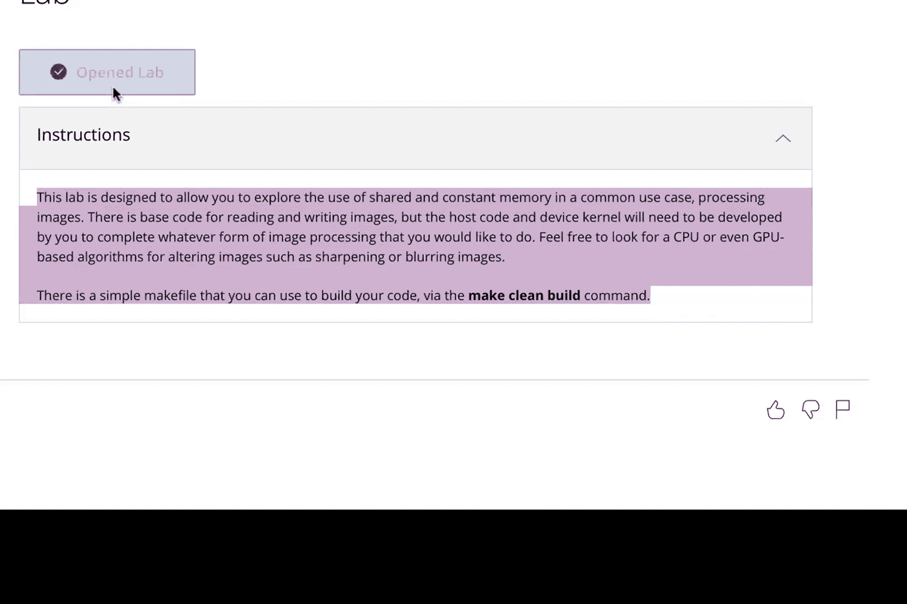
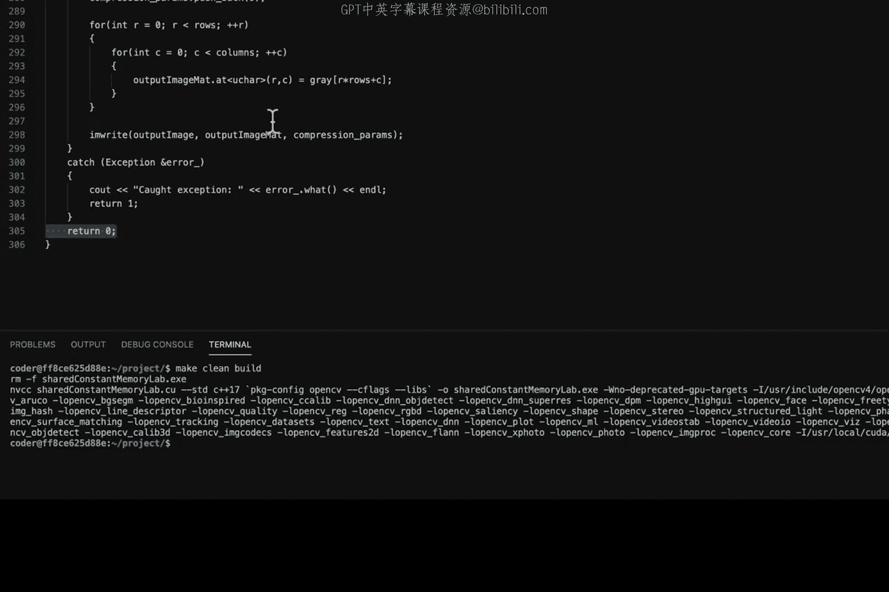

# 054：共享与常量内存图像处理实验教程 🖼️

在本节课中，我们将学习第四周的实验内容，具体是关于在图像处理中应用共享内存和常量内存的实验。我们将通过构建代码、执行程序并分析关键函数来理解如何在CUDA编程中高效地使用这些内存类型。

## 实验概述与构建

首先，我们来看实验的基本操作。你需要运行 `make clean build` 来构建你的代码，然后执行它。这与我们之前实验的操作流程一致。

以下是构建和运行的基本步骤：
*   运行 `make clean` 来清理之前的构建文件。
*   运行 `make build` 来编译当前代码。
*   编译成功后，即可执行生成的可执行文件。

## 分析Makefile与代码结构

上一节我们介绍了实验的基本操作，本节中我们来看看项目的构建文件。Makefile 通常包含 `build`、`run` 和 `clean` 等目标。之前提到过，你可以使用 `make clean build` 命令。这个命令会首先移除旧的可执行文件（例如 `shared_constant_mem_lab.exe`），然后尝试编译新代码。

现在，让我们查看核心的CUDA内核文件 `shared_constant_mem_lab.cu`。在这个文件中，`cuda_kernel` 函数里已经为你预留了注释，提示你在何处需要编写代码来初始化变量、同步线程以及进行性能计算。像线程ID（`threadId`）、块ID（`blockId`）等变量的计算已经为你完成，你只需要在指定位置填充代码即可。

## 设备内存管理与内核调用

理解了内核结构后，我们接下来关注主机端如何管理设备内存并启动内核。`allocate_device_memory` 函数使用 `cudaMalloc` 为设备的RGB通道分配内存。接着，对于图像的**行数**和**列数**，它会将它们复制到**常量内存**中。请注意，这些维度在 `.hpp` 头文件中已有定义。

以下是内存操作的关键步骤：
*   **主机到设备复制**：`copy_to_device` 函数接收主机端RGB值的无符号字符指针，并将它们传递给设备端指针。
*   **内核执行**：`run_kernel` 函数负责启动CUDA内核，对RGB值以及图像的行列维度进行处理。
*   **设备到主机复制**：`copy_from_device` 函数使用 `cudaMemcpy` 将处理后的设备内存RGB值复制回主机。
*   **资源清理**：`deallocate_memory` 和 `cleanup_device` 函数确保释放设备内存并使设备处于良好状态，以备下一次迭代使用。

## 主函数流程与图像处理

最后，我们来梳理整个程序的主逻辑。`main` 函数首先解析命令行参数，以获取输入图像文件名、输出图像文件名、分区ID以及每个块的线程数。接着，它根据输入文件名读取图像数据，并生成一个灰度图像指针。

以下是 `main` 函数的执行序列：
1.  解析命令行参数。
2.  读取输入图像。
3.  为RGB数据分配设备内存。
4.  将主机数据复制到设备。
5.  在RGB值及行列数据上执行内核。
6.  将结果从设备复制回主机。
7.  释放内存并清理设备。
8.  基于处理后的灰度像素创建PNG格式的图像（你也可以尝试使用RGB模式进行不同的实验，这里提供了一定的自由度）。
9.  将图像写入输出文件。
10. 返回0，程序正常结束。

## 课程总结

本节课中，我们一起学习了如何在CUDA图像处理实验中应用共享内存和常量内存。我们从构建代码开始，逐步分析了内核函数的结构、设备内存的分配与传输流程，以及主函数如何协调整个图像处理过程。通过本实验，你应能理解如何利用CUDA的特殊内存类型来优化数据访问，并掌握一个完整CUDA图像处理程序的基本框架。