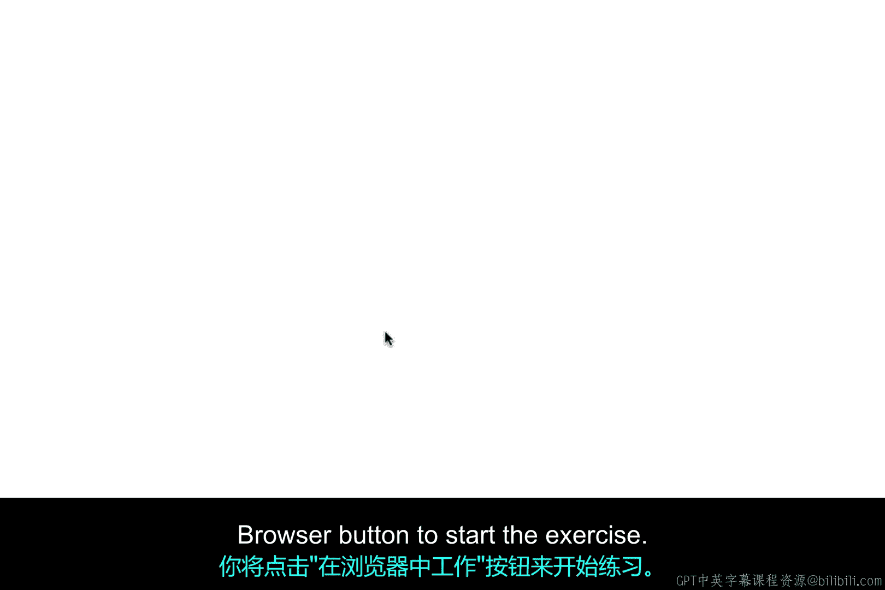
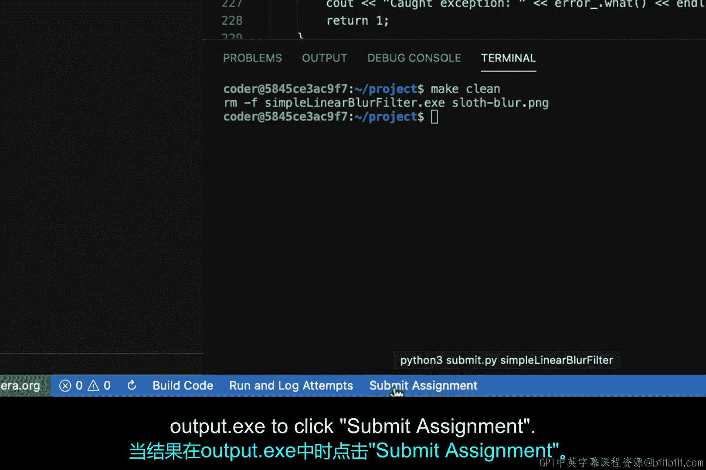

# 055：使用常量与共享内存进行图像处理作业指南 🖼️

在本节课中，我们将学习如何完成第四周的编程作业。该作业的核心是使用CUDA的常量内存和共享内存，对一个RGB图像进行模糊处理，并将其转换为灰度图。我们将逐步解析作业要求、代码结构以及操作流程。

## 概述

本作业要求你编写一个CUDA内核函数，利用常量内存存储模糊滤镜的权重，并使用共享内存来优化图像像素的访问。你需要将处理后的GPU结果与一个CPU参考实现进行比较，并根据两者的差异百分比获得成绩。

## 作业操作流程

以下是完成此作业需要遵循的具体步骤。

1.  **编写内核代码**：首先，你需要编写处理RGB值的CUDA内核代码。该代码需使用常量内存，并将输入的RGB图像转换为灰度图像。
2.  **构建与运行**：完成编码后，点击“构建代码”按钮。接着，点击“运行并记录尝试”按钮。
3.  **查看输出**：程序运行后，查看输出的TXT文件。其中会包含一个“平均差异百分比”，该值用于计算你生成的图像与CPU生成的参考图像之间的差异。
4.  **提交作业**：点击“提交作业”按钮。系统将根据“平均差异百分比”来计算你的成绩。请注意，系统中存在一个已知的Bug，这可能导致你的最高成绩约为90%。修复这个Bug将作为练习的一部分留给你完成。
5.  **开始练习**：点击“在浏览器中工作”按钮，即可开始编码练习。

## 核心代码解析

上一节我们介绍了作业的整体流程，本节中我们来看看需要实现的核心CUDA代码结构。

主内核函数是 `apply_simple_linear_blur_filter`。代码注释描述了每个步骤需要完成的任务。

**内核函数步骤：**
1.  **初始化变量**：根据线程索引计算要处理的图像像素位置。
2.  **同步线程**：由于使用了共享内存，在从全局内存加载数据到共享内存后，必须调用 `__syncthreads()` 来确保所有线程的数据加载完成。
3.  **应用模糊滤镜**：此步骤应使用常量内存中存储的权重值。同时，你也可以利用常量内存来存储图像的行数（`d_rows`）和列数（`d_cols`），代码框架已为此设置好。

用于比较图像的 `compare_color_images` 函数，会计算两幅图像RGB通道的差异。

**图像比较逻辑：**
*   对于每个像素的R、G、B三个通道，分别计算其绝对差值。
*   将一个像素的三个通道差值进行平均，得到该像素的差异值。
*   将所有像素的差异值求和，再根据图像的总像素数进行平均，得到整幅图像的平均差异。

## 程序执行流程

了解了核心内核后，我们来看看整个主机端程序的执行流程。

1.  **分配设备内存**：此步骤包括设置常量内存符号和分配共享内存。具体的实现需要由你完成。
2.  **执行内核**：`execute_kernel` 函数是 `apply_simple_linear_blur_filter` 内核的封装调用器。
3.  **清理设备内存**：内核执行完毕后，释放分配的GPU内存。
4.  **解析命令行参数**：程序通过命令行参数获取输入/输出图像路径、当前设备ID以及每个块的线程数。
5.  **读取图像**：使用OpenCV库从文件读取图像，并将其数据存储为一个包含RGB值的向量（`vector<Vec3b>`），其大小由图像的行数（`rows`）和列数（`cols`）定义。
6.  **CPU参考实现**：`apply_blur_kernel` 函数是你要实现的GPU内核的CPU版本。它的基本逻辑是查看目标像素左、右、上、下的像素，并对这些像素的RGB值进行平均。
7.  **主函数流程**：
    *   解析命令行参数，获取输入/输出图像信息。
    *   调用 `execute_kernel` 执行GPU模糊处理。
    *   读取GPU处理生成的图像数据，并写入到输出PNG文件。
    *   对原始输入图像调用CPU版本的 `apply_blur_kernel`，得到用于对比的RGB向量。
    *   最后，使用 `compare_color_images` 函数，通过对比CPU和GPU生成图像的RGB值，计算出一个缩放后的平均差异百分比。

## 最终步骤

代码开发完成后，请按顺序执行以下操作：
1.  点击“构建代码”按钮（这通常会执行 `make clean` 和 `make build`）。
2.  点击“运行并记录尝试”按钮（这通常会执行 `run.sh` 脚本）。
3.  当结果输出到 `output.txt` 文件后，点击“提交作业”按钮。

## 总结

本节课中，我们一起学习了第四周图像处理编程作业的完整指南。我们明确了作业目标是使用CUDA常量内存和共享内存实现图像模糊滤镜，并理解了从代码编写、构建运行到结果对比和提交的整个流程。你需要重点关注 `apply_simple_linear_blur_filter` 内核的实现，特别是共享内存的数据加载同步以及常量内存的使用。通过完成这个作业，你将加深对CUDA内存模型及优化策略的理解。