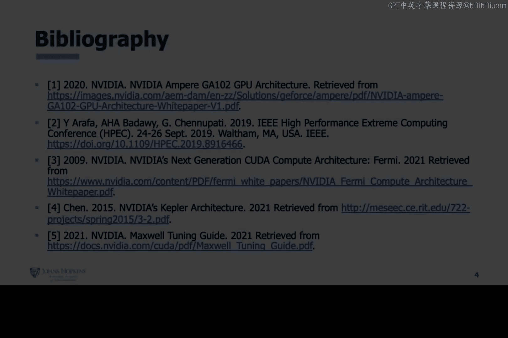
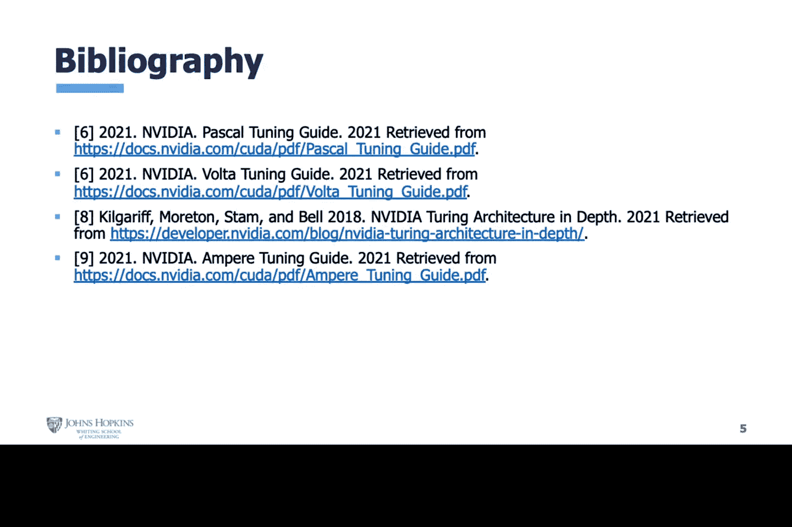

# 056：CUDA GPU寄存器内存机制 🧠

在本节课中，我们将要学习CUDA编程中最后一种设备内存类型：寄存器内存。我们将了解它的基本概念、工作原理、使用方法以及相关的性能考量。

---

## 概述

寄存器内存是GPU设备上速度最快的内存类型，位于每个流多处理器内部。它专属于每个线程，用于存储线程执行过程中频繁使用的局部变量。理解寄存器内存对于编写高效的CUDA内核至关重要。

上一节我们介绍了共享内存和常量内存，本节中我们来看看速度更快的寄存器内存。

## 寄存器内存的基本概念

让我们回顾一下GPU设备的通用布局图。一张是通用概览图，另一张是更详细的图像，展示了从主机到设备，再到流多处理器的数据流。

关于寄存器，可以将其视为一个**文件**。这个文件可以被流多处理器内的所有处理单元访问，包括构成线程的通用核心，以及执行单精度和双精度浮点运算的专用处理单元。

寄存器文件的大小是预定义的，通常为**64 KB**。流多处理器中核心数量的增加，并不意味着总的寄存器内存会增加。寄存器文件的大小在大多数架构中是静态的。

## 寄存器内存的特性

正如刚才提到的，在大多数架构中，每个流多处理器的寄存器内存量是静态的。早期的一些型号可能较少，而一些高端显卡可能拥有更多寄存器内存。

最佳实践是，除非你明确知道你使用的显卡有更多寄存器内存，否则应假定每个流多处理器只有**64 KB**的寄存器内存。

一个有趣的副作用是，**每个线程可用的寄存器内存量会根据硬件而变化**。虽然变化不会很大，但你可能需要找到一个安全的边界来规划你的寄存器使用。

## 如何使用寄存器内存

实际上，我们一直在使用寄存器内存。任何时候你在内核中创建一个变量，无论是基本数据类型、数组还是指针，它们通常都会被分配到寄存器内存中。

你并不能完全控制一个变量是否总是存储在寄存器中。如果你为每个线程分配的内存超过了可用寄存器容量，那么多余的部分将会被**溢出到本地内存**（实际上是缓存在L1缓存或全局内存中），这会导致访问速度变慢，但并非极其缓慢。

以下是使用寄存器内存的要点：

*   **自动分配**：在内核中声明的局部变量通常优先使用寄存器。
*   **容量限制**：每个线程可用的寄存器数量有限，由硬件和编译参数决定。
*   **寄存器溢出**：当所需寄存器超过限制时，编译器会将部分变量“溢出”到更慢的内存中。

## 核心概念与公式

一个关键的性能指标是每个流多处理器上可同时驻留的最大线程数，这受到寄存器总量的限制。其关系可以用以下公式描述：

**`最大驻留线程数 ≈ (每个SM的寄存器总数) / (每个线程使用的寄存器数)`**

这个公式表明，如果你的内核使用了大量寄存器，那么每个流多处理器上能够同时运行的线程块和线程数就会减少，这可能会影响GPU的占用率，从而影响性能。

在代码中，声明一个寄存器变量非常简单：

```c
__global__ void myKernel(int* data) {
    int tid = threadIdx.x + blockIdx.x * blockDim.x; // 变量'tid'通常存储在寄存器中
    float temp = data[tid] * 2.0f; // 变量'temp'通常存储在寄存器中
    // ... 其他计算
}
```

## 性能考量与最佳实践

寄存器内存的访问延迟极低，带宽极高。为了充分利用寄存器，应遵循以下原则：

1.  **最大化数据复用**：将频繁访问的中间计算结果存储在寄存器中。
2.  **最小化寄存器使用**：优化内核代码，避免声明过多不必要的局部变量，以允许更多线程同时活跃。
3.  **使用编译选项**：可以通过`-maxrregcount`编译器选项或`__launch_bounds__`指令来提示编译器每个线程使用的寄存器数量上限，以控制寄存器占用和线程占用率之间的平衡。


---



## 总结



本节课中我们一起学习了CUDA中的寄存器内存机制。我们了解到寄存器是GPU上最快的内存，专用于每个线程，容量有限但访问速度极快。我们讨论了它的自动分配特性、寄存器溢出的概念，以及寄存器使用量与线程占用率之间的重要权衡关系。合理利用寄存器是优化CUDA内核性能的关键步骤之一。