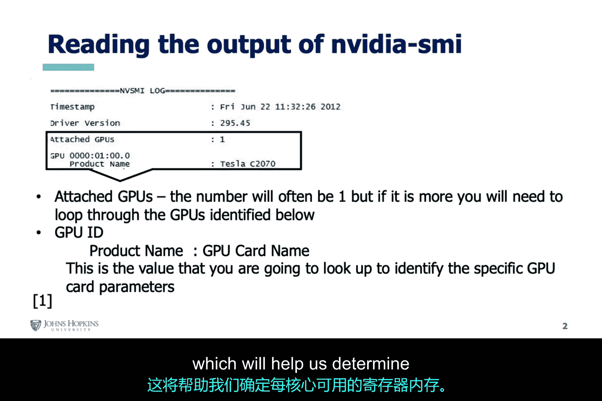
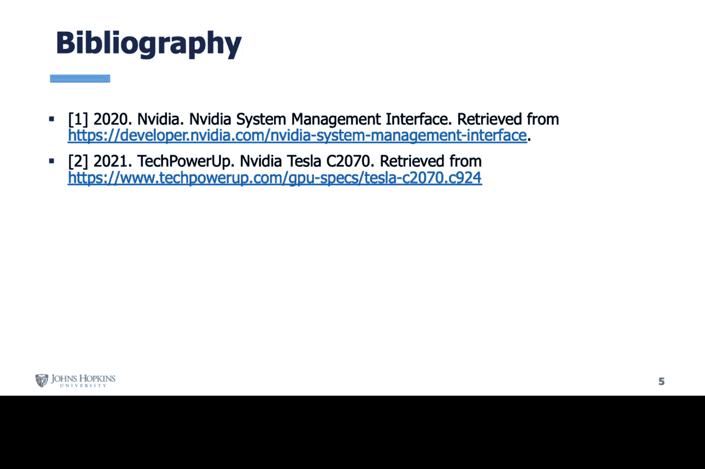

# 057：CUDA寄存器内存研究 🔍

在本节课中，我们将学习如何研究GPU卡上的寄存器内存数量，以及流多处理器中的核心数量如何决定可用的寄存器内存量。

## 工具与资源概览

与查看其他类型内存或显卡属性一样，NVIDIA SMI是一个非常有用的工具。我们不会逐一查看所有属性，但最重要的属性之一是产品名称。你将使用产品名称来确定流多处理器中的核心数量，这将帮助我们确定每个核心可用的寄存器内存。

## 架构与调优指南

对于NVIDIA仍在支持的所有架构（这些架构大约是在过去10年内生产的），NVIDIA提供了调优指南。这些调优指南提供了多种方法，使你的程序在特定的GPU卡上运行更高效。因此，这些指南始终是很好的参考资料，你应该查阅它们，以了解不同架构可用的不同功能。如果你愿意，可以为特定架构编译你的代码。

## 使用GPU数据库

然而，与其他类型的内存一样，TechPowerUp GPU数据库对于确定每个核心的寄存器内存量非常有价值。请注意，这个GPU数据库并没有具体说明寄存器文件的大小，你可能需要去其他地方查找。但关键在于，它告诉你每个流多处理器有多少个核心可用。

## 计算每个核心的寄存器内存

基于这个数字，你可以进行计算。通常显示的是总核心数，通常被称为“着色单元”。以示例中的GTX 970为例，它有448个着色单元和14个流多处理器。这意味着每个流多处理器有32个核心。

接下来，我们知道每个流多处理器有64 kB的寄存器内存。因此，每个核心关联的内存为 `64 kB / 32 = 2 kB`。

## 注意事项与最佳实践

请注意，可能存在分支或其他情况，导致变量未在内核中实例化，因此这个数字可能会更高或更低，但这是一个很好的经验法则。所以，在创建大量变量之前，请考虑你能在2 kB中放入多少数据。

如果你在内核中拥有更多的变量内存（这些内存试图成为寄存器内存），那么会发生的情况就像在CPU上一样：内存将根据需要在这些变量和寄存器内存之间来回移动。你希望避免这种情况，因为这会使那些变量和特定的访问速度降低到全局内存的速度。

## 总结

本节课中，我们一起学习了如何利用NVIDIA SMI工具和TechPowerUp GPU数据库来研究GPU的寄存器内存配置。我们了解了如何根据显卡的流多处理器和核心数量，计算出每个核心大致可用的寄存器内存量（例如，GTX 970上每个核心约2 kB）。最后，我们强调了优化内核变量使用以避免寄存器溢出到全局内存的重要性，这是保证GPU程序高效运行的关键。