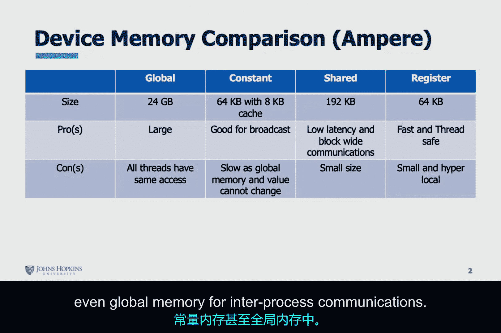
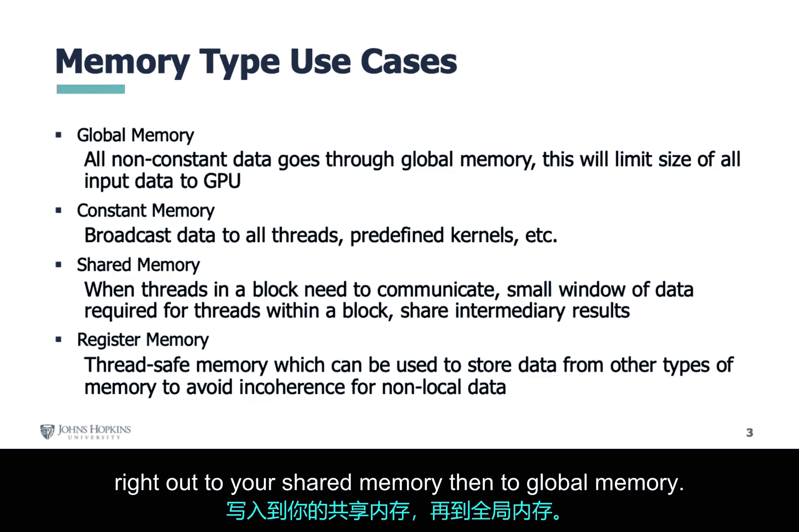

# 058：CUDA GPU内存评估方法 🧠

在本节课中，我们将学习CUDA设备上不同类型内存的评估方法。我们将比较全局内存、常量内存、共享内存和寄存器内存的特性、优缺点及适用场景，并探讨如何根据编程需求选择合适的内存类型。

---

上一节我们介绍了CUDA内存模型的基本概念，本节中我们来看看不同类型内存的具体比较。

下表展示了不同类型设备内存的简单对比。

以下是不同类型内存的简要比较：

*   **全局内存**：容量最大。根据安培架构，典型容量可达24GB。优点是容量巨大，可以存储大量数据，例如多张图像。具体来说，如果您需要处理视频或其它形式的大型数据，全局内存是必要的。需要注意的是，所有线程都能访问相同的数据，因此尽管您可以根据线程ID进行映射，但必须考虑**竞态条件**的可能性。
*   **常量内存**：容量约为64KB，通常配有缓存以帮助减少未命中的影响。它适用于广播数据，因为其容量显著且所有线程都能访问相同的内存。优点是您可以向所有线程通知基础信息，或使用相同的**内核**（例如图像处理内核）。但其速度与全局内存一样慢，并且在编译后无法更改常量内存中的数据。
*   **共享内存**：在安培架构中，容量最高可达约192KB。优点是延迟低，这意味着数据进出速度快。它适用于在**线程块**内共享信息，这与适用于所有线程的常量内存不同。共享内存可用于共享数据，例如构成视频的一系列图像中的整张图像，或者如果您希望在线程之间进行异步通信。只要在同一个块内，这就是一个很好的机制。与全局内存相比，其容量相对较小。
*   **寄存器内存**：速度最快。它是**线程安全**的，因为每个线程只能访问自己的寄存器内存。缺点是容量可能非常小，您拥有的核心越多，每个寄存器的内存量就越低。它也是高度局部的，因此无法直接从寄存器共享信息。如果您有一个局部变量，您必须将其添加到共享内存、常量内存甚至全局内存中，才能进行**进程间通信**。

---

现在，让我们讨论一下设备上可用内存类型的一些使用场景。

首先请注意，所有非常量的内存传输都必须经过全局内存。因此，无论您创建寄存器还是共享内存，所有这些数据都必须从主机传输到设备的全局内存。这一点需要注意，这是所有内存传输的瓶颈，不仅体现在速度上，还体现在能通过全局内存的数据量大小上。因此，如果您需要处理的图像大于全局内存容量，则必须将其分解为多次运行。例如，可以使用处理更多数据的更大块大小，但该数据量受限于全局内存的大小。

因此，几乎所有用例都会用到全局内存，只是效果可能不理想。但它的一个绝佳用途是：获取大型数据，将其放入全局内存，然后根据需要移动到其他类型的内存中。

常量内存是向所有线程广播数据的好方法。它可以是一个预定义的图像、过滤器或内核。

共享内存允许同一块内的不同线程进行通信。这可以是全局内存中数据的子集，例如图像的一部分、视频的单个帧，或者与您的线程在二维、三维甚至更高维网格空间中的布局相匹配的局部数据。

如前所述，寄存器内存是线程安全的，因此您不必担心竞态条件等问题。它速度快，并且是显式定义的，因此您不必担心处理指针之类的事情。它是命名的，因此在编程上有许多优点。

但一个好的实践是：从全局内存中获取数据，如果块中的所有内容都需要访问，则将其放入共享内存。然后，如果您要修改共享内存中的数据，则将其放入寄存器内存，让所有线程读取，调用 `__syncthreads()` 同步，然后反向操作：写回共享内存，再写回全局内存。

---

本节课中，我们一起学习了CUDA中四种主要设备内存（全局内存、常量内存、共享内存、寄存器内存）的特性、优缺点和典型使用场景。理解这些内存类型的差异是进行高效GPU编程的关键。请记住这些指导原则，但也鼓励您亲自探索，以确定最适合您特定应用的最佳实践。