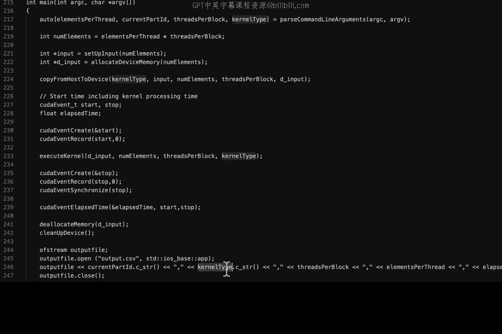

# 059：设备内存实验教程 🧠

在本节课中，我们将学习第五周的实验内容，该实验主要围绕CUDA设备内存展开。我们将详细解析实验说明、代码结构以及核心步骤，帮助你理解如何在CUDA编程中有效地使用不同类型的设备内存。

## 实验概述 📋

实验说明中有一个部分专门讨论了主机代码及其将执行的六个步骤。这些步骤涵盖了从数据准备到内核执行，再到结果输出的完整流程。

## 主机代码执行步骤 📝

以下是主机代码将按顺序执行的六个核心步骤：

1.  **创建数据数组**：根据传入的每个线程块中的线程数量，创建一个大小为“每个线程元素数”的数组。这将作为你的输入数据。
2.  **分配设备内存**：根据你将运行的内核类型，将数据适当地放入设备内存中。
3.  **启动计时器**：启动一个计时器，以便了解内核执行所需的时间。
4.  **执行内核**：根据内核访问的是全局内存、常量内存、共享内存还是寄存器内存，执行相应的内核函数。
5.  **停止计时器**：停止计时器，记录内核执行的总时长。
6.  **输出统计信息**：根据实验ID、内核参数、每个线程的元素数、线程数以及内核执行时间，将统计信息输出到一个CSV文件中。

## 内核函数设计 ⚙️

内核函数本身的设计遵循以下逻辑：

1.  **计算线程跨度**：首先，内核需要确定每个线程处理的“跨度”。这通过将输入数据的总大小除以线程总数来计算。由于这两个值都是常量，这个计算应该非常快，但需要在每次内核执行时进行。
2.  **执行增值操作**：接着，内核会对一个值进行递增操作。这样做的目的是确保内核在执行过程中，确实花费了时间在内存访问上，而不是在其他地方。
3.  **执行核心计算**：然后，执行你的内核想要进行的任何操作。这部分由你决定，你可以根据需要使其变得复杂。
4.  **赋值输出**：最后，将你搜索到的值或某些计算结果，赋值给输出变量或指针。

## 命令行参数解析 🛠️

程序支持三个命令行参数，用于灵活配置实验：

*   `-M`：指定每个线程处理的元素数量。这个值乘以线程总数，就得到了总的数据量。
*   `-N`：指定每个线程块中的线程数量，范围可以从32到1024。
*   `-K`：指定内核类型，即使用哪种内存（全局、常量、共享或寄存器）。

**注意**：由于常量内存和共享内存的容量有限，存在一个能确保程序正常工作的最大数据量。我计算这个值大约是32K。虽然理论上可以是64K，但这里我们留出一些余量。这意味着，例如，你可以设置每个线程处理256个元素，每个线程块有64个线程（总计16K数据）。你可以调整这些数字的组合，但请注意不要超过内存限制。

## 代码结构解析 💻

现在，让我们来看看代码的具体实现。代码中包含了四个内核函数，分别对应全局内存、共享内存、常量内存和寄存器内存。目前，这些内核函数内部基本上是空的，除了计算线程ID的部分。


```c
// 示例：全局内存内核函数框架
__global__ void kernel_global(int *input, int *output, int elements_per_thread) {
    int tid = threadIdx.x + blockIdx.x * blockDim.x;
    int stride = gridDim.x * blockDim.x;
    // ... 你的计算逻辑将写在这里
}
```

你可以自由决定在这些内核函数中实现什么功能，尽情发挥你的创意。

## 辅助函数与主流程 🔧

代码中还包含了一些关键的辅助函数：

*   **分配随机内存**：主机代码会分配一个值在0到255之间的随机内存数组。
*   **分配设备内存**：使用简单的`cudaMalloc`为输入数据分配设备内存。你可以根据内核的需要修改这部分。
*   **释放内存**：执行完代码后，务必使用`cudaFree`释放设备内存中的所有指针，这是良好的编程习惯。
*   **解析命令行参数**：如前所述，这个功能允许你动态设置线程数、元素数和内核类型。
*   **主函数**：作为C/C++程序的核心，主函数负责处理命令行参数、设置设备内存的输入变量、在主机和设备之间复制数据、围绕内核执行进行计时、释放内存、清理设备，并最终输出用于分析的CSV文件。

## 总结 🎯



本节课中，我们一起学习了第五周关于CUDA设备内存的实验。我们详细剖析了实验的六个执行步骤，理解了内核函数的设计逻辑，掌握了如何通过命令行参数配置实验，并浏览了代码的整体结构。这个实验为你提供了实践机会，去探索和比较不同类型设备内存（全局、常量、共享、寄存器）在性能和行为上的差异。请根据实验指导，填充内核函数的具体实现，并运行实验以收集和分析性能数据。