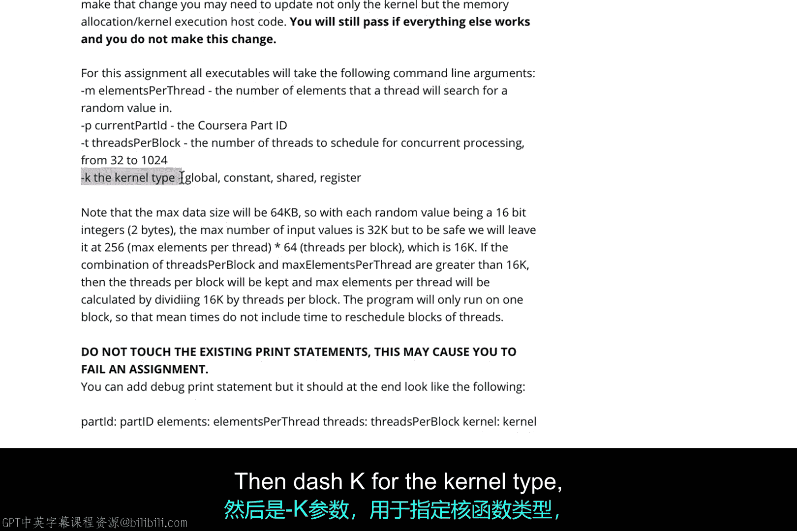
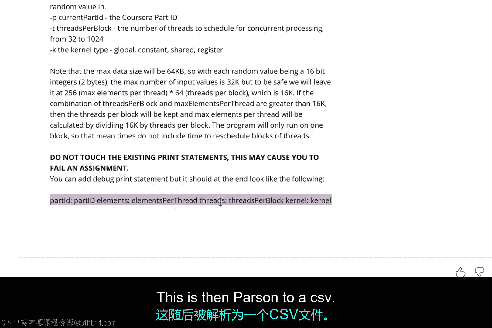
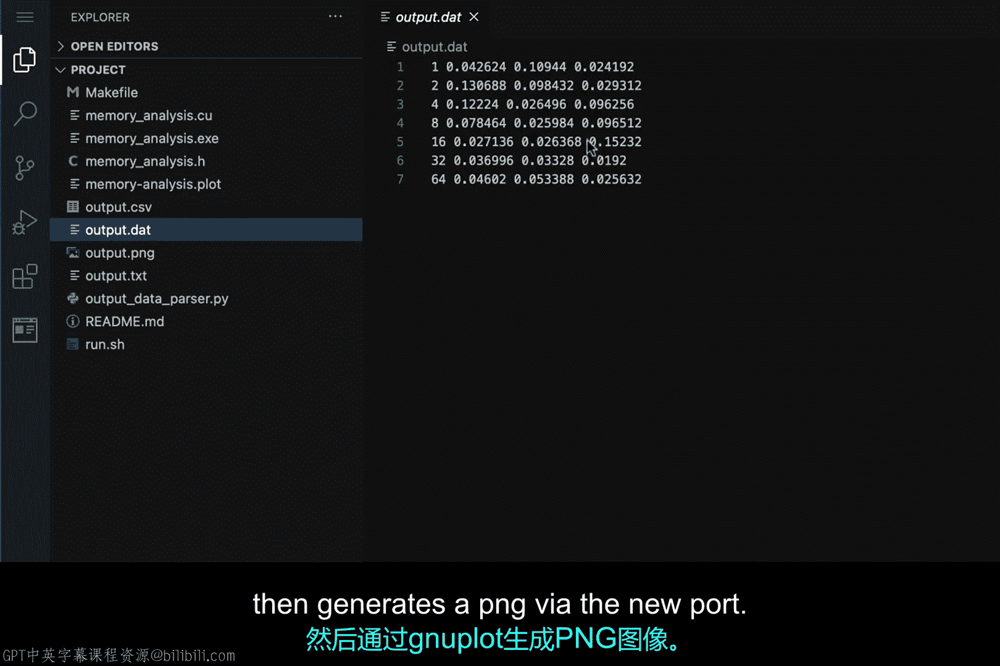
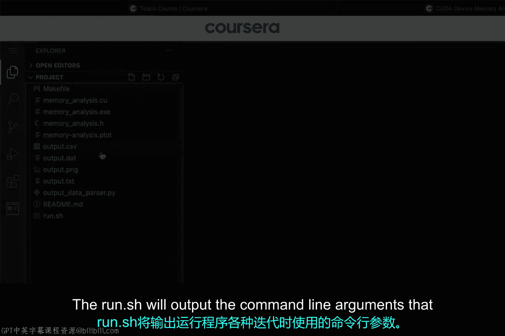
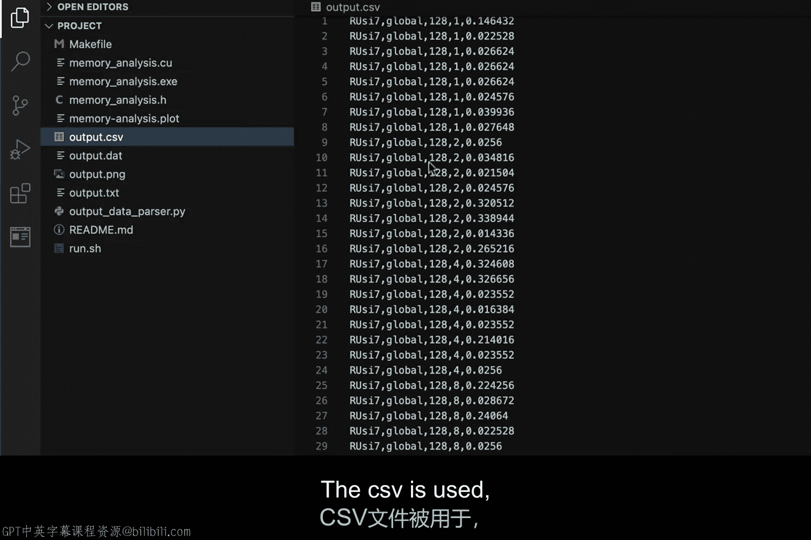
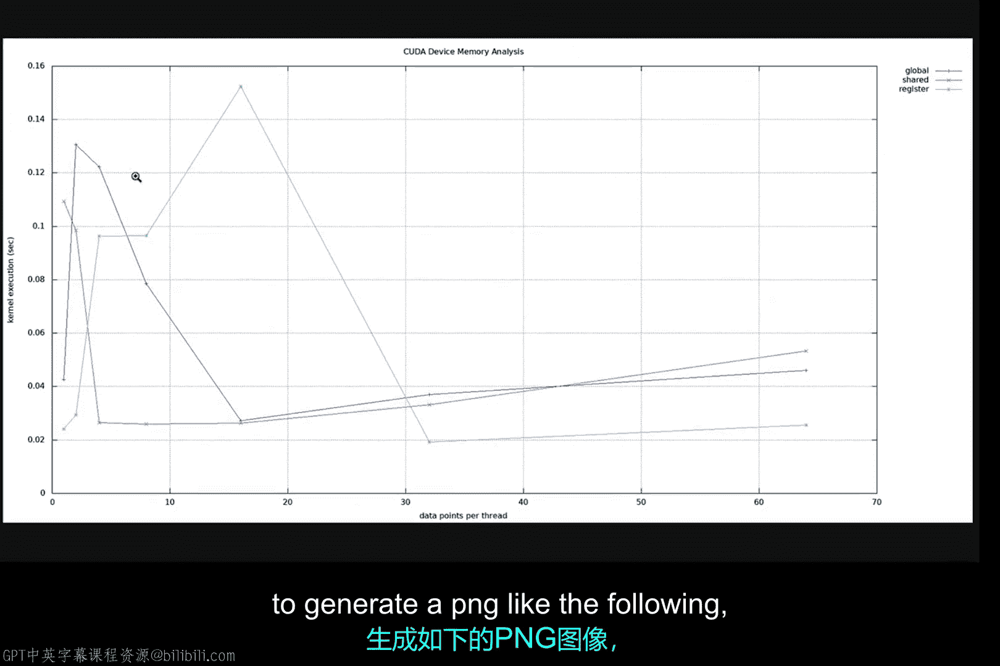
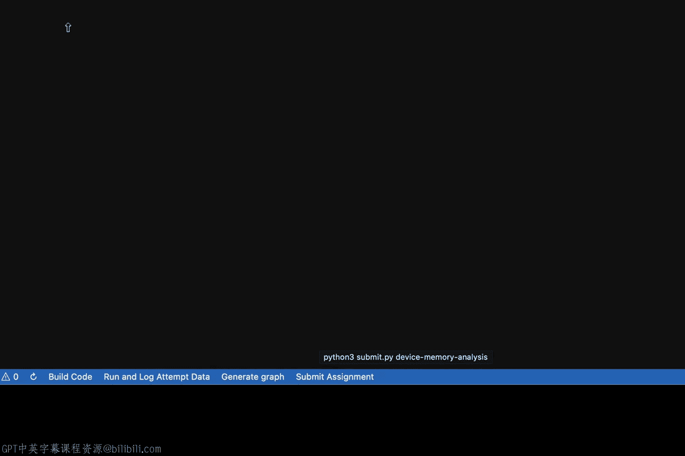

# 060：CUDA设备内存分析作业指南 🧠💻

在本节课中，我们将学习如何完成第5周关于CUDA设备内存分析的编程作业。我们将详细解析作业要求、代码结构、执行流程以及如何获得满分。

## 概述

本次作业的核心是分析不同CUDA内存类型（全局、共享、常量、寄存器）的性能。你的主机代码需要执行六个步骤，而算法部分包含五个步骤。评分脚本`run.sh`默认只运行全局、共享和寄存器内存的内核。若想获得100%的分数，你需要修改该脚本以包含常量内存的测试。

## 作业结构与要求

上一节我们介绍了作业的整体目标，本节中我们来看看具体的执行步骤和参数要求。

你的主机代码应执行以下六个步骤：
1.  确定搜索目标的大小。
2.  递增内存输入。
3.  遍历输入数据。
4.  在数据中查找目标值。
5.  设置输出值。

作业通过命令行传递多个参数：
*   `elements_per_thread`：每个线程处理的元素数量。
*   `current_part_id`：当前部分ID（不应修改，由`run.sh`使用）。
*   `threads_per_block`：每个块的线程数（强制范围32到1024）。
*   `kernel_type`：内核类型，可选值为 `global`、`constant`、`shared`、`register`。

**注意**：请避免修改任何打印语句，否则可能导致作业评分失败。你可以添加调试用的打印语句，但最终输出格式应大致如下模式：`part ID, elements, threads, kernel`。此输出将被解析为CSV文件。

## 代码解析与实现要点

了解了作业框架后，我们深入看看需要你编写的核心代码部分。

代码中提供了四个内核函数的框架，分别对应全局、共享、常量和寄存器内存。每个内核内部已给出基本结构，你需要根据注释完成具体逻辑。内核的主要任务是正确处理线程ID并确保不会发生越界访问。

在主机端代码中，你需要：
1.  分配可分页的随机内存。
2.  分配设备内存。
3.  将数据从主机复制到设备。
4.  根据传入的`kernel_type`参数，执行相应的内核。

特别需要注意的是，变量 `thread_span` 需要你计算并使用，它用于确定每个线程处理的数据范围，对于某些类型设备内存的访问模式至关重要。

对于常量内存，搜索值 `symbol` 已在代码中预设，这是为了防止在其他地方遗漏设置。

## 执行、评分与可视化

完成了代码编写，下一步就是执行、评分并生成可视化结果。

主函数 `main` 的运行逻辑与实验课类似。它封装了内核执行的时间测量，负责内存的分配与清理，并输出可被解析的CSV格式结果。

`run.sh` 脚本将输出用于运行程序不同迭代的命令行参数。如前所述，生成的CSV文件用于创建性能对比图。

以下是作业执行的完整流程：
1.  **修改 `run.sh`**：将其中的循环修改为遍历 `global`、`shared`、`register` 和 `constant` 内存类型。
2.  **构建代码**：执行 `build_code`。
3.  **运行与记录**：执行 `run_and_log_attempts` 来运行 `run.sh`。
4.  **生成图表**：使用 `generate_graph` 并配合 `gnuplot` 生成性能图表。
5.  **提交作业**：完成上述步骤后提交作业。

**重要提示**：`run.sh` 脚本会遍历不同的内核类型、每个线程处理的元素数量以及迭代次数，以生成平均值。Python脚本 `parse_output.py` 会读取输出的CSV文件并生成供 `gnuplot` 使用的数据文件。

## 总结

本节课中我们一起学习了第5周CUDA设备内存分析作业的完整指南。我们明确了作业的六个执行步骤和五个算法步骤，分析了四种内存类型（全局、共享、常量、寄存器）内核的实现要点，并梳理了从代码编写、修改评分脚本、执行测试到生成可视化图表的全流程。记住，若要获得满分，必须修改 `run.sh` 以包含常量内存的测试。