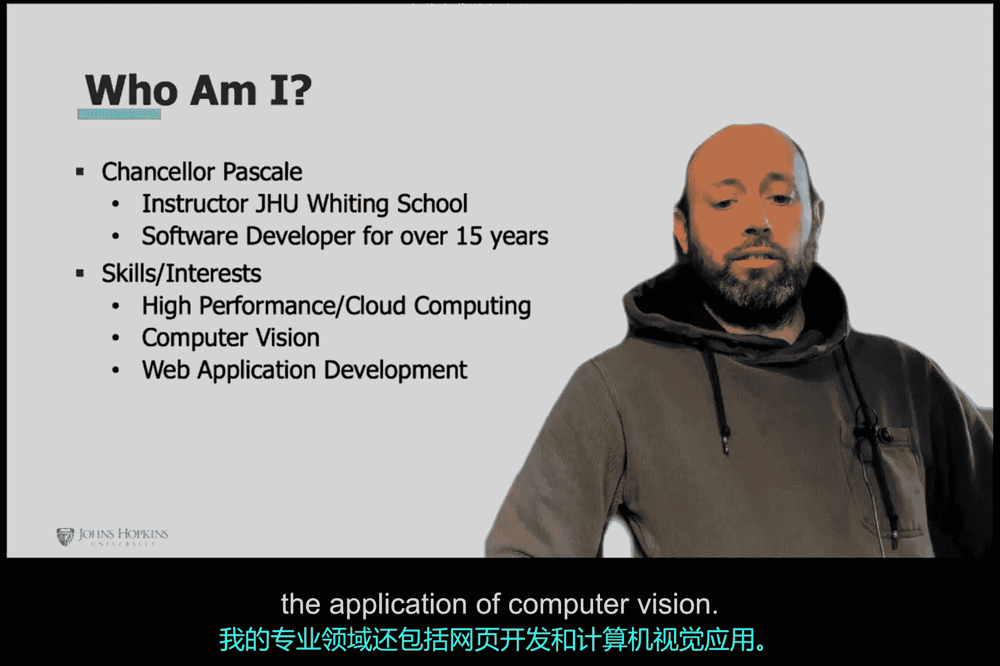
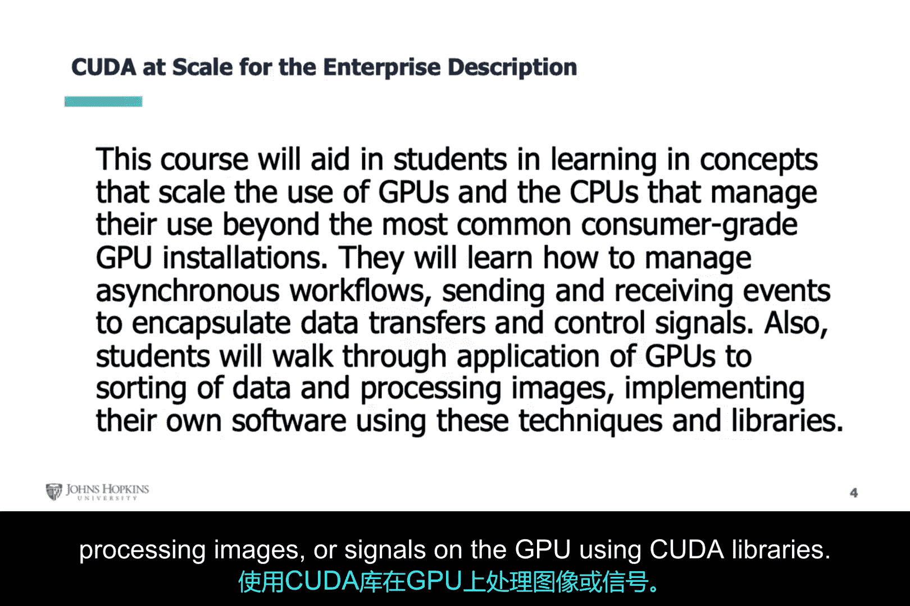
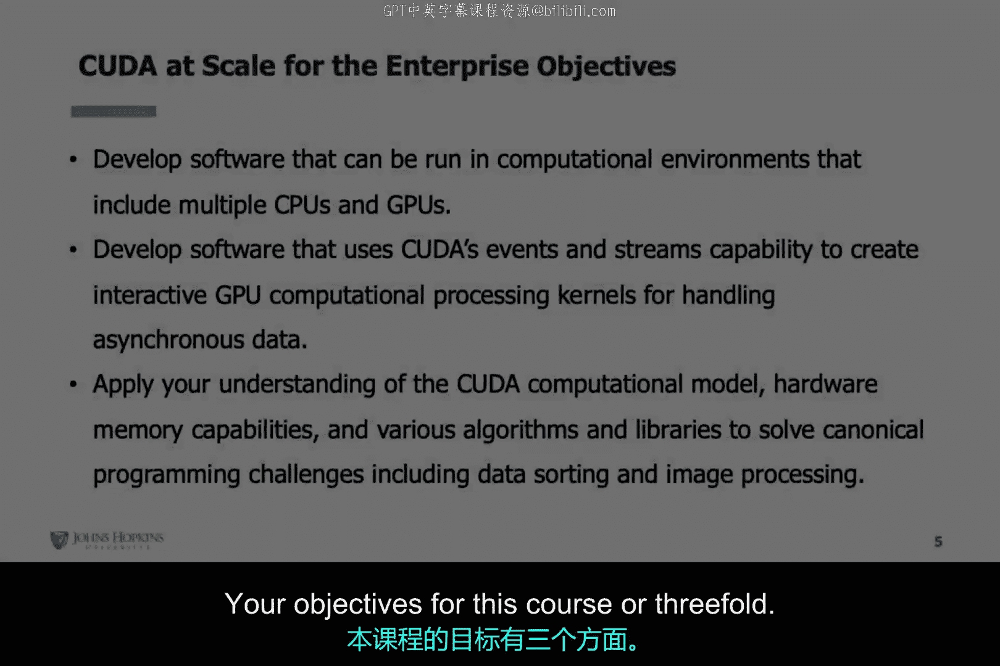
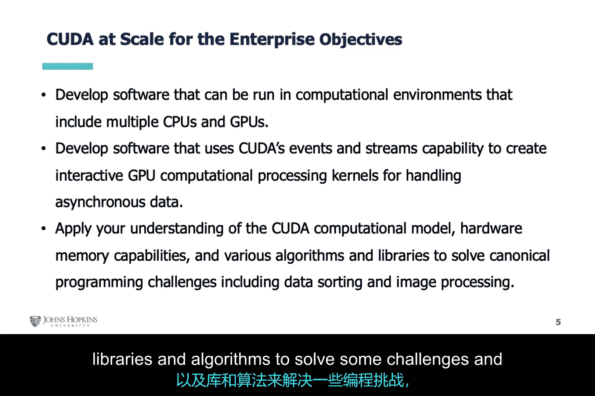

# 061：课程总览 🚀

在本节课中，我们将对约翰霍普金斯大学的GPU编程专项课程进行总览，了解整个课程体系的结构、目标以及你将学习到的核心内容。

大家好，欢迎来到《面向企业的规模化CUDA》课程。我们将基于你在前两个模块中学到的知识进行扩展，探索如何将其应用于处理更大规模的数据、更复杂的算法，以及利用CUDA提供的库。

我是Chancellor Pascal。我在约翰霍普金斯大学怀廷工程学院担任了10年的讲师，同时也是一名拥有15年经验的软件开发人员。高性能计算、云计算、Web开发以及计算机视觉的应用都是我的兴趣所在。现在，我想为你概述一下Coursera平台上的GPU专项课程。

## 课程体系结构

以下是GPU专项课程包含的四门课程：

*   **第一门课程**：**《GPU并发编程导论》**。这是你当前所在的课程，我将在下一张幻灯片中详细介绍。
*   **第二门课程**：**《CUDA并行编程导论》**。这门课程重点介绍NVIDIA GPU和CUDA编程框架提供的基本硬件与软件能力。
*   **第三门课程**：**《面向企业的规模化CUDA》**。这门课程深入探讨CUDA更复杂的功能，以及如何将其应用于超越程序员个人机器的企业级硬件，实现规模化计算。
*   **第四门课程**：**《CUDA高级库》**。这门课程向学生介绍CUDA开发者工具包中附带的一系列最流行且功能强大的库。

## 本课程具体内容

现在，让我们具体谈谈你正在学习的这门《GPU并发编程导论》课程。

上一节我们介绍了整个课程体系，本节中我们来看看本课程的核心学习内容。你将学习如何为以下配置进行编程：

*   单GPU配合多CPU
*   单CPU配合多GPU
*   两者结合（这是GPU安装的常见模式）

接下来，你将学习如何处理**流（Streams）**和**事件（Events）**。它们允许异步工作流，使你能够在不同数据上重复运行相同的内核（Kernel），并控制执行顺序。

最后，我们将重点介绍一些库和技术，这些最终能让你在GPU上实现诸如数据排序、使用CUDA库处理图像或信号等任务。

## 课程目标

本课程的学习目标有三方面：

1.  **环境利用**：在给定多CPU和/或多GPU的环境中，开发能恰当利用这些资源的软件。
2.  **异步控制**：使用CUDA流和事件与GPU及内核进行异步交互。
3.  **解决挑战**：运用你对CUDA硬件、GPU能力、库和算法的理解，解决编程中的一些挑战，包括数据排序和图像处理。

本节课中我们一起学习了GPU编程专项课程的整体框架、本课程《GPU并发编程导论》的具体学习内容与目标。希望本次介绍能让你开始思考自己在本课程乃至整个GPU专项课程中希望实现的目标。本次介绍到此结束。