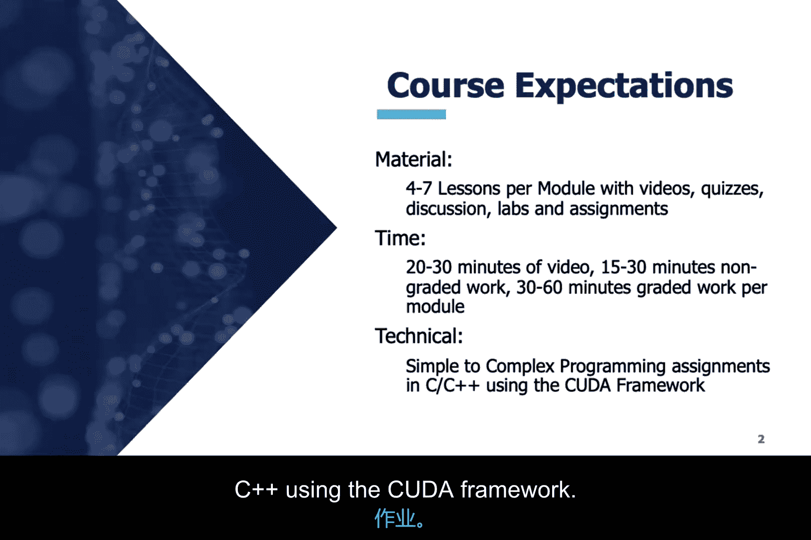
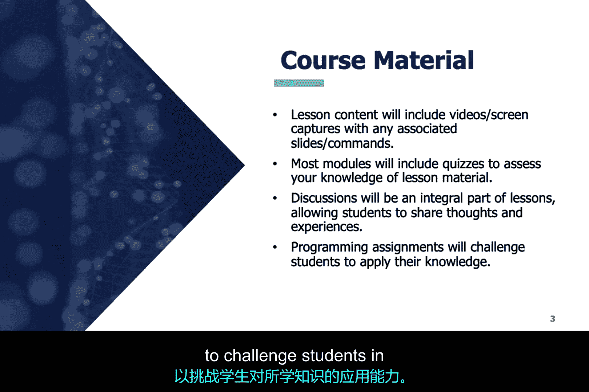
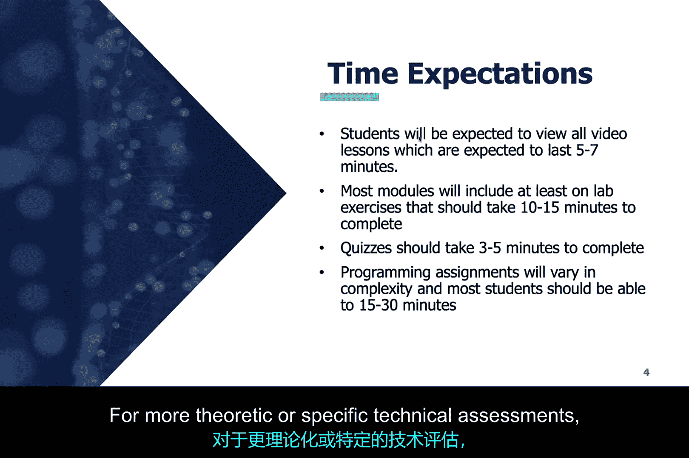
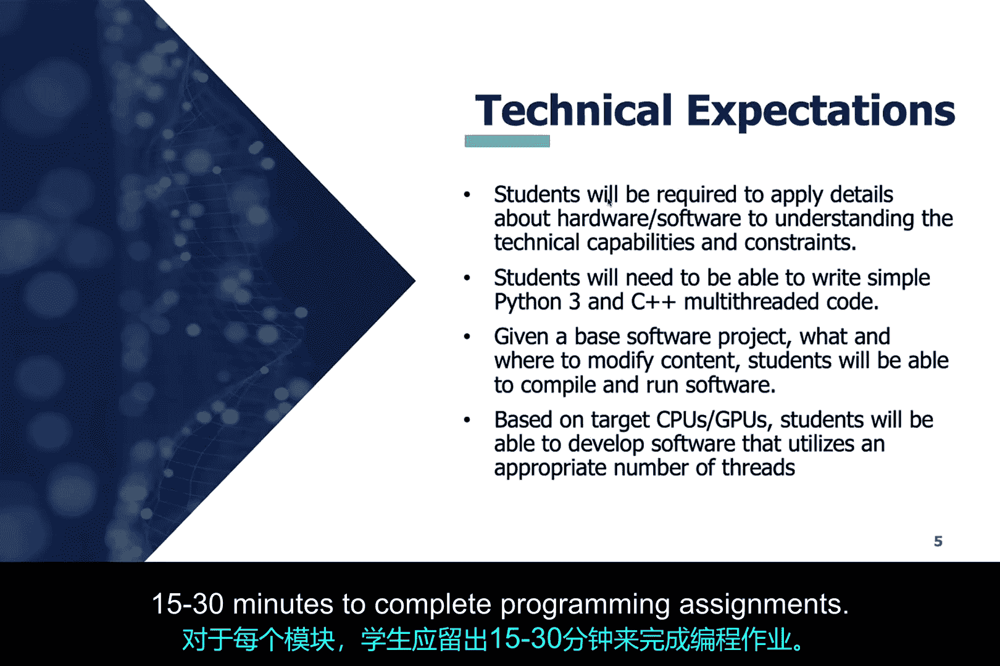
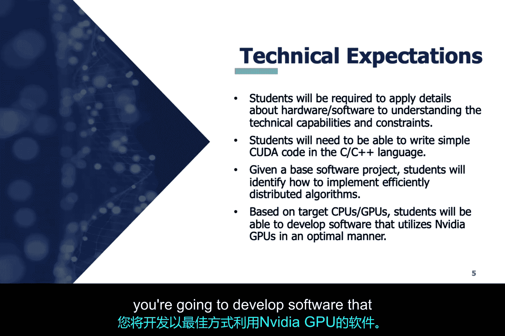
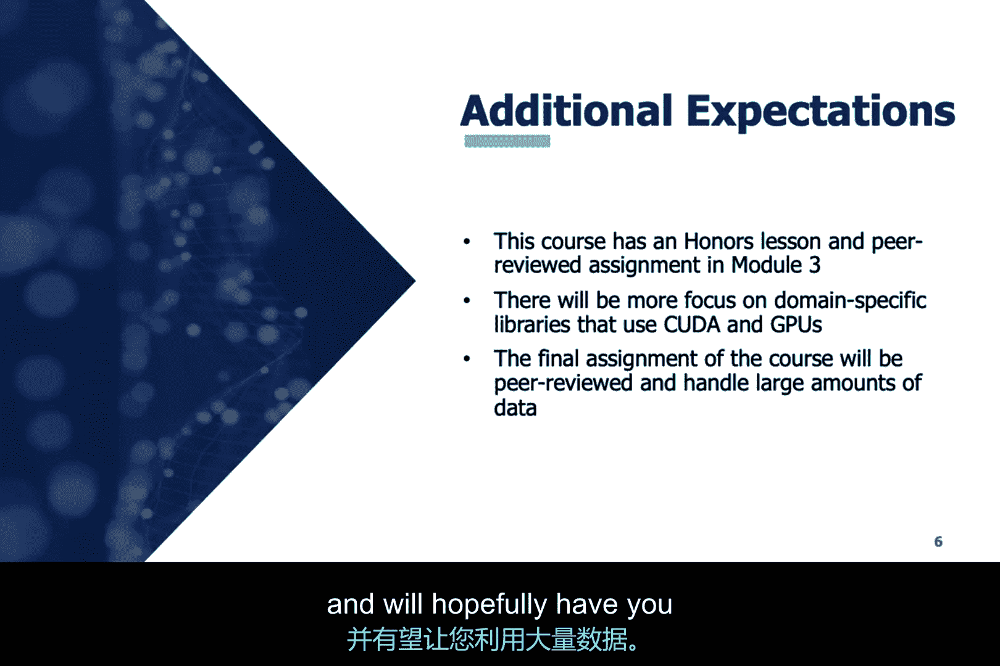

# 062：课程预期目标 🎯

在本节课中，我们将了解《面向企业的规模化CUDA编程》课程的整体预期目标。我们将从课程材料、时间投入和技术要求等多个维度，详细说明学习本课程需要完成的任务和达到的水平。

## 课程材料与结构 📚

从课程材料的角度来看，本课程的结构安排如下。

每个模块将包含4到7节课，每节课配有视频、测验等内容。

## 时间投入预期 ⏱️

从时间投入的角度来看，学生需要为以下内容预留时间。

以下是每周大致的课时分配：
*   每周将有20到30分钟的视频学习内容。
*   每周将有15到30分钟的非计分作业，例如实验和讨论。
*   每周将有30到160分钟的计分作业，形式为编程作业和测验。

此外，学生需要能够使用CUDA框架和C++语言，完成从简单到复杂的编程作业。

## 课程内容形式 📺

上一节我们了解了时间分配，本节中我们来看看课程内容的具体形式。

每节课将包含以幻灯片或屏幕录制形式呈现的视频材料。
*   配有旁白的幻灯片视频将同时提供对应的PowerPoint幻灯片文件。
*   对于包含屏幕录制内容的视频，其中使用的命令也将被提供。

许多模块会包含测验，用于评估学生对讲座内容的理解。

为了鼓励协作和分享想法与经验，每个模块都将包含讨论环节，学生应将其视为学习过程中不可或缺的一部分。

为了挑战和评估学生对技术主题的理解，大多数模块将使用编程实验活动和作业，来检验学生应用所学知识的能力。

## 各环节时长预估 🕒

了解了内容形式后，我们来预估完成每个环节所需的具体时间。

每节课将包含讲座和技术应用视频，这些是深入理解课程主题所必需的，每个视频时长在5到7分钟之间。

实验活动将允许学生在实际环境中探索技术主题，通常需要10到15分钟来掌握其核心要点。

对于更理论化或特定的技术评估，学生需要完成测验，每个模块的测验预计需要3到5分钟。

对于每个模块，学生应预留15到30分钟来完成编程作业。

## 技术要求与能力 🔧

前面介绍了课程的形式与时间，本节我们将深入探讨课程对学生的具体技术要求。

你需要理解如何利用硬件和软件的约束与能力细节来优化程序。

你必须能够使用C++语言编写至少简单的CUDA代码。

我将提供一个基础的软件项目，然后对于作业，你需要能够识别在何处放置你的代码，以及如何最高效地分配算法。

最后，根据目标GPU以及你自有硬件或Coursera实验平台的GPU，你将开发出能够以最优方式利用NVIDIA GPU的软件。

## 本课程的额外特色 🚀

与先前的课程相比，本课程还有一些额外的特色和期望。

以下是本课程特有的环节：
*   在模块3中，设有一个荣誉课程和一个同行评审作业。
*   课程将更侧重于介绍可用的、特定领域的CUDA库，以利用GPU进行计算。
*   最终作业将包含同行评审环节，并期望你能处理大量数据。

## 总结 📝

本节课中，我们一起学习了《面向企业的规模化CUDA编程》课程的详细预期目标。我们了解了课程的材料结构、每周需要投入的时间、各种学习环节的形式与时长，以及课程对学生提出的具体技术能力要求。此外，我们还明确了本课程相比之前课程的独特之处，包括荣誉课程、同行评审和对特定领域库的深入探讨。掌握这些信息，将帮助你更好地规划学习路径，为后续的深入学习做好准备。