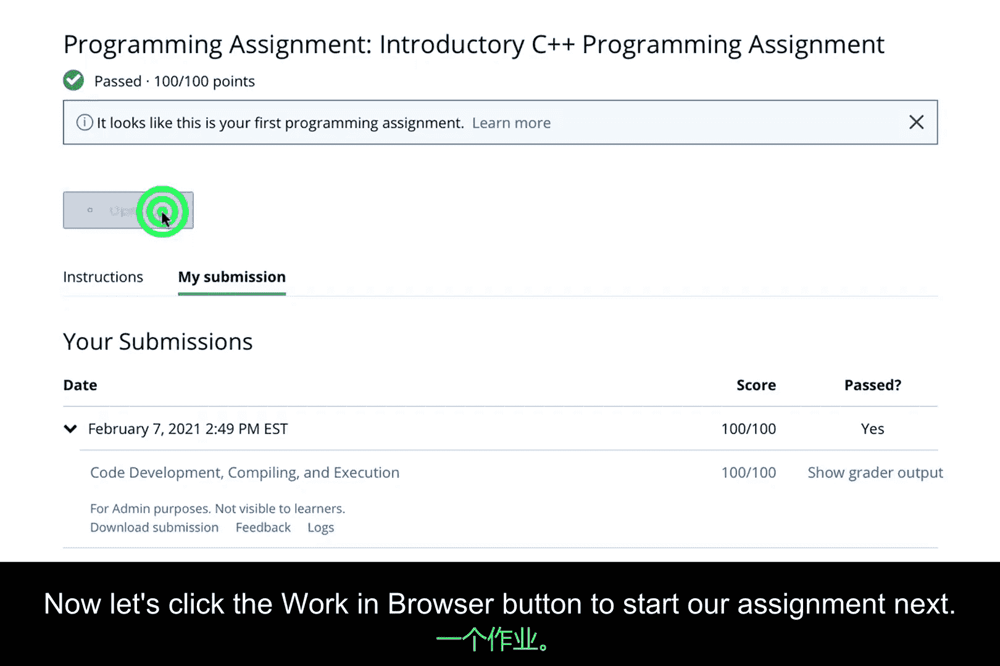
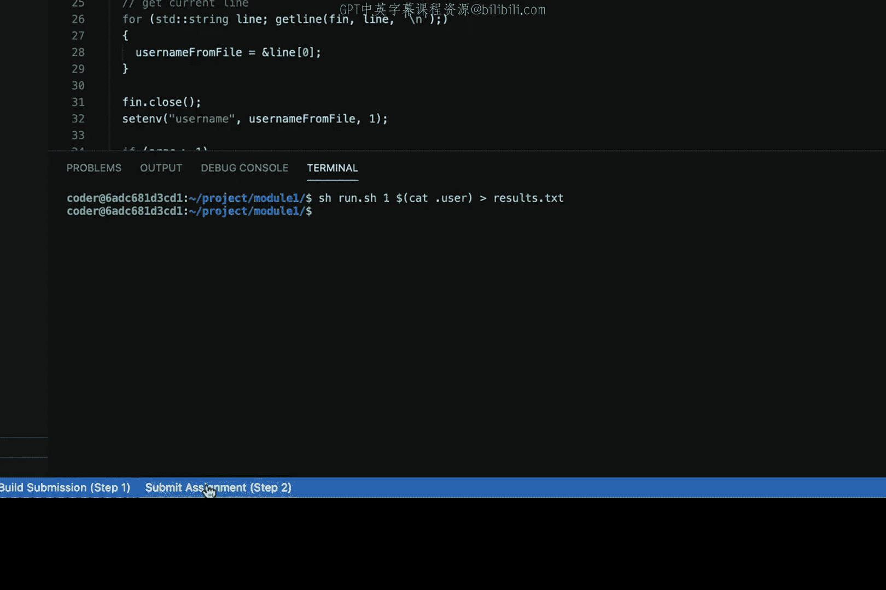
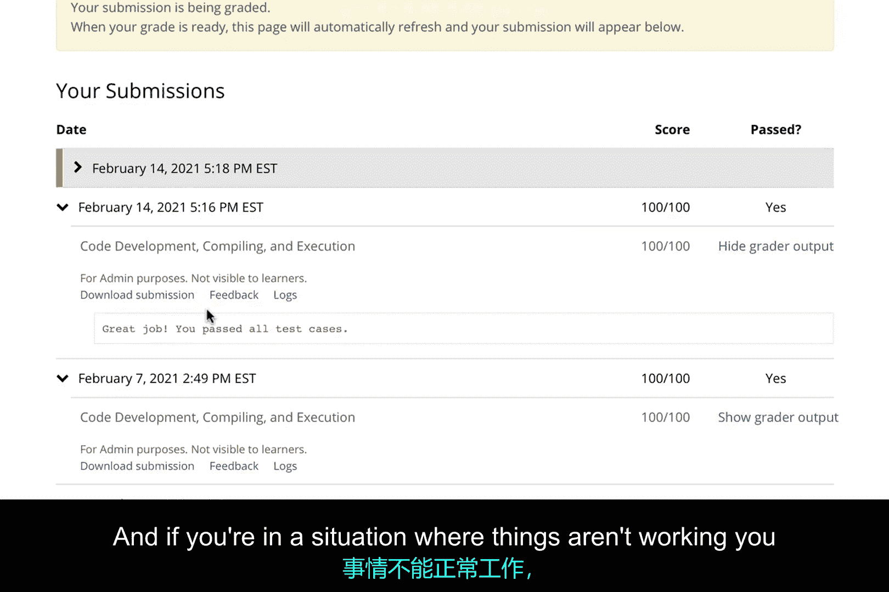
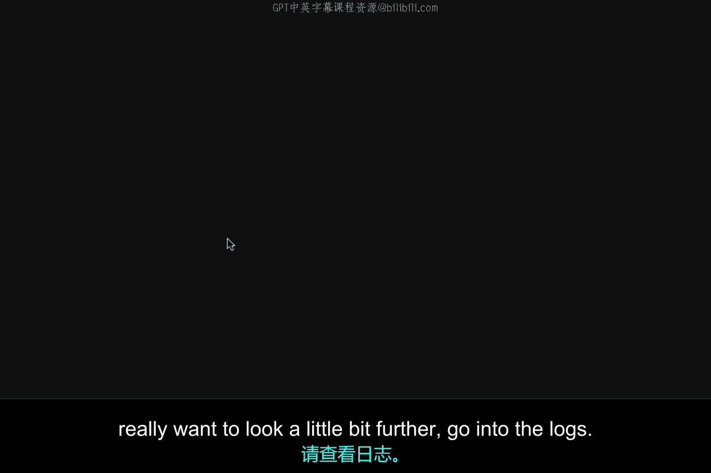

# 063：Coursera实验与作业综述 🧑‍💻

在本节课中，我们将学习约翰霍普金斯大学《GPU编程》课程中，关于Coursera平台实验与作业的完整操作流程。我们将详细介绍从打开环境到最终提交作业的每一个步骤。

---

## 概述

Coursera平台上的实验与作业遵循一个清晰的六步流程。我们将逐一拆解这些步骤，确保你能顺利完成课程任务。

---

## 实验与作业开发六步流程

以下是完成Coursera实验活动的六个标准步骤。

1.  **打开Coursera实验环境**：在浏览器中使用集成的VS Code编辑器。
2.  **打开模块目录并阅读说明**：定位到`modules`目录，仔细阅读`README.md`文件。
3.  **编辑源代码文件**：根据任务要求，修改`.cu`、`.cpp`、`.h`或`.hpp`等源代码文件。
4.  **在终端中执行命令**：使用`make`命令来清理、构建和运行你的代码。对于作业，可能需要多次迭代。
5.  **（仅作业）编辑用户文件**：按照`README.md`中的说明，编辑`.user`文件并修改指定的代码变量。
6.  **提交作业**：完成代码后，通过平台界面提交你的作业。

---

## 模块作业页面详解

上一节我们介绍了通用流程，本节中我们来看看作业页面的具体布局和功能。

这是模块1编程作业的页面。我们将逐步讲解完成作业所需的所有操作。


页面主要包含以下几个区域：
*   **进度通知区**：显示作业完成状态。
*   **“在浏览器中工作”按钮**：点击此按钮启动实验环境。
*   **作业完成指南**：提供详细的步骤说明。
*   **提交结果区**：显示作业评分和反馈。

现在，点击 **“在浏览器中工作”** 按钮来启动我们的作业。



---

## 在VS Code中打开项目

启动环境后，你需要在VS Code中打开与实验或作业关联的目录。

如果你在页面顶部附近没有看到模块名称，请按以下步骤操作：
1.  点击菜单栏中的 **“文件”** 选项。
2.  从下拉菜单中选择 **“打开”**。
3.  在弹出的“打开文件或文件夹”对话框中，你可以通过点击 `..`（双点号）向上导航目录结构。

对于本课程项目，你需要导航至以下路径：
```
/home/coder/project/module_1
```
在对话框中找到所需文件夹后，点击 **“确定”** 按钮。该文件夹将在编辑器左侧打开，其中包含开始当前模块实验或作业所需的所有文件。

---

## 关键文件说明

打开项目后，你应该首先阅读`README.md`文本文件，其中包含背景材料和具体的作业要求。

以下是项目中几个关键文件的作用：
*   `README.md`：**核心说明文件**，包含作业背景和详细指令。
*   `run.sh`：**运行脚本**，用于执行作业的所有步骤。
*   `Makefile`：**构建文件**，用于清理、构建和运行你的代码。

**请注意**：你通常不需要修改`run.sh`和`Makefile`这两个文件，只需专注于修改代码及其他相关文件。

---

## 作业提交前的关键配置

如果你正在完成一项作业，接下来需要确保用户名配置正确，这是提交的前提。

配置涉及两个文件：
1.  **`.user`文件**：确保该文件内容是你的用户名（可以是任意名称或登录名，但不能包含特殊字符）。
2.  **主代码文件**：例如`assignment.cpp`，你需要修改`user_name`字符串常量，使其与`.user`文件中的名称一致。

通过编辑这两个文件，你可以保证你的提交满足作业的**用户名验证**这一首要要求。当你通过`run.sh`或`make`命令执行代码时，也需要传递相同的用户名。

**代码示例**（在`assignment.cpp`中）：
```cpp
const std::string user_name = “YourUserNameHere”;
```

---

## 构建与提交作业

完成代码编写和配置后，即可提交作业。提交分为两个步骤：

1.  **点击构建提交（步骤1）**：点击页面底部的 **“构建提交 步骤1”** 按钮。页面底部将出现一个终端窗口，它会清理、构建并执行你的当前代码，并将输出结果保存到一个用于评分的文件中。请留意终端中的任何输出信息。
2.  **点击提交作业（步骤2）**：然后点击附近的 **“提交作业 步骤2”** 按钮，将生成的文件提交给评分系统。


---

## 查看提交结果与日志

提交后，你可以在作业页面查看提交结果。结果在评分器运行期间会显示为琥珀色（处理中）。



打开提交结果后，你可以看到：
*   **成绩**：你的得分。
*   **是否通过**：作业通过状态。
*   **反馈**：评分器提供的具体反馈信息。

如果你遇到问题或作业未通过，需要进一步排查，可以查看详细的**日志文件**以获取更多信息。




---


## 总结


本节课中，我们一起学习了在Coursera上完成《GPU编程》实验与作业的完整流程。我们从**打开实验环境**开始，逐步了解了如何**导航项目目录**、**阅读说明文件**、**编辑代码和配置文件**，最后完成了**构建与提交作业**以及**查看评分结果**的全过程。掌握这个标准化流程，将帮助你高效地完成后续的所有编程任务。