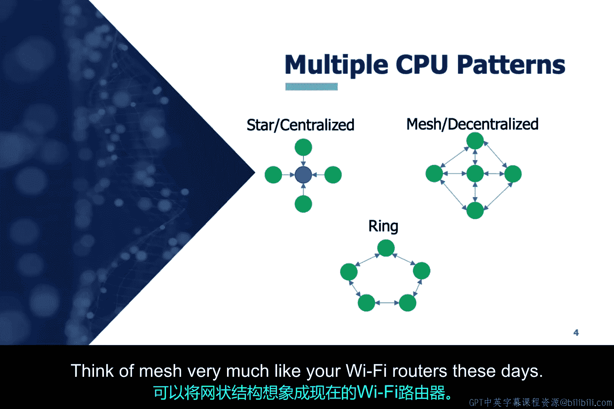
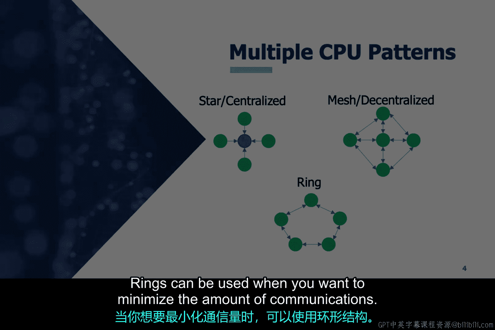
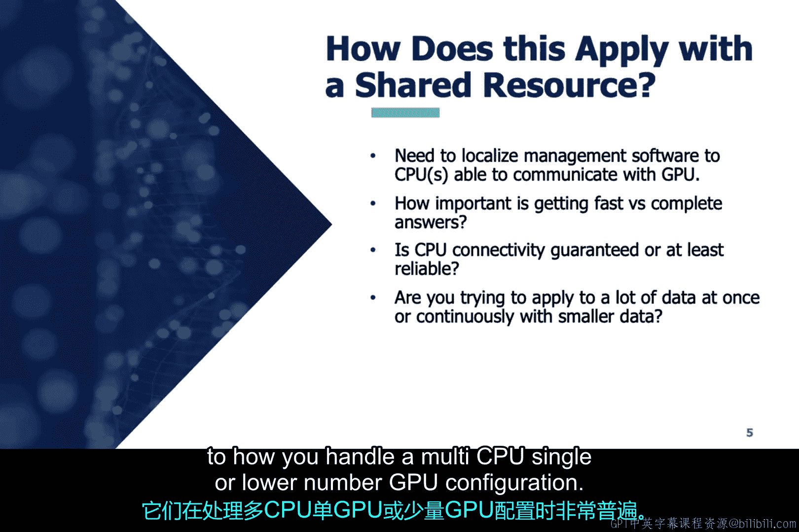

# 064：多CPU架构解析 🖥️

在本节课中，我们将学习如何在一个架构中利用多个CPU进行协同工作。我们将探讨CPU间通信的不同模式、技术选择以及设计多CPU系统时需要考虑的关键约束。

## 概述

为了在多个CPU之间实现通信，需要选择一种模式或技术。一个常见的选择，尤其是在过去，是使用文件系统。

## 通信模式与技术

以下是几种常见的CPU间通信模式与技术。

*   **文件系统**：通过锁文件或远程服务器上的文件进行通信。可以认为，万维网（World Wide Web）最初就是这样开始的。
*   **套接字（Sockets）**：预定义的双向通信方式，允许点对点通信。
*   **消息队列系统（Message Queuing Systems）**：包含一个缓冲区或队列，用于存储消息。另一端的处理系统会从中取出消息，并可能通过另一个消息队列进行回复。
*   **更规范的协议**：例如**RPC（远程过程调用）** 或 **REST**，它们通过已知的方法进行通信。

## 设计约束与考量

在设计多CPU通信系统时，需要考虑以下重要约束和因素。

*   **同步与异步**：通信是同步还是异步？是否需要立即得到响应，还是可以发送请求后稍后再查看结果？
*   **数据一致性**：数据一致性是否是一个问题？
*   **数据传输模式**：是批量发送大量数据，还是以流的形式持续发送少量数据？
*   **连接与网络弹性**：连接和网络的健壮性如何？
*   **安全性**：是否需要考虑安全性？不同的进程或用户是否需要不同的访问权限或角色？

## 常见的网络通信拓扑

上一节我们介绍了通信的技术与约束，本节中我们来看看三种常见的多台联网计算机之间的通信拓扑模式。

*   **星型/集中式（Star/Spoke/Centralized）**：存在一个中心枢纽，所有通信都通过它进行。
*   **网状/去中心化（Mesh/Decentralized）**：所有节点基本上都可以相互通信，或者与一定数量的邻居节点连接。
*   **环型（Ring）**：邻居节点之间通信，但只与一跳之内的邻居通信，因此通信相对稀疏。

可以将网状网络想象成如今的Wi-Fi路由器。当你想最小化主题通信时，可以使用环型网络。

## 与GPU共享资源的结合

那么，当你想使用像GPU这样的共享资源时，这些模式如何工作呢？

如果你采用**星型**网络模式，可以将GPU放在那个中心枢纽上。反之，如果你知道某个节点有GPU，也可以将其设为中心枢纽。如果有多台机器都拥有GPU（但每台可能只有一个），那么可能更适合使用**去中心化的网状网络**。

通信速度或对响应的要求可能会影响你的决策。

*   你是需要大量部分答案，还是需要完整的答案？
*   你是否确定CPU之间会始终保持连接，还是连接可能是突发性的？如果是后者，批量处理（batch）可能更好，即在连接存在时发送批次数据。
*   如果接收大量小响应很重要，但允许丢失部分数据（类似于UDP通信协议），那么可以使用**流（stream）** 模式。在这种模式下，系统不断尝试连接并发送数据，即使有些数据没有完全送达也没关系。

这又回到了一个问题：你是需要一次性处理所有数据，还是可以处理部分数据？例如，对于图像，你可能不需要整张图像都在；对于视频，你可能不需要所有帧。你可以一次发送一帧视频或图像的一部分，然后让流来处理。

## 总结

本节课中我们一起学习了多CPU架构中的通信模式，包括文件系统、套接字、消息队列和RPC/REST等技术。我们探讨了设计时需考虑的同步性、数据一致性、传输模式和安全性等约束。同时，我们分析了星型、网状和环型三种网络拓扑，并讨论了它们如何与GPU等共享资源结合，以及如何根据对通信速度和数据完整性的要求选择批量或流式处理策略。这些模式对于处理多CPU、少量GPU的配置至关重要。