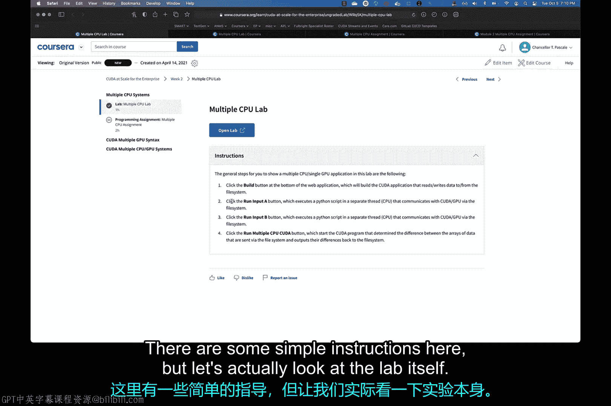
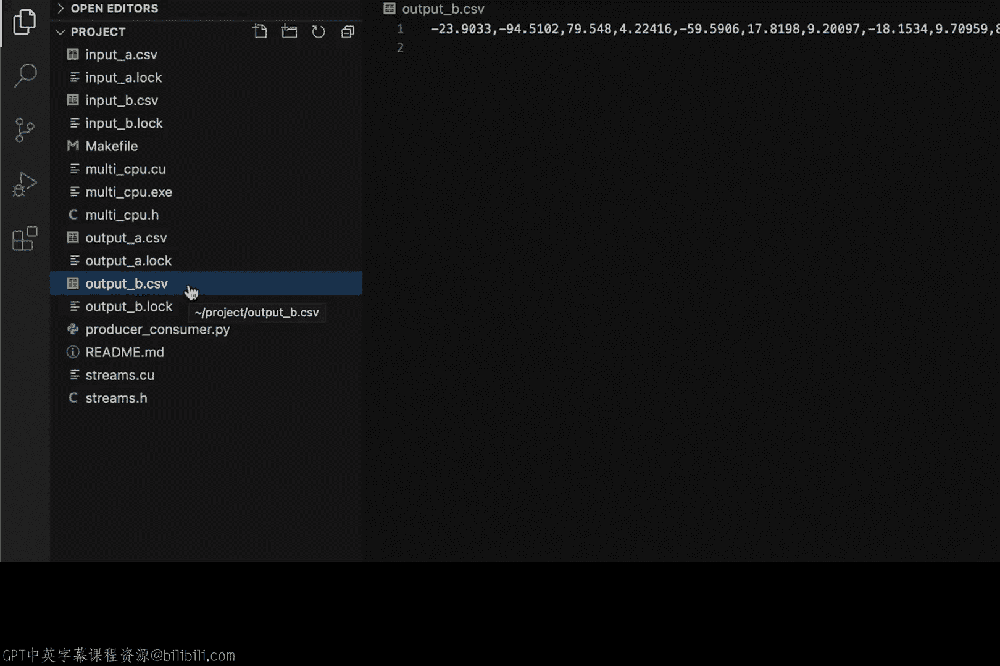

# 065：多CPU实验项目概述 🧪



在本实验中，我们将学习如何构建一个多CPU与GPU协同工作的异步通信系统。该系统包含Python脚本作为数据生产者，CUDA C++代码作为数据处理者，它们通过文件系统和锁文件进行同步。

## 实验文件结构 📁

以下是实验目录中的关键文件及其作用。

*   **输入文件**：`input_A.csv` 和 `input_B.csv`。这些文件由Python脚本生成，包含待处理的浮点数数据。
*   **锁文件**：`input_A.lock` 和 `input_B.lock`。这些文件不包含实际数据，仅作为同步信号，用于指示某个文件正在被读取或写入，以防止数据竞争。
*   **输出文件**：`output_A.csv` 和 `output_B.csv`。这些文件由CUDA程序生成，包含处理后的结果。
*   **输出锁文件**：`output_A.lock` 和 `output_B.lock`。功能与输入锁文件类似，用于同步输出文件的写入过程。
*   **Python脚本**：`run_input_A.py` 和 `run_input_B.py`。它们作为数据生产者，负责生成随机数并写入对应的CSV文件。
*   **CUDA C++代码**：`cuda_to_file.cu`。这是核心的数据处理程序，从输入文件读取数据，在GPU上进行计算，并将结果写入输出文件。

## Python生产者脚本解析 🐍

上一节我们介绍了实验的整体结构，本节中我们来看看数据生产者——Python脚本的具体工作方式。

Python脚本 `run_input_A.py` 和 `run_input_B.py` 逻辑相同。它们接受两个参数：输入标识符（`A` 或 `B`）和要生成的元素数量。脚本的核心工作是循环执行以下步骤：
1.  生成指定数量的随机数。
2.  等待对应的输入锁文件消失（表示GPU程序未在读取）。
3.  将随机数写入 `input_[A|B].csv` 文件。
4.  创建锁文件 `input_[A|B].lock`，通知GPU程序有新数据待处理。
5.  等待GPU程序处理完毕（通过检查输出锁文件）。
6.  从输出文件读取结果并打印。

其关键函数调用类似于：
```python
# 示例性逻辑
write_data_to_csv(“input_A.csv”, random_data)
create_lock_file(“input_A.lock”)
```

## CUDA C++处理程序解析 ⚙️

了解了数据如何产生后，我们现在进入核心环节：查看CUDA C++程序如何处理这些数据。

主程序 `cuda_to_file.cu` 的核心是一个无限循环，它不断检查输入锁文件，执行GPU计算，并输出结果。其主要流程如下：

1.  **内存分配**：使用CUDA统一内存（Unified Memory）为输入和输出数组分配空间，这简化了主机与设备间的数据拷贝。
    ```cpp
    float *d_input, *d_output;
    cudaMallocManaged(&d_input, data_size);
    cudaMallocManaged(&d_output, result_size);
    ```
2.  **数据检索**：当检测到输入锁文件存在时，程序读取对应的CSV文件，将字符串解析为浮点数数组，并存入 `d_input`。
3.  **内核执行**：配置线程块和网格，启动CUDA内核。内核的核心计算是求两个输入向量中对应元素的差值。
    ```cpp
    __global__ void vectorDiffKernel(float* inputA, float* inputB, float* output, int n) {
        int i = blockIdx.x * blockDim.x + threadIdx.x;
        if (i < n) {
            output[i] = inputA[i] - inputB[i]; // 核心计算：差值
        }
    }
    ```
4.  **结果输出**：将GPU计算得到的差值结果（存储在 `d_output`）写入 `output_[A|B].csv` 文件，并管理输出锁文件。
5.  **同步信号**：删除输入锁文件，通知Python生产者可以写入下一批数据；创建输出锁文件，通知生产者结果已就绪。

## 实验运行与观察 🚀

现在我们已经理解了各个组件的工作原理，接下来看看如何运行整个系统并观察其行为。

你需要打开三个独立的终端窗口或标签页，分别执行以下命令：

1.  运行生产者A：`python run_input_A.py A 100`
2.  运行生产者B：`python run_input_B.py B 100`
3.  运行GPU处理程序：`./cuda_to_file`

所有程序都将持续运行，直到你使用 `Ctrl+C` 手动终止。在运行过程中，你可以观察输出文件的内容。需要注意的是：
*   由于异步执行，`output_A.csv` 和 `output_B.csv` 中同一位置的值通常并不对应同一批输入数据的处理结果。
*   然而，从数学上看，`output_A` 中的值应是 `output_B` 中对应值的相反数。这是因为对于同一对数据 `(a, b)`，从A视角计算是 `a - b`，从B视角计算是 `b - a`，两者互为相反数。

## 总结 📝



本节课中我们一起学习了如何构建一个基于文件锁的多CPU/GPU异步协作系统。我们剖析了Python数据生产者与CUDA数据处理者的角色，理解了它们如何通过锁文件实现松耦合的同步。我们还查看了核心的CUDA内核函数，它执行了简单的向量差值计算。这个实验展示了在异构计算环境中实现任务级并行和数据流的一种实用模式。你可以尝试修改数据大小、计算逻辑或同步机制来进行更深入的探索。