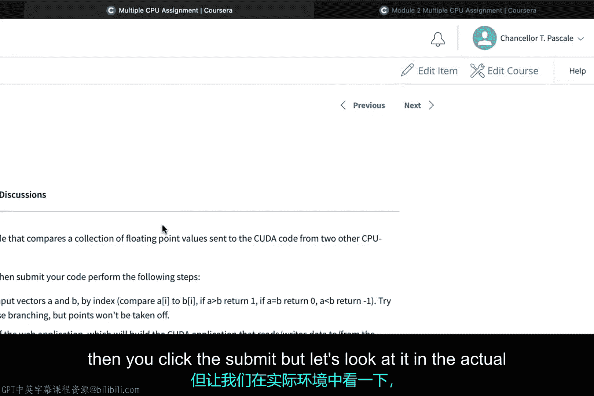
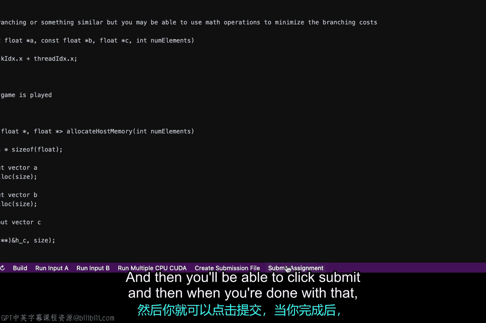
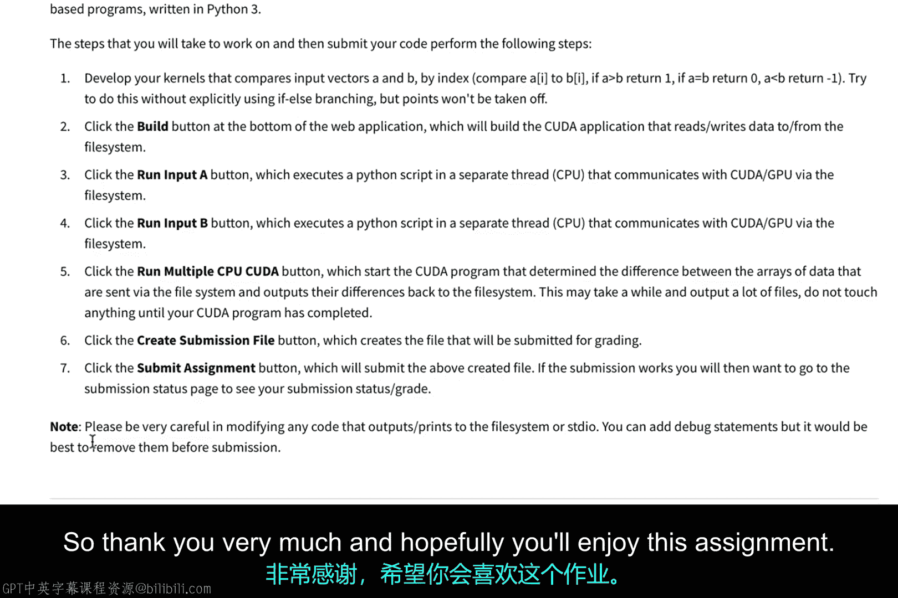

# 066：多CPU编程作业详解 🖥️

在本节课中，我们将详细讲解模块2的多CPU编程作业。这个作业的执行流程与之前的实验非常相似，我们将一步步解析从代码开发到提交的完整过程，并重点说明作业中的核心任务与注意事项。

## 作业执行流程概述

上一节我们介绍了作业的整体背景，本节中我们来看看具体的执行步骤。作业流程主要包含几个关键环节，其顺序与实验课类似。

以下是作业的核心步骤：
1.  开发你的核心代码。
2.  运行代码。
3.  生成提交文件。
4.  提交作业。
5.  查看提交结果。

需要注意的是，步骤二到步骤五与实验课一致。步骤一（代码开发）是独立的，但在调试时，你可能需要从步骤五返回到步骤一进行修改。你通常不需要修改提供的Python框架代码，但为了获得更好的控制，你可能希望先停止其运行。如果让Python代码持续运行，那么在修改后你需要从步骤三重新开始执行。

## 核心代码任务解析

在代码开发完成后并成功运行，接下来的两步是生成提交文件和正式提交。生成提交文件按钮会执行一系列底层脚本，将输出CSV文件的内容处理并整合，以展示所有运行结果的完整视图。

现在，让我们具体看看在编程环境中需要完成的任务。

在multiC代码文件中，已经包含了许多注释来指导你。你需要自行决定如何分配代码、从文件复制数据以及执行内核（kernel）。

作业的内核函数与实验课略有不同。实验课的内核计算的是差值，而本次作业的内核需要比较两个数组A和B在特定索引位置的值。

其逻辑描述如下：从数组A的值大于数组B的值的视角出发，需要返回不同的结果。
*   如果 `A[i] > B[i]`，则返回 `1`。
*   如果 `A[i] == B[i]`，则返回 `0`。
*   如果 `A[i] < B[i]`，则返回 `-1`。

你需要在代码中实现这个逻辑。我强烈建议你尝试探索**不使用条件分支**（如if语句）的实现方式，但这并非强制要求。如果你只能通过if语句来实现，那也是可以的。实际上，存在一些技巧可以避免显式的条件判断来实现此类比较。从长远来看，除非必要，应尽量避免在GPU内核中使用过多的条件分支。

## 提交与评分注意事项

在深入代码细节之前，我们先回顾一下操作按钮。前四个按钮用于创建提交文件，点击后会执行一系列底层Bash脚本，请不要随意修改这些脚本。最终会生成一个结果CSV文件，然后你可以点击提交按钮。

提交完成后，你可以返回查看当前的提交状态。

目前这里没有任何提交记录。我想强调一个重要的注意事项。

请务必小心修改任何打印语句或输出到标准IO（stdout）的内容，因为这可能会影响代码的评分方式。你可以为了调试临时添加打印语句，但我建议在完成后将其删除。如果你不希望输出我预设的所有内容，请确保在最终提交前恢复原状，因为评分时会检查特定的输出格式。

## 总结

本节课中我们一起学习了模块2多CPU编程作业的完整流程。我们回顾了从代码开发、实现特定的数组比较内核、到生成提交文件并最终提交的步骤。关键点在于理解内核函数的比较逻辑（返回1， 0， 或 -1），并注意保持输出格式的规范性以确保正确评分。

非常感谢，希望你能顺利完成这个作业。

