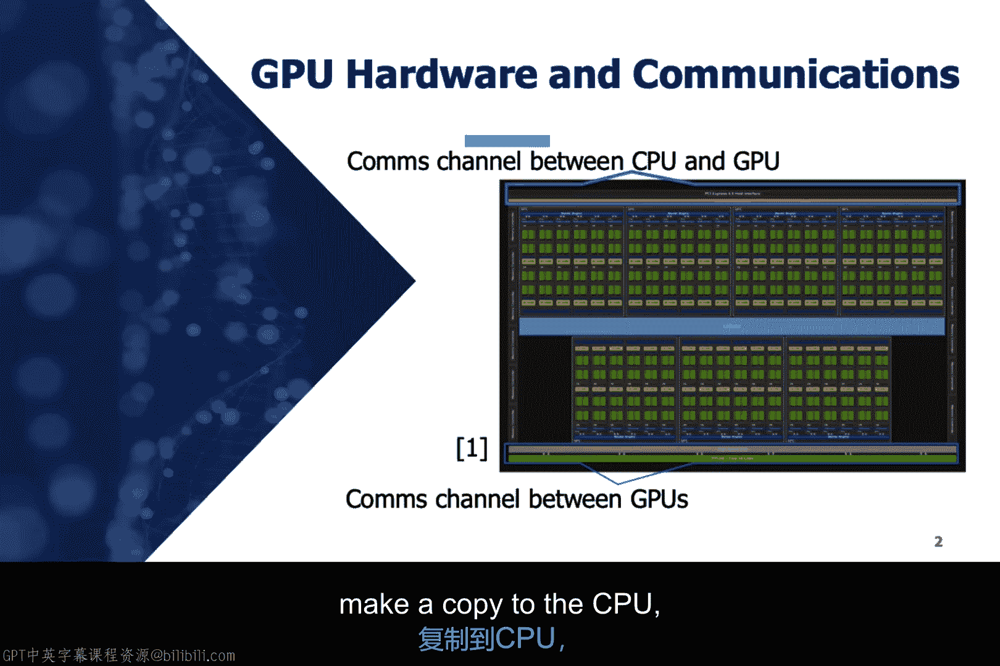
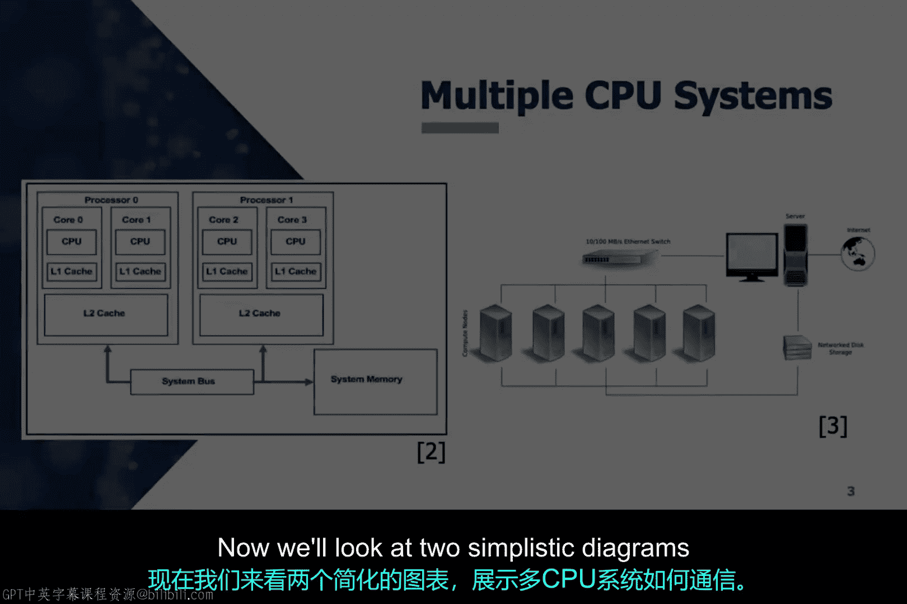
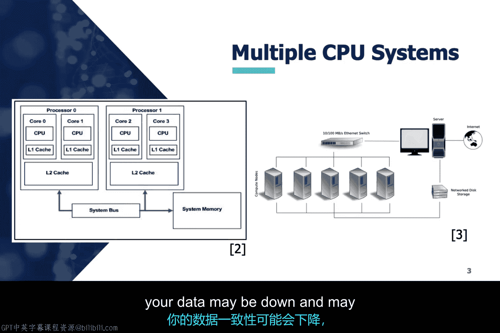
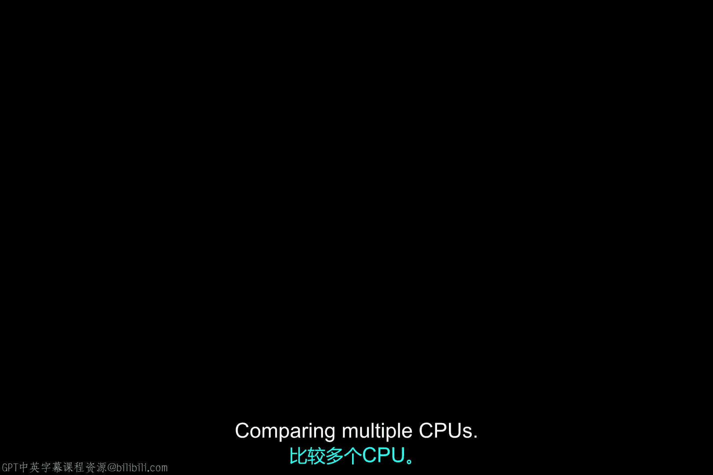
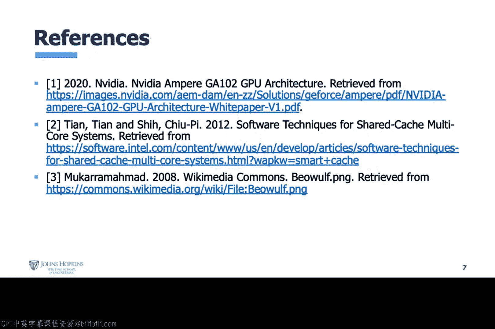

# 067：多CPU与多GPU对比分析 🖥️🆚🎮

在本节课中，我们将对比分析多CPU系统与多GPU系统的架构、通信方式、优缺点及适用场景。理解这些差异有助于为特定计算任务选择合适的硬件平台。

## 单GPU与多GPU系统架构 🔧

上一节我们介绍了GPU的基本编程模型。本节中，我们来看看多GPU系统的通信基础。

首先回顾单GPU系统的架构图。顶部是CPU与GPU之间的通信机制，在执行内存拷贝时频繁使用。底部是类似NVLink的技术，它作为主干，允许连接在同一台计算机同一总线上的GPU之间进行内存拷贝和通信。这意味着可以执行快速、近乎无缝的数据拷贝，从而构建更高效的系统，因为无需先将数据拷贝到CPU，再传输到下一个GPU，这个过程会显著降低速度。

## 多CPU系统的通信方式 🔄

了解了GPU间的通信，我们再来看看多CPU系统是如何工作的。

以下是两种简化的多CPU系统通信示意图。左侧展示了多CPU、多核、多处理器系统（例如您可能正在使用的笔记本电脑或手机）的基本工作原理。一个或多个核心上的CPU通过缓存或系统总线进行通信，速度很快，但其性能最终受限于电信号在铜线上的传输距离。

右侧展示的是一个网络化的CPU集群。它们在更高层次上通过以太网交换机等网络设备，经由互联网或内联网进行通信。距离更长，存在连接性问题（这在同一台机器上不存在），并且各节点的配置不一定完全相同，尤其是在异构计算系统中。

因此，左侧方案具有更好的一致性和更多的控制权；右侧方案则拥有更强大的算力，几乎无限数量的CPU、内存和存储空间，但问题在于连接可能不一致，数据一致性可能降低，并且获取完整答案可能需要更长时间。

## 多CPU与多GPU的优缺点对比 ⚖️

前面我们分别看了两种系统的架构，现在我们来系统性地对比它们的优缺点。

以下是多CPU系统的主要特点：
*   **优点**：拥有近乎无限的存储或内存。可以执行多种非常复杂的、彼此不同的任务。可以采用“数据向计算迁移”或“计算向数据迁移”的策略。例如，可以选择在数据所在地进行计算以减少传输开销。
*   **缺点**：计算可能成本高昂。需要管理网络或CPU间的通信。不同节点间的配置差异可能很大。

以下是多GPU系统的主要特点：
*   **优点**：通信形式有限且通常预先明确定义。所有GPU重复执行相同的任务，这是一大优势，意味着成本通常更低。如果所有GPU在同一台机器内，它们可以近乎无缝地协同工作。
*   **缺点**：计算受限于分支方案或更复杂的计算模型。因此，它不一定适合处理少量极其庞大复杂的任务，而更适合将问题分解。但这并不一定使编程更容易，这也是我们学习本课程的原因。

## 适用场景与总结 🎯

分析了各自的优缺点后，我们来看看它们分别适用于哪些场景。

**多CPU系统的适用场景**：
当您希望在较低功耗的边缘计算层面，或者因为数据遍布各地而希望在数据所在地进行计算时，可以使用多CPU系统。如果连接不同处理器很容易，或者需要处理非常复杂、不易分解的任务，多CPU系统是合适的选择。

**多GPU系统的适用场景**：
多GPU系统擅长执行大量、大量的简单计算，许多问题可以通过这种方式解决。可以将当今主流的机器学习视为典型例子，TensorFlow等类似库将任务分解成可在这些网络上频繁执行的单元。如果您要执行的计算不常变化，并且成本和计算位置对您很重要（例如，您不想花费大量资金购置机架式服务器，而只想在系统中安装一块显卡），那么多GPU系统会非常强大。

**总结**：
本节课中，我们一起学习了多CPU与多GPU系统的对比分析。我们回顾了单GPU与多GPU的通信架构，探讨了多CPU系统通过总线或网络通信的不同模式，系统比较了二者在灵活性、成本、控制力和适用性方面的优缺点，并最终明确了它们各自最适合的应用场景。理解这些核心差异是进行高效并行与分布式编程的基础。