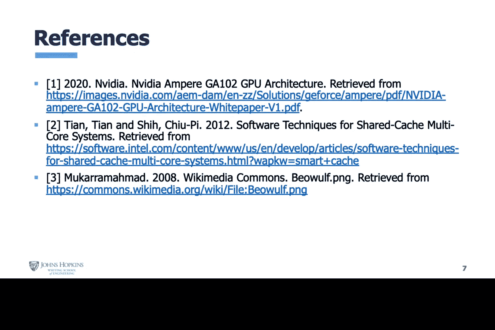

# 068：CUDA多GPU编程模型 🚀

在本节课中，我们将要学习CUDA在多GPU系统下的编程模型。我们将了解如何管理多个设备、如何设置设备间通信以及如何利用统一寻址等高级功能来简化多GPU编程。

## 概述

上一节我们介绍了CUDA编程的基础。本节中我们来看看当系统拥有多个GPU时，CUDA提供了哪些模型和工具来管理和协调它们的工作。

CUDA拥有一套设备管理系统，无论系统是单设备还是多设备，这套系统都能工作。开发者可以根据命名约定、硬件版本等属性在多个设备间进行选择。系统底层提供了许多方法，允许我们查询诸如全局内存容量、不同类型内存的速度等属性。此外，CUDA还支持设置进程间通信，这意味着不同GPU上的处理器可以相互通信。还有一些方案和方法允许你在所有GPU（甚至包括CPU）上使用统一的寻址方案，从而简化编程。例如，当你指定内存时，无需担心它具体位于哪个设备上，CUDA架构会自行处理。

## 选择与设置设备

首先需要确定要使用哪些设备。如果只使用单个设备，可以采用默认设置，无需特别指定。但如果系统有多个设备，或者你想确认设备数量，可以使用 `cudaGetDeviceCount` 函数。

以下是查询设备数量的代码示例：
```c
int deviceCount;
cudaGetDeviceCount(&deviceCount);
```

获取设备数量后，你可以查询特定设备的属性，并基于这些信息选择设备。`cudaGetDeviceProperties` 函数可以返回设备的详细属性。

基于这些信息，你可以根据匹配特定属性（如全局内存大小）来选择设备，或者根据一个非常具体的设备ID来设置当前设备。你还可以设置多个设备，并让CUDA来处理哪个内核在哪个设备上执行。这在某些情况下很方便，但如果你期望它们在同一台机器上并共享全局内存（且未使用统一内存），则可能会带来问题。

## 设备间通信与资源共享

假设你已经设置了多个GPU，接下来可能需要共享内存句柄。这需要你打开和关闭它。共享内存句柄意味着不同GPU上的进程可以使用该句柄进行进程间通信。

此外，你还可以在GPU之间的共享流上创建事件。随着课程的深入，我们将了解更多关于事件的知识，它们功能强大。但有时你需要共享实际数据，这可以通过内存句柄函数来实现。

## 统一寻址与对等访问

最后一个主要功能块是使用统一寻址或对等访问。在大多数情况下，统一寻址由CUDA框架处理，开发者无需过多担心。

但有一件事你可能需要做：如果你使用不同版本的CUDA或不同的硬件（因此可能需要使用不同版本的CUDA），你可能希望使用 `cudaPointerGetAttributes` 函数，并专门询问关于统一寻址的支持情况。

假设查询结果显示支持良好，你设置了多个有效设备并启动了内核，那么接下来可以授予设备对等访问权限。这是基于设备ID完成的，通过 `cudaDeviceEnablePeerAccess` 函数实现，你也可以使用相应的方法禁用它。你可以使用 `cudaDeviceCanAccessPeer` 函数来查询两个设备之间是否能够建立对等访问。

一旦确认两个设备可以互访，你就可以使用 `cudaMemcpyPeerAsync` 函数在它们之间进行内存复制。这意味着这两个设备将在特定时间段内共享内存。

下图展示了多GPU编程中设备选择、通信与数据拷贝的流程：


下图进一步说明了在启用对等访问后，GPU间直接进行数据拷贝的路径：


## 总结




本节课中我们一起学习了CUDA的多GPU编程模型。我们了解了如何查询和选择设备，如何通过内存句柄和事件实现设备间通信与同步，以及如何利用统一寻址和对等访问功能来简化跨设备的数据传输。掌握这些概念是进行高效多GPU并行计算的基础。