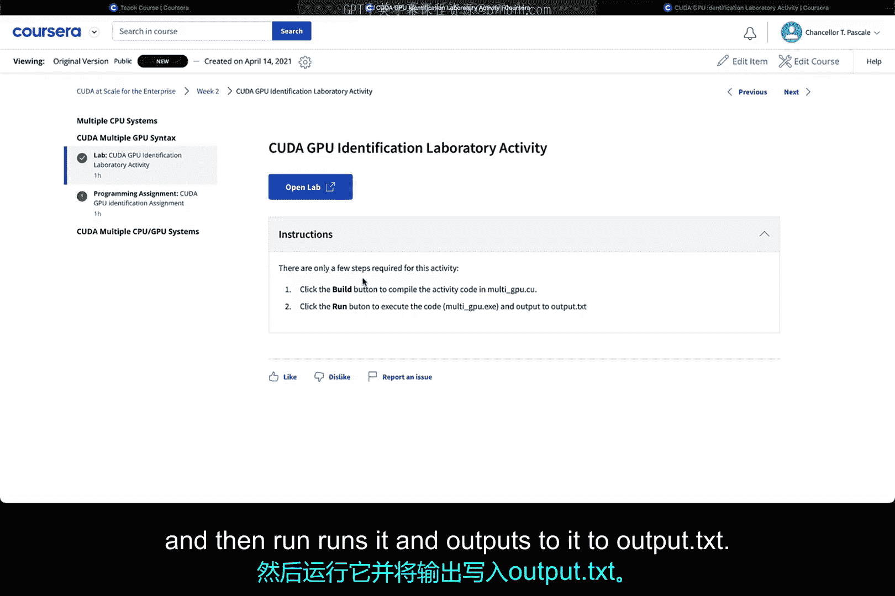
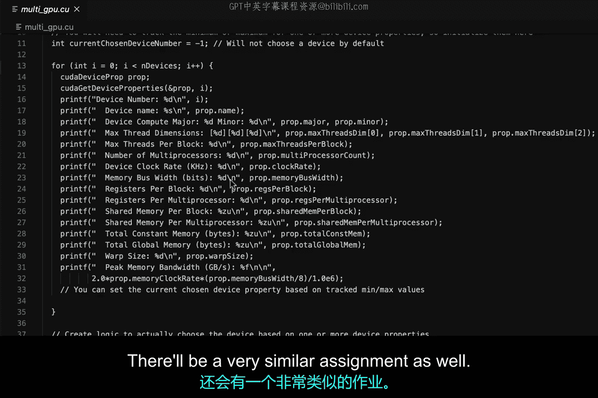

# 069：多GPU实践项目 🖥️

在本节课中，我们将快速浏览多GPU识别实验活动。我们将学习如何编写一个程序来识别系统中的GPU设备，并获取它们的属性信息，为后续选择特定GPU执行计算任务打下基础。

## 概述

本次实验的核心目标是编写代码来检测系统中可用的GPU数量，并获取每个GPU的详细属性。通过这个过程，我们可以理解如何在多GPU环境中进行设备选择和配置。



## 实验步骤

以下是完成此实验活动的主要步骤。

1.  **构建项目**：点击构建按钮，执行 `make clean build` 命令。此操作将从 `multi_gpu.cu` 源文件生成可执行文件 `multi_gpu.exe`。
2.  **运行程序**：运行生成的可执行文件。程序执行后，会将输出结果写入 `output.txt` 文件。

## 代码逻辑解析

上一节我们介绍了实验的操作步骤，本节中我们来看看实现这些功能的代码逻辑。

代码的核心流程非常简单。首先，我们需要获取系统中GPU设备的数量。

```c
int device_count;
cudaGetDeviceCount(&device_count);
```

接着，我设置一个默认的“已选择设备”索引为 `-1`。然后，创建一个循环来遍历所有检测到的GPU设备。

在循环内部，我们使用 `cudaGetDeviceProperties` 函数来获取每个GPU的属性，并将其存储在一个 `cudaDeviceProp` 结构体变量中。

```c
cudaDeviceProp device_prop;
cudaGetDeviceProperties(&device_prop, device_index);
```

以下是代码输出的一些关键属性，这些通常是选择GPU时最重要的考量因素：
*   **设备名称** (`device_prop.name`)
*   **计算能力版本** (`device_prop.major` 和 `device_prop.minor`)
*   **全局内存大小** (`device_prop.totalGlobalMem`)
*   **每个块的最大线程数** (`device_prop.maxThreadsPerBlock`)

你可以根据需求设定最小或最大值标准（例如，最低计算能力版本，或所需的最小全局内存），然后判断当前设备是否符合条件。

程序会输出所有GPU的统计信息。一旦完成评估，你可以通过某种机制（例如选择第一个符合条件的，或性能最好的）确定要使用的GPU，并记录下其索引。之后，你就可以通过 `cudaSetDevice` 函数让内核程序运行在所选的特定GPU上。

```c
cudaSetDevice(chosen_device_index);
```

## 总结与思考

本节课中我们一起学习了多GPU识别的基本方法。我们了解了如何获取设备数量、查询设备属性，并基于这些信息为计算任务选择合适的GPU。

这个实验的逻辑设计得非常灵活。即使你当前的环境只有一个GPU设备，这套处理多设备选择和单设备适配的代码同样可以正常工作。请记住这一点，因为在某些部署环境中，你可能确实无法访问多个设备。

在后续的作业中，你会遇到一个非常类似的任务。建议你查阅CUDA工具包文档，了解更多可用的设备属性，并思考在实际场景中，你会根据哪些标准在多个GPU之间做出选择。



希望你能享受这个实验过程！