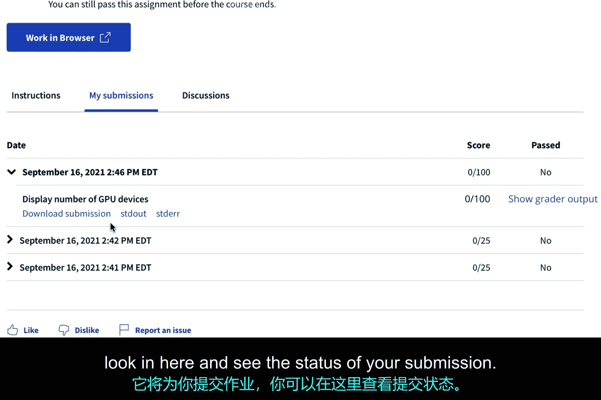
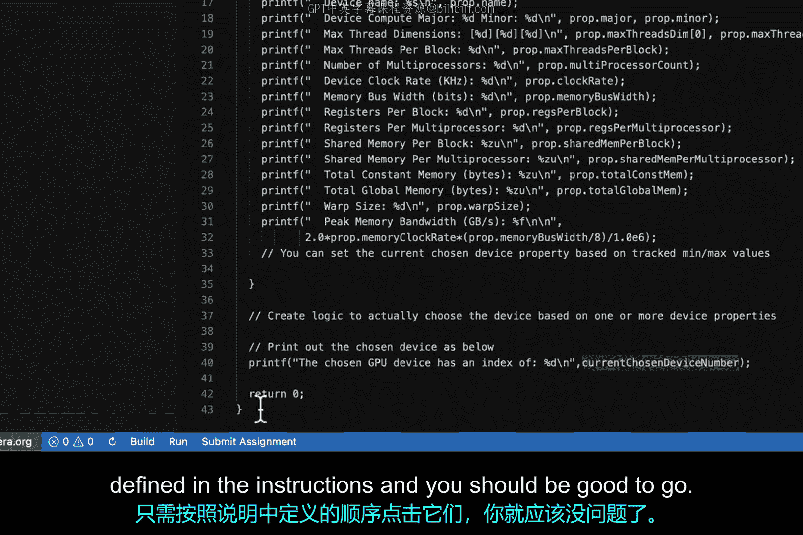

# 070：多GPU编程作业详解 🖥️

在本节课中，我们将学习如何完成约翰霍普金斯大学《GPU编程》课程中关于多GPU编程的作业。我们将详细解析作业的四个步骤，并理解如何通过代码逻辑选择不同的GPU设备来执行计算任务。

## 作业概述

本次作业的核心任务是编写或更新多GPU环境下的CUDA代码。你需要创建一个机制，根据GPU设备的属性（如计算能力、内存大小等）智能地选择并设置要使用的设备，并将此选择应用于内核的执行。

## 作业步骤详解

以下是完成本次作业需要遵循的四个具体步骤。

### 第一步：编写或更新代码

首先，你需要在项目文件 `multi_gpu.cu` 中编写或更新你的CUDA代码。代码的关键在于实现一个设备选择逻辑。

上一节我们介绍了作业的整体目标，本节中我们来看看具体的代码要求。代码框架已经提供，但你需要填充核心的设备选择与设置部分。




*   **核心任务**：你需要实现一个函数或逻辑块，根据系统中的一个或多个GPU设备的属性（例如 `cudaDeviceProp` 结构体中的信息）来决定使用哪个设备。
*   **重要提示**：代码中不包含内核设置的具体内容，这完全由你自由设计和实现。你的主要精力应放在设备选择机制上。

以下是设备选择与设置的核心代码结构示例：

```cpp
// 示例：获取设备数量并遍历其属性
int deviceCount;
cudaGetDeviceCount(&deviceCount);

for (int i = 0; i < deviceCount; ++i) {
    cudaDeviceProp prop;
    cudaGetDeviceProperties(&prop, i);
    // 在此处添加你的设备选择逻辑
    // 例如：选择计算能力最高的设备
    // if (prop.major > bestMajor) { ... }
}

// 根据你的逻辑选择设备后，使用 cudaSetDevice 进行设置
cudaSetDevice(chosenDeviceId);
// 确保在启动内核时，计算将在你设置的设备上进行
myKernel<<<blocks, threads>>>(...);
```

### 第二步：构建项目

代码编写完成后，点击开发环境中的“构建”（Build）按钮。此操作会将你的CUDA源代码编译为可执行程序。

### 第三步：运行程序

构建成功后，点击“运行”（Run）按钮。程序将执行，并根据你的代码逻辑选择GPU设备并运行内核。

程序运行成功后，会在项目根目录下的 `output_do.txt` 文件中生成输出结果。请检查该文件以确认程序运行符合预期。

### 第四步：提交作业

最后，点击“提交作业”（Submit Assignment）按钮。系统会自动将你的作业提交以供评分。你可以在提交界面查看作业的提交状态和评分结果。

## 注意事项与评分标准

在完成作业时，请特别注意以下几点，它们与评分直接相关。

*   **输出语句**：请不要修改代码中已有的 `printf` 打印语句。这些输出用于自动评分系统验证你的设备选择逻辑是否正确。
*   **选择逻辑**：你需要在代码中添加逻辑，根据打印出的设备信息来决定执行哪个设备。你可以自由添加更智能的搜索和选择策略。
*   **操作顺序**：请严格按照“构建 -> 运行 -> 提交”的顺序点击按钮，以确保作业被正确提交。

## 总结



本节课中我们一起学习了多GPU编程作业的完整流程。我们了解到，作业的核心是**实现一个基于设备属性（如 `cudaDeviceProp`）的智能GPU选择机制**，并通过 `cudaSetDevice()` 函数将选择应用于实际计算。记住，保持输出语句不变、按顺序操作按钮是成功提交作业的关键。现在，你可以开始动手实践，设计你的多GPU选择策略了。