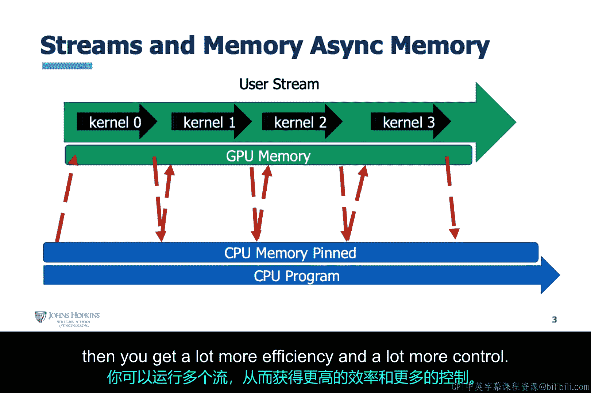
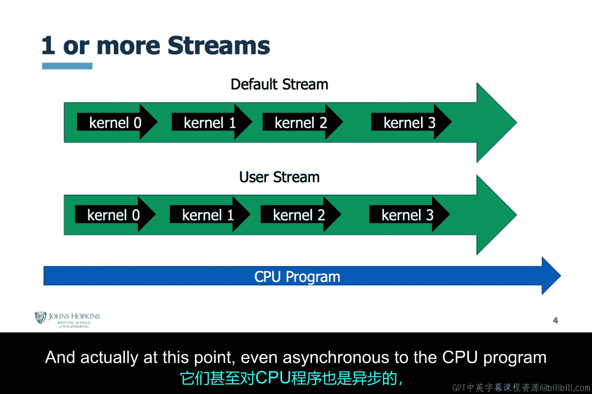
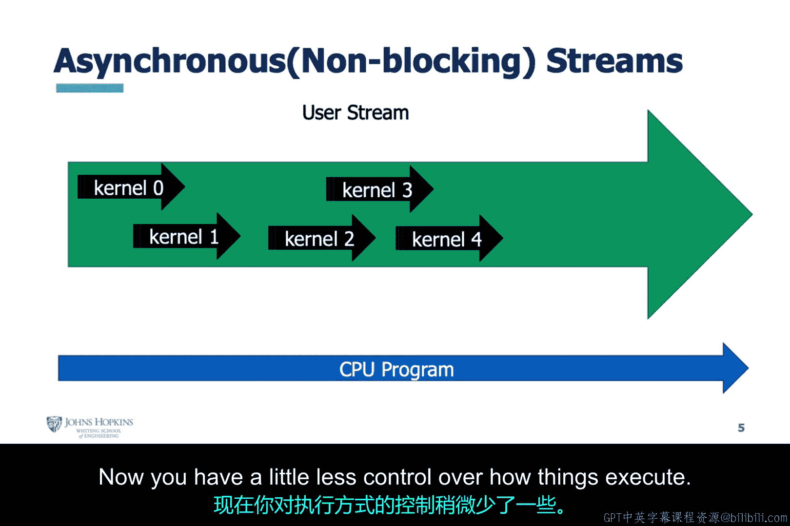
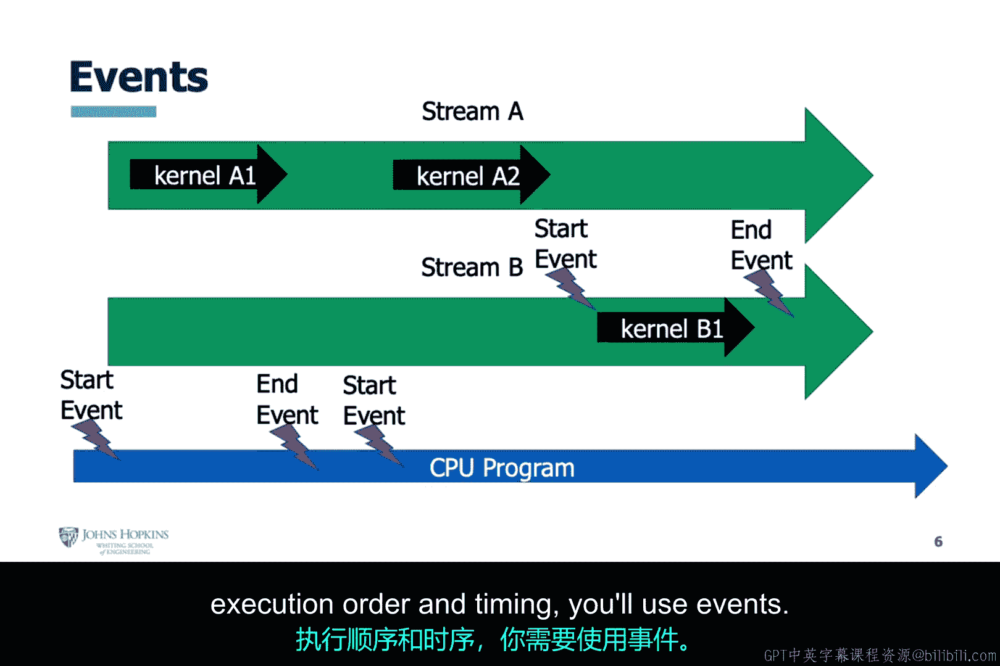
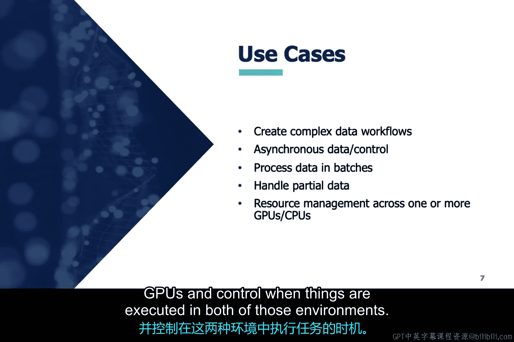

# 071：CUDA流与事件机制 🚀

在本节课中，我们将要学习CUDA编程中的两个核心概念：**流（Streams）** 和**事件（Events）**。我们将探讨它们如何工作，以及如何利用它们来提升程序的并发性和执行效率。

---

## 概述

到目前为止，您的CUDA程序可能只使用了默认流。在这种模式下，所有内核（kernel）默认在同一个流上顺序执行，并且通常使用可分页内存（pageable memory）进行数据传输。虽然从某些角度看这更易于使用，但它在效率上并非最优。

上一节我们介绍了默认流的基本执行模型，本节中我们来看看如何通过创建用户定义的流和使用事件来优化程序。

---

## 默认流的局限性

在默认流模式下，程序的执行流程如下：
1.  CPU程序将数据复制到可分页内存。
2.  当需要执行内核时，数据从可分页内存复制到固定的锁页内存（pinned memory）。
3.  数据再从锁页内存复制到GPU的全局内存（如显存、常量内存、纹理内存等）。
4.  内核在默认流上**顺序执行**。
5.  执行完毕后，数据通过锁页内存传回CPU程序。

这种模式的主要特点是：
*   **内核间同步**：内核在单个流上顺序执行，一个内核必须完全结束后，下一个才能开始。
*   **CPU异步**：CPU程序在发起内核调用后可以继续执行，无需等待内核结束，从这个角度看它是异步的。
*   **效率非最优**：数据传输路径较长，且内核执行缺乏真正的并行性。

---

## 使用用户定义的流

为了提升效率，我们可以创建自己的流，即用户流（user stream）。这需要使用锁页内存（pinned memory），并直接在锁页内存和GPU之间复制数据。

以下是创建和使用流的基本步骤：
1.  **分配锁页内存**：使用`cudaMallocHost`或`cudaHostAlloc`在主机上分配锁页内存。
2.  **创建流**：使用`cudaStreamCreate`创建一个新的CUDA流。
3.  **异步执行**：在内核启动和内存复制函数（如`cudaMemcpyAsync`）中指定要使用的流。

通过使用多个流，我们可以让不同的内核和内存复制操作并发执行。虽然单个流内的内核仍是顺序的，但不同流之间的操作可以重叠，从而更充分地利用GPU资源。

上图展示了多流编程的模型。您可以将默认流与自己定义的流结合使用，让更多内核有机会同时运行。效率的提升通常不是线性的，例如，当一个内核遇到缓存未命中（cache miss）导致某些线程空闲时，GPU可以将计算资源分配给另一个流上的内核。

需要注意的是，在没有事件机制介入时，这些流彼此**完全独立且异步**地运行，并且在此刻，它们与CPU程序之间也是异步的。

---

## 非阻塞流与更高阶的异步

为了获得更强的异步能力，可以将流定义为**非阻塞（non-blocking）** 的。这意味着您可以在同一个流上指定多个内核。当某个内核在运行时，如果该流暂时无事可做（例如等待数据），GPU可以切换到执行该流上的另一个已就绪的内核，并确保前一个内核最终完成。

当然，这存在限制，就像GPU上能同时存在的流数量有限一样。但通过这种方式，您可以获得更快的执行速度和更高的效率，代价是对执行顺序的控制力有所减弱。

---

## 事件机制的作用

当您需要对流和CPU程序的执行顺序与时机进行精细控制时，就需要用到**事件（Events）**。

事件的核心用途是标记动作的**开始**和**完成**。例如，您可以记录一个内核的启动事件和结束事件。

以下是事件的主要功能：
*   **CPU同步**：CPU程序可以等待某个流或内核上的特定事件完成，然后再继续执行。
*   **流间依赖**：您可以在不同流之间建立依赖关系。一个流上的内核可以设置为必须等待另一个流上的某个事件完成后才能开始执行。
*   **性能分析**：记录事件的时间戳，用于测量不同操作的执行时长。

---

## 流与事件的典型应用场景

了解了流和事件的基本概念后，我们来看看它们的一些典型应用场景。

以下是流与事件机制的主要应用：
*   **等待实时数据并批量处理**：CPU持续接收数据，积累到一定量后，通过事件触发，将整批数据发送给GPU内核处理。
*   **流式处理**：与上述“流编程”不同，这里指持续地将少量或部分数据发送给不同的内核进行处理，形成流水线。
*   **构建复杂工作流**：控制不同操作的执行顺序。例如，在不同的流上依次执行kernel0、kernel1、kernel2，实现高效但可控的并行。工作流可以“分叉”（fan-out）并行处理，再“汇聚”（fan-in）合并结果。
*   **管理多CPU/GPU资源**：在拥有多个CPU核心或GPU的环境中，事件可以帮助协调和控制不同设备上的任务执行时机。

---

## 总结

本节课中我们一起学习了CUDA中的流与事件机制。我们首先分析了只使用默认流在效率和并发性上的局限性。接着，我们探讨了如何通过创建用户定义的流和使用锁页内存来提升数据传输效率和内核并发度。然后，我们介绍了非阻塞流以实现更高级的异步操作。最后，我们讲解了事件机制，它为我们提供了在CPU程序与多个流之间、以及不同流之间建立依赖和进行同步控制的强大工具。掌握流与事件是进行高效、复杂CUDA并行编程的关键。