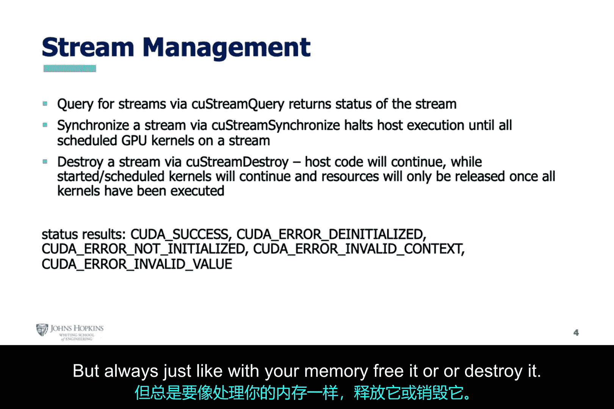

# 072：CUDA流语法解析 🚀

在本节课中，我们将学习CUDA流的语法。我们将了解如何创建流、如何在流中管理内存以及如何管理流本身。

## 流对象的创建

首先，我们来看如何创建CUDA流对象。创建流有三种主要方式。

以下是创建CUDA流的三种方法：
*   **基本创建**：仅通过变量名创建流。
*   **带标志创建**：可以添加标志，例如指定流相对于CPU是阻塞还是非阻塞，从而控制CPU是否等待流完成。
*   **带优先级创建**：可以为流指定优先级，这样流中执行的操作将具有不同的优先级。你可以创建超过硬件限制数量的流，系统会根据优先级在需要时调度它们。

## 回调与内存管理

上一节我们介绍了如何创建流，本节中我们来看看如何为流添加回调以及如何管理流中使用的内存。

对于复杂的工作流，可以创建带有回调的流。这意味着CPU可以继续执行其他任务，当该流中的所有操作完成时，系统会自动调用一个预先指定的函数（函数指针）。这样，无论CPU当时在做什么，都会执行这个回调函数。

流中使用的内存必须是**固定内存**（Pinned Memory），或者使用**统一寻址内存**（Unified Addressing Memory）。你可以异步地将内存附加到流上，这意味着内存将在附加的那一刻起对指定的流可用，而不是通过复制操作。

附加内存的函数参数包括：流变量、设备内存指针、内存长度和标志。标志可以指定该内存对所有设备、所有流可用，或仅对主机可用（这对于在后台执行某些对CPU全局内存不可见的操作很有用），或者默认地仅对特定设备上的单个流可用。

## 内存分配与异步拷贝

现在，我们来了解具体的内存分配和异步拷贝操作。

使用固定内存进行分配时，如果使用运行时API，则调用 `cudaMallocHost`；如果使用驱动API，则调用 `cuMemAllocHost`。使用统一寻址内存时，则调用 `cudaMallocManaged` 函数。

如果你需要进行异步内存拷贝（无论是从主机到设备、设备到主机、设备到设备还是主机到主机），可以使用 `cudaMemcpyAsync` 函数。你需要提供目标指针、源指针、数据大小、拷贝类型（例如 `cudaMemcpyHostToDevice`）以及执行该拷贝操作的流。

## 流的管理与同步

假设你已经创建了流，接下来需要学习如何管理它们。

首先需要认识到，所有流管理的API调用都会返回一个状态码。`cudaSuccess` 表示流操作成功完成，其他错误状态码则与流初始化、上下文是否正确等问题相关。

如果你想查询一个流的状态（例如是否已完成），可以使用 `cudaStreamQuery` 函数，并传入流变量，它会返回流是否已完成。

如果你想同步主机执行，即让主机代码暂停并等待某个流中的所有已调度操作完成，可以使用 `cudaStreamSynchronize` 函数。

## 流的销毁

最后，也是至关重要的一步，是流的销毁。

你应该始终在流使用完毕后销毁它。即使流上的所有操作都已完成，或者你准备退出程序，也应调用 `cudaStreamDestroy`。这个调用允许已调度的操作继续完成。需要注意的是，主机代码会继续执行，如果你在销毁流后没有进行异步内存拷贝，虽然已调度的操作仍在运行，但你可能无法再访问相关的内存。请记住这一点，但务必像释放内存一样，总是销毁你创建的流。

---

本节课中我们一起学习了CUDA流的完整语法。我们从创建流的三种方式开始，接着探讨了如何为流设置回调以及流中内存的管理原则，包括固定内存和统一寻址内存的使用。然后，我们介绍了如何进行异步内存拷贝。最后，我们详细讲解了如何查询流状态、同步流以及最终销毁流，这是确保程序资源正确释放的关键步骤。