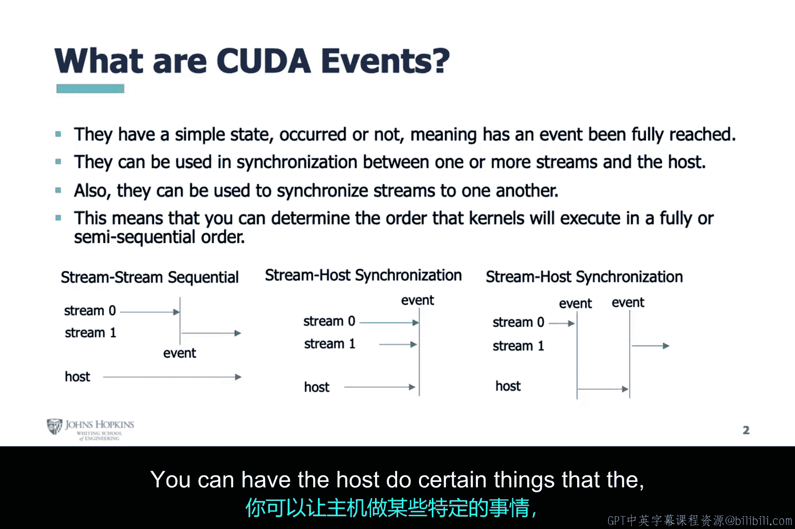
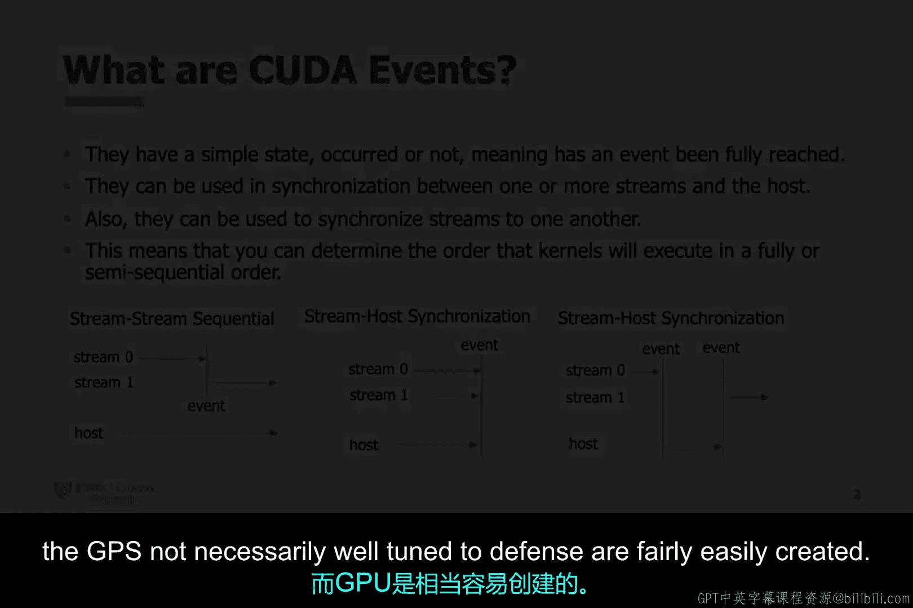
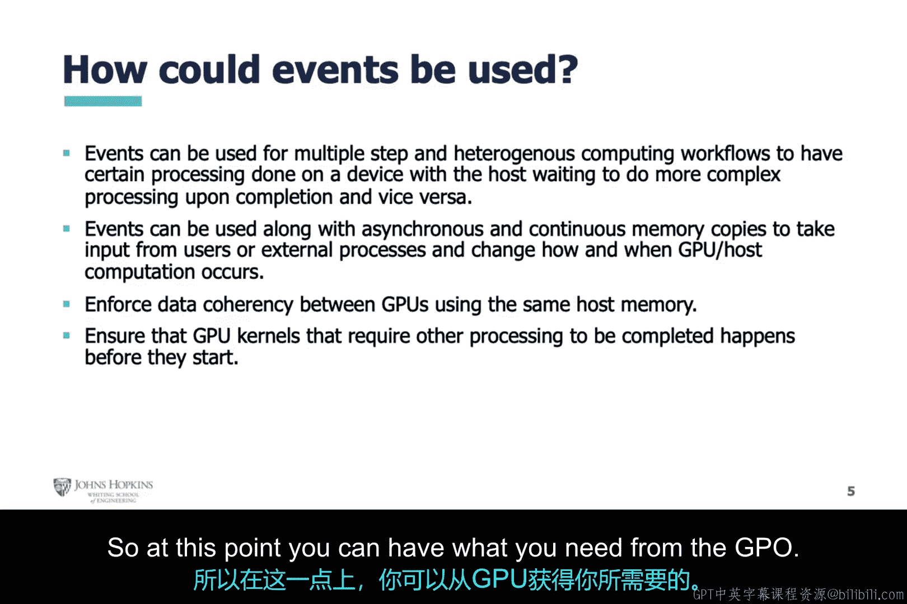
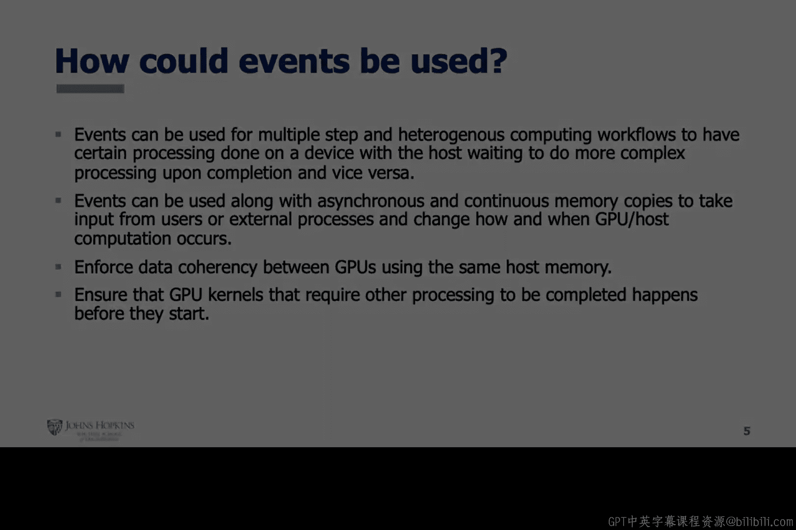

# 073：CUDA事件语法详解 🎯

在本节课中，我们将学习如何利用CUDA事件API语法。事件是CUDA编程中用于精确控制执行流程和同步的重要工具。

## 概述

CUDA事件是一种用于标记和同步GPU操作执行点的机制。它们可以用于流之间的同步、主机与设备之间的同步，从而实现对并行执行顺序的精细控制。

## 事件的基本概念

CUDA流中的事件状态很简单：要么已发生，要么未发生。当我们说事件“已发生”时，意味着执行流已经完全到达了该事件点。你设置了一个事件，但实际上，只有当流执行到该点时，事件才被视为发生。

事件可以用于流之间的同步，也可以用于主机与流之间的同步。这为你提供了大量控制权，因为你现在可以控制不同流之间的执行顺序。但请注意，在单个流内部，内核的执行顺序是严格按照入队顺序进行的。

## 事件的创建与使用

以下是创建和使用CUDA事件的基本步骤。

### 创建事件





事件的创建分为两步：
1.  使用 `cudaEvent_t` 语法实例化一个变量。
2.  调用创建函数，该函数会在设备上创建事件，并在主机上通过之前实例化的事件变量来引用它。

```c
cudaEvent_t event;
cudaEventCreate(&event);
```

### 记录与查询事件

事件通过 `cudaEventRecord` 函数被记录或标记为“未发生”。这基本上是说：将这个事件放入一个流中，我稍后会引用它。例如，当一个内核完成或一个流执行到某个点时。

之后，你可以查询事件的状态。这允许你判断操作是否仍在运行，从而决定是等待还是执行其他任务，避免了紧密的耦合。

```c
// 在流中记录事件
cudaEventRecord(event, stream);
// ... 执行其他操作 ...
// 查询事件是否完成
cudaEventQuery(event);
```

### 等待事件

你可以命令CUDA流等待一个事件。这意味着，一旦设置了这个等待，流中所有已入队的内核和操作都将暂停，直到指定的事件发生。

```c
// 让流等待事件发生
cudaStreamWaitEvent(stream, event, 0);
```

### 同步事件

事件同步通过 `cudaEventSynchronize` 函数完成。这会阻塞主机线程，直到指定的事件发生。这意味着在该事件点之前的所有流操作都必须完成，主机才能继续执行。这与流同步或内核同步功能类似，但粒度更细。

```c
// 主机等待事件完成
cudaEventSynchronize(event);
```

## 事件的应用场景

CUDA事件有多种用途，以下是几个核心应用：

*   **同步数据拷贝**：确保在某些内核执行之前，数据拷贝操作已经完成，数据具有一致性。
*   **控制流启动**：可以基于一个事件来完全启动另一个流。例如，主机可以在一个流完成后，根据触发的事件来启动另一个流。
*   **实现混合执行流程**：允许主机和GPU交错执行任务。主机可以在GPU执行某些任务时处理其他工作，或者等待GPU的中间结果进行后续处理，从而实现复杂的、交织的执行流程。
*   **资源管理与性能调控**：可以用于在特定时间点确保获得足够的GPU计算资源，或者根据处理器的负载情况来调度任务。

## 总结





本节课我们一起学习了CUDA事件的核心语法与应用。我们了解到，事件是标记GPU操作执行点的工具，通过 `cudaEventCreate`、`cudaEventRecord`、`cudaEventQuery`、`cudaStreamWaitEvent` 和 `cudaEventSynchronize` 等函数，可以实现流内、流间以及主机与设备间的精细同步。事件的主要用途包括确保数据一致性、控制任务执行顺序以及构建主机与GPU协同的复杂工作流。掌握事件的使用，是进行高效、可控的CUDA并行编程的关键一步。