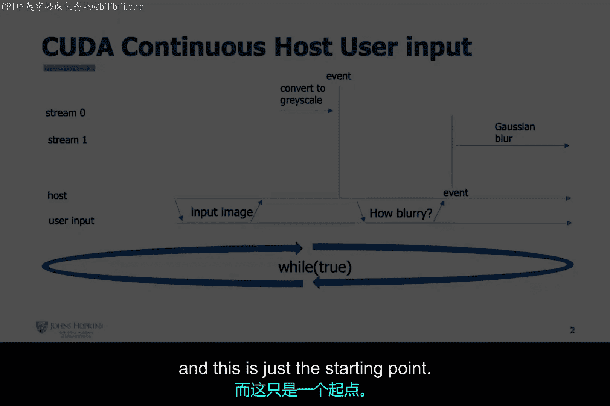
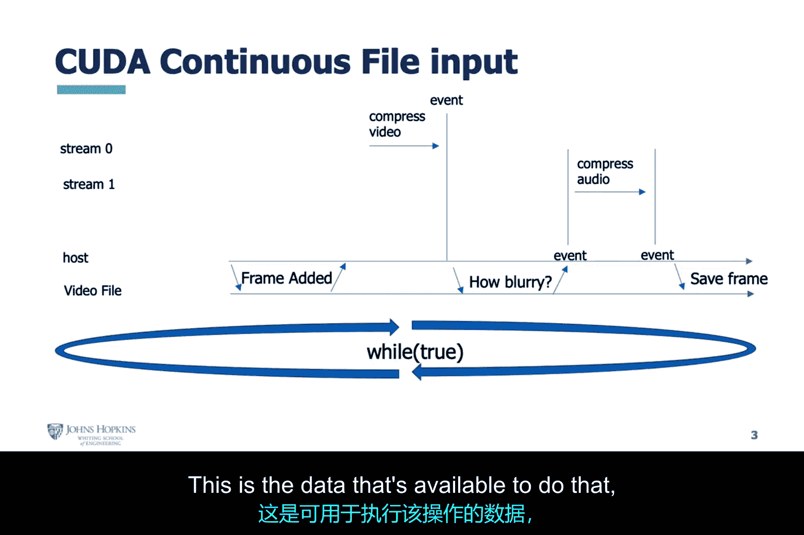
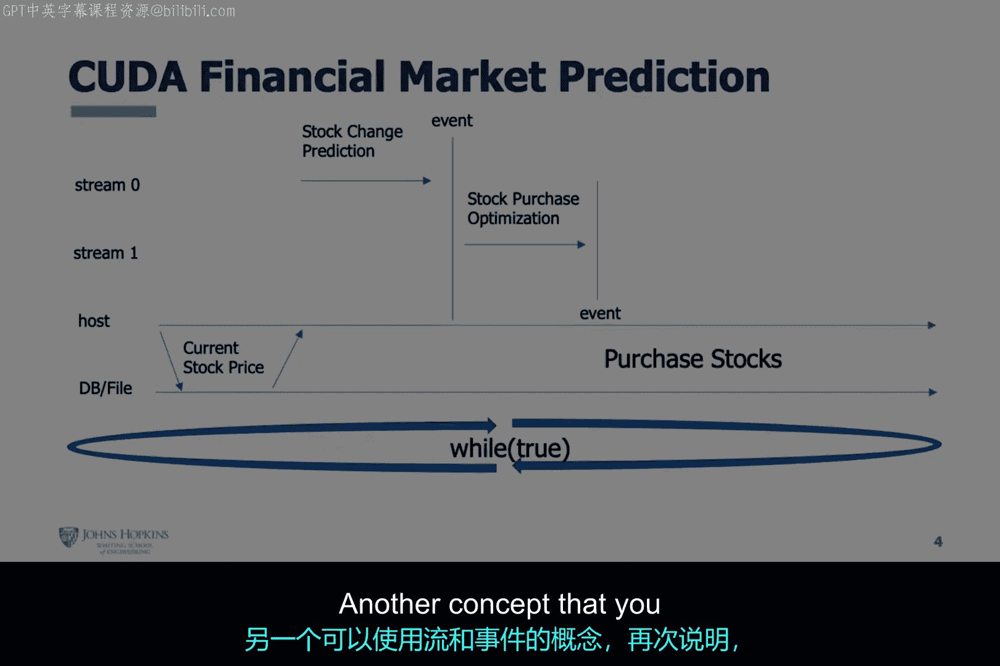
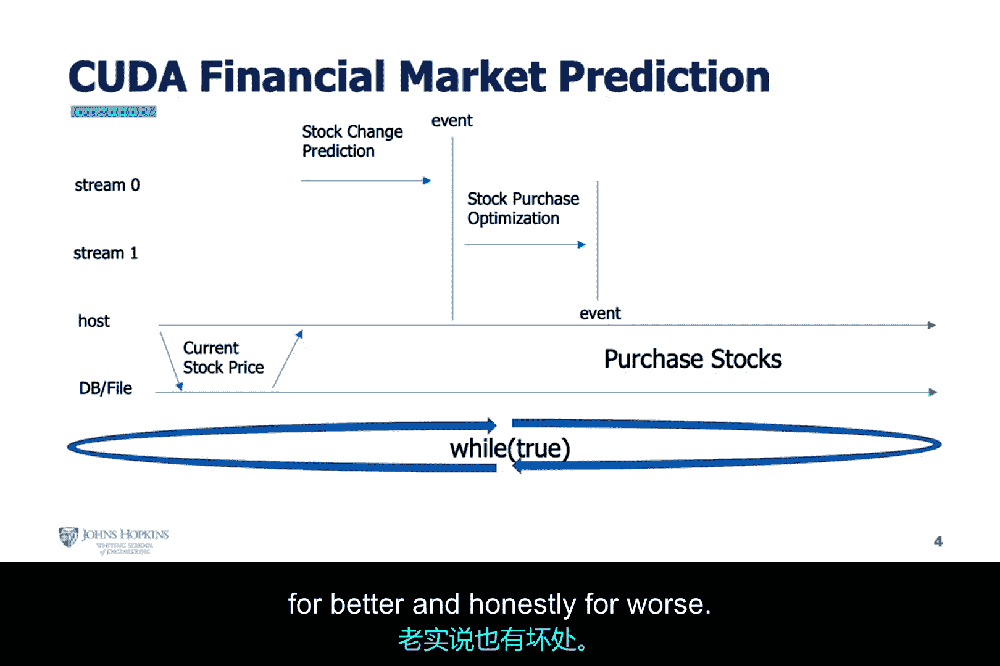

# 074：CUDA流与事件应用场景 🚀

在本节课中，我们将探讨CUDA流（Streams）与事件（Events）的三个主要应用场景。这些示例旨在启发你思考如何在自己的项目中利用这些强大的异步执行与同步工具。虽然应用方式并非无限，但可能性非常丰富，这里只是一个起点。

---

## 概述 📋

CUDA流允许在GPU上并发执行多个任务序列，而事件则用于精确同步这些任务或监控其进度。结合使用它们，可以构建高效、响应灵敏的应用程序，特别是在需要处理持续输入、协调多个独立处理流水线或实现复杂工作流依赖的场景中。

---

## 应用场景一：交互式图像处理流水线 🖼️

上一节我们介绍了流与事件的基本概念，本节中我们来看看它们如何应用于需要持续用户交互的场景。

一个常见的应用场景是交互式图像处理。例如，程序可能持续要求用户输入要处理的图像。用户输入图像名称后，程序启动一个流来执行灰度转换。由于主机（CPU）在此过程中无需干预，它可以等待一个事件——即灰度转换完成的事件。

当该事件触发后，程序可以再次询问用户：“是否需要添加模糊效果？是否需要镜头光晕？是否需要马赛克？” 用户回答“是”、“否”或提供具体参数值。然后，基于这个用户输入，相应的事件会触发并启动下一个处理步骤（例如高斯模糊）。该步骤完成后，结果可能被保存到文件系统或发布到网络。这个过程可以持续循环进行，形成一个“双循环”结构，实现CPU与GPU不同部分之间的持续同步与异步处理。

以下是此类应用的关键特点：
*   **异步处理**：GPU处理图像时，CPU可以自由处理用户交互。
*   **事件驱动**：每个处理步骤的完成通过事件来通知和触发下一步。
*   **持续响应**：系统能够对用户的连续请求做出即时响应。

---

## 应用场景二：音视频文件的并行处理 🎬

接下来，我们探讨流与事件在协调多个独立处理流水线时的作用，例如处理音视频文件。

这个场景与第一个类似，但交互对象从用户变成了文件系统。假设文件系统只能间歇性地提供视频帧（例如，每隔一段时间有一帧新数据可用）。你希望用一个流来压缩视频，用另一个高度优化的流来压缩音频。

理论上，你可以让处理循环持续运行，不断检查新帧并进行压缩。但这样做可能低效，且难以管理文件系统的访问时机（例如，避免在读取文件时写入）。这时，事件就非常有用了。

你可以利用事件来精确计时各项任务的完成时刻，确保文件读写操作不会冲突。这对于处理流程长、步骤多的任务尤其有效。基本模式是：完成一个步骤（如解码）后触发事件，该事件通知并启动下一个依赖步骤（如特效处理或编码），同时确保底层数据（如文件）处于可用状态。

---

## 应用场景三：金融市场的预测与交易系统 📈

最后，我们看看流与事件如何用于构建具有多阶段、依赖关系复杂的工作流，例如金融分析系统。

流可以承担不同的角色。例如，第一个流负责**预测**：基于当前数百上千只股票、商品的状态，持续预测其价格变化。第二个流负责**决策**：基于某种模型和模拟，分析预测结果，决定当前最佳买入标的、持有时间等。这两个阶段通过事件进行同步。

具体流程是：预测流完成一批计算后，触发一个事件。决策流等待该事件，一旦事件发生，便立即开始基于最新预测结果进行计算并生成交易信号。在真实系统中，执行交易后，其本身又可能对市场产生微小影响，从而形成一个反馈循环。事实上，存在一系列金融应用，专门利用GPU进行高速计算，以预测市场变化、快速执行交易，甚至试图影响市场系统。

---

## 总结 🎯

本节课中我们一起学习了CUDA流与事件的三个典型应用场景：
1.  **交互式图像处理流水线**：利用事件实现用户交互与GPU处理步骤之间的无缝衔接。
2.  **音视频并行处理**：使用事件协调多个独立的处理流（如视频流和音频流），并管理资源（如文件）访问冲突。
3.  **多阶段金融分析系统**：通过事件同步预测、决策等连续且依赖的计算阶段，构建复杂的工作流水线。

这些场景展示了如何通过流实现任务并发，并通过事件实现精细化的同步与控制，从而充分发挥GPU的并行计算能力，并提升整个应用程序的效率和响应速度。