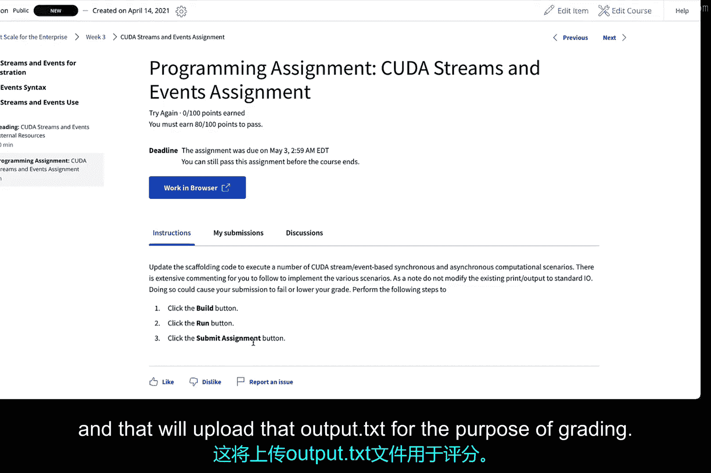
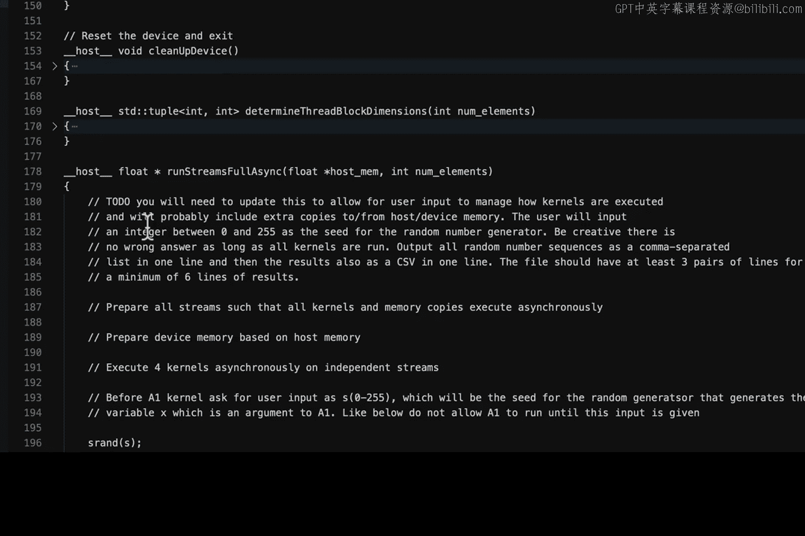

# 075：CUDA流与事件作业指导 🚀

在本节课中，我们将学习如何完成关于CUDA流与事件的编程作业。我们将解析作业代码的结构，理解三个核心执行场景，并学习如何正确地准备内存、流和事件以实现不同的并发模式。

## 概述

本次编程作业的核心是实践CUDA的流与事件机制。代码结构主要包含三个部分，分别对应三种不同的流执行策略：完全异步流、使用阻塞内核的朴素双流执行，以及经过优化的双流执行。作业要求我们遵循代码注释的指引，完成特定函数的实现，并最终生成用于评分的输出文件。

## 作业结构与要求

在深入代码之前，我们先了解作业的整体要求。完成代码后，你需要构建并运行程序。程序会生成一个包含主机输入和输出的文本文件，总共有六种组合，对应不同的运行场景。当你对输出结果有信心时，需要点击提交作业按钮，上传生成的输出文件以供评分。

## 代码结构解析

现在，让我们来看作业代码的主要结构。你的编程作业包含三个主要部分。

以下是三个核心的执行场景：
1.  **运行完全异步流**：在此场景中，运行在流上的任务彼此独立，也独立于CPU程序。
2.  **运行阻塞内核（双流，朴素版）**：此场景涉及使用事件在内核之间进行同步。
3.  **运行阻塞内核（双流，优化版）**：此场景是第二种的优化版本，关键在于更有效地使用事件进行同步。

需要特别注意，`printHostMemory`函数及其周围的代码是评分过程的一部分，请不要修改。

## 内核函数说明

在开始实现各个场景之前，我们先了解将要使用的四个内核函数。

以下是四个核心的内核函数：
*   **A1**：将一个外部值加到浮点数组的所有元素上。公式可表示为：`output[i] = input[i] + value`。
*   **B1**：对数组中特定范围内的每个元素进行平方运算。公式可表示为：`output[i] = input[i] * input[i]`。
*   **A2**：从数组的每个元素中减去一个值。公式可表示为：`output[i] = input[i] - value`。
*   **B2**：将数组的每个元素除以一个值特定次数。这类似于之前见过的操作，即对一块内存进行乘法或除法运算。

内核A1与B1配对，A2与B2配对。根据不同的执行顺序和同步方式，最终的内存结果会有所不同，这是正常的。

## 场景实现详解

上一节我们介绍了作业的整体结构和内核函数，本节中我们来看看每个具体场景的实现要点。

### 场景一：完全异步流

在`runAsyncStreams`函数中，你需要实现完全异步的执行。关键步骤包括准备设备内存、准备CUDA流，然后在两个不同的流上异步执行所有内核。代码注释会详细指导你每一步该做什么，例如如何使用A1和B1内核。记住，对于完全异步的场景，你应该使用异步内存拷贝函数。

### 场景二：阻塞内核（朴素双流）

在`runStreamsBlockingKernelTwoStreamsNaive`函数中，目标是使用事件来强制特定的执行顺序。你需要先在不同的流上异步执行两个内核，然后再执行另外两个。这里的“朴素”指的是尚未对事件的使用进行优化，只是简单地用它们来规定顺序。虽然部分同步可以通过流同步实现，但使用事件是更推荐的做法。

### 场景三：阻塞内核（优化双流）

在`runStreamsBlockingKernelTwoStreamsOptimal`函数中，你需要实现一个优化的版本。优化的核心在于思考同步发生在哪里：你需要在主机与流之间进行同步，而不是在流与流之间进行不必要的同步，以避免意外的执行顺序问题。仔细阅读代码中大量的注释，理解如何准备流和设备内存是实现优化的关键。

## 工具函数与准备工作

为了完成上述场景，代码提供了一系列工具函数。你需要自己完成流的创建和准备工作，但之前的实验课已经为此提供了很好的示例。

以下是提供的主要工具函数：
*   `allocateDeviceMemory`: 分配设备内存。
*   `allocateHostMemory`: 分配主机内存。**注意**，这里要求使用固定内存（Pinned Memory），使用统一寻址内存也可以，但固定内存同样简单有效。
*   `copyToDeviceAsync`, `copyToDeviceSync`, `copyToHostAsync`, `copyToHostSync`: 用于在主机和设备间进行同步或异步的内存拷贝。请根据场景选择正确的版本（异步场景用异步拷贝）。
*   `deallocateMemory`: 释放内存。
*   `getNumBlocks`: 根据输入参数计算需要启动的线程块数量。

## 总结

本节课中，我们一起学习了CUDA流与事件编程作业的完整指南。我们分析了作业的三个核心场景：完全异步执行、使用事件的朴素同步执行以及优化后的事件同步执行。我们了解了四个关键的内核函数（A1, B1, A2, B2）以及一系列必须使用的工具函数，特别是涉及固定内存分配和异步拷贝的部分。请务必仔细阅读代码中的详细注释，并参考之前的实验经验，逐步完成每个函数的实现，最终生成正确的输出文件以提交作业。