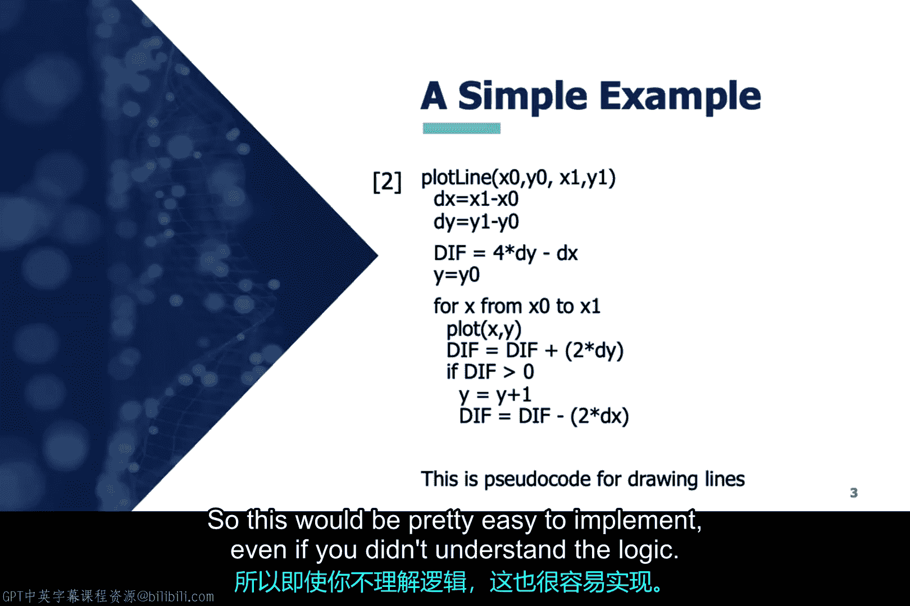
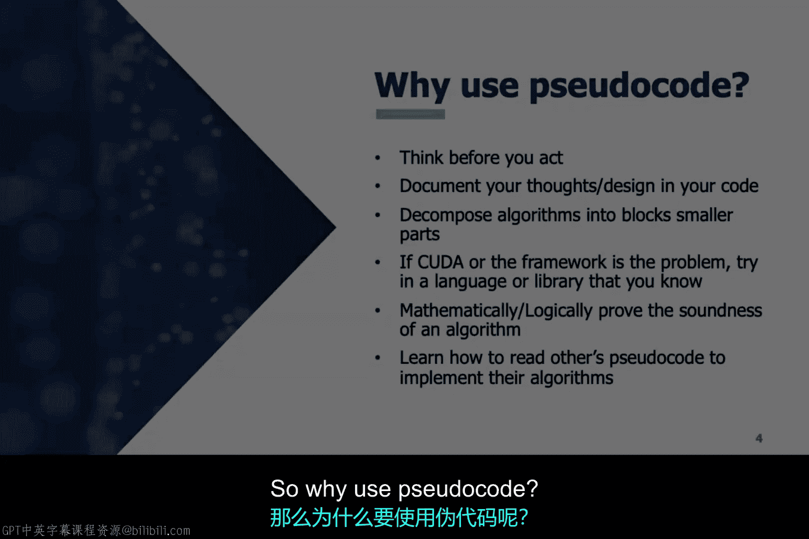
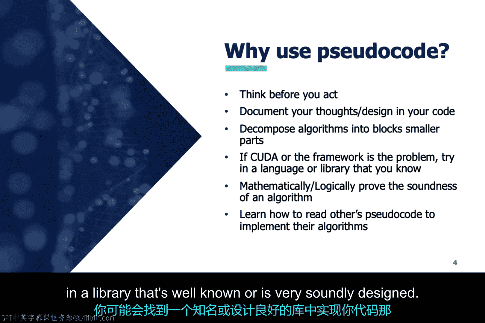
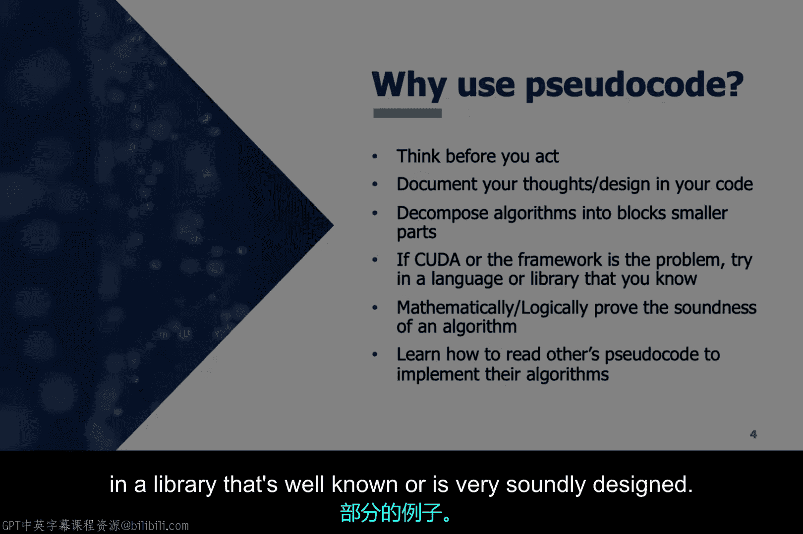
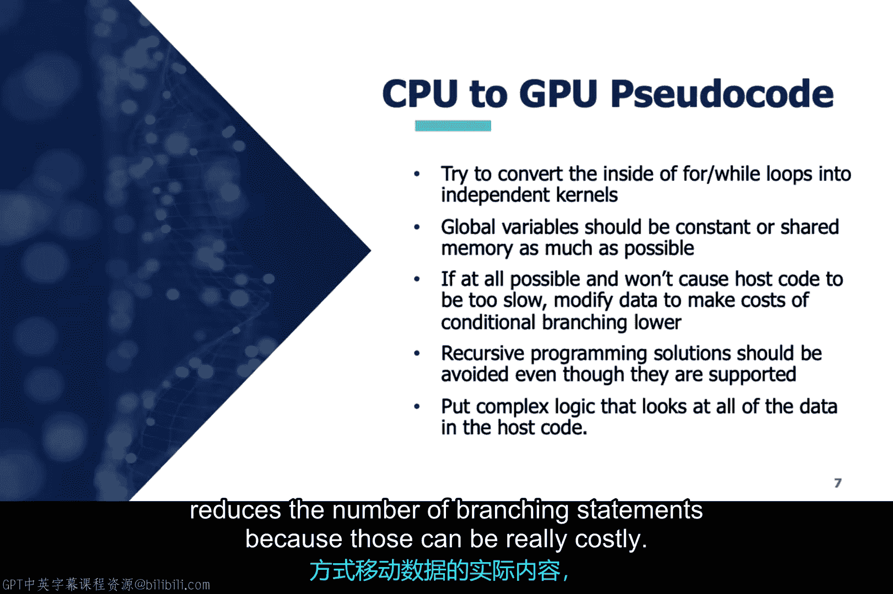
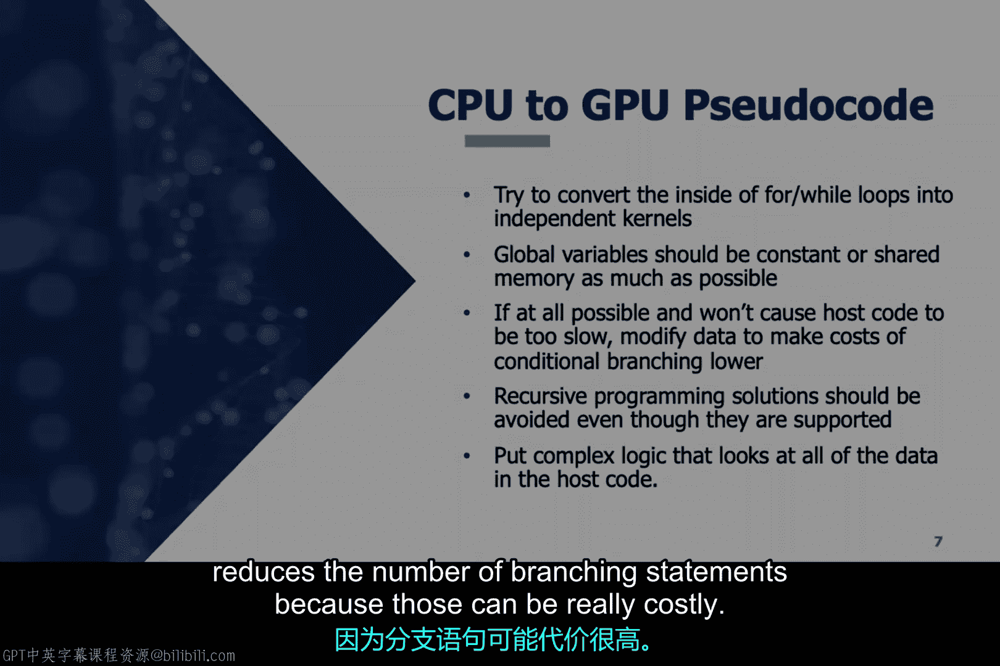

# 076：基于输入数据的GPU伪代码开发 🚀

在本节课中，我们将学习如何根据输入数据来开发GPU伪代码。伪代码是一种使用高级语言结构来描述算法逻辑的文本大纲，它不依赖于特定编程语言，但包含常见的编程结构，如循环和条件分支。通过伪代码，我们可以在实际编码前进行设计和思考，并将设计过程以注释形式保留在最终代码中，实现自我文档化。

## 什么是伪代码？ 📝

上一节我们介绍了课程目标，本节中我们来看看伪代码的具体定义。根据Martin Bates在《Interfacing PIC Microcontrollers》中的描述，伪代码使用高级语言结构来展示程序的基本流程，包括顺序处理、选择和循环。它是一种通用的算法描述方式，不绑定于特定语言，但会融入常见的语言结构，如`for`循环和`do while`循环。

以下是一个简单的伪代码示例，用于在图形程序中绘制一条线：

```pseudocode
输入起点 (x_start, y_start) 和终点 (x_end, y_end)
计算 delta_x = x_end - x_start
计算 delta_y = y_end - y_start
设置 difference = 2 * delta_y - delta_x
设置 y = y_start

循环 x 从 x_start 到 x_end:
    绘制点 (x, y)
    如果 difference >= 0:
        y = y + 1
        difference = difference - 2 * delta_x
    difference = difference + 2 * delta_y
```

这个示例展示了常见的伪代码结构，如变量、`for`循环和`if`条件分支。即使不理解具体逻辑，也能相对容易地将其转化为实际代码。

## 为什么使用伪代码？ 🤔





使用伪代码有多个好处。首先，它允许你在实现前进行设计和思考，并将这些思考以注释形式融入代码，实现自我文档化。其次，伪代码不局限于特定语言，便于跨语言理解和移植。此外，你可以对伪代码进行数学或逻辑证明，这在算法课程中常见，如使用大O符号进行复杂度分析。最后，伪代码可以分解为多个部分，便于创建函数或查找现有库实现。

## 输入数据如何影响算法设计？ 🧩

输入数据的特性直接影响算法设计。你需要从多个角度思考数据，以确定算法如何与之交互。





以下是评估输入数据时需要考虑的几个方面：

*   **数据类型**：数据是简单的整数、字符串、字符、浮点数，还是更复杂的结构？
*   **数据结构**：数据是扁平的数组，还是层次化的数据结构或字典？
*   **数据规模**：数据是否占用大量内存，如图像文件，或是许多小对象，如整数数组？
*   **数据维度**：数据是否是多维的，例如具有X、Y、Z维度？这有助于思考如何在网格、块和线程中使用它。
*   **数据动态性**：数据内容是否随时间变化？是否有多维部分或某些值可能为空？你需要考虑如何处理这些情况。
*   **现有算法**：是否有现成算法可以处理这类数据？如果没有，你是否能将数据转换为适合现有算法的形式？

## 算法设计技巧 💡

设计算法时，可以遵循以下技巧：

*   尽可能将算法分解为更小的部分。
*   尝试使用现有库，特别是那些知名且有良好文档的库，来解决部分或全部问题。
*   在代码中寻找设计模式，并避免反模式。
*   始终使用具有代表性的示例数据进行设计。不要只选择简单值或极端情况，要考虑边界条件。

## 将CPU伪代码转换为GPU伪代码的特定技巧 ⚙️

将CPU伪代码适配到GPU环境时，有一些特定的转换技巧：

*   当你看到`for`或`while`循环时，考虑让每个迭代在一个独立的线程或内核中运行。
*   当有线程块需要操作相同数据时，使用共享内存。
*   如果有全局变量，使用常量。
*   尽量避免递归编程，即使它被支持。
*   将处理复杂逻辑或大型数据结构、且不易分解的代码放在主机代码中。
*   尝试以优化GPU速度和减少分支语句数量的方式移动数据内容，因为分支语句在GPU上代价很高。

## 总结 📚





本节课我们一起学习了基于输入数据开发GPU伪代码的方法。我们首先明确了伪代码的定义和作用，它是不依赖于特定语言、用于描述算法逻辑的高级大纲。接着，我们探讨了输入数据的各种特性如何影响算法设计，例如数据类型、结构和维度。然后，我们介绍了一些通用的算法设计技巧，如分解问题和使用现有库。最后，我们重点学习了将CPU伪代码转换为GPU伪代码的特定策略，包括利用线程并行化循环、使用共享内存以及优化数据移动以减少分支。掌握这些方法将帮助你在GPU编程中更有效地设计和实现算法。